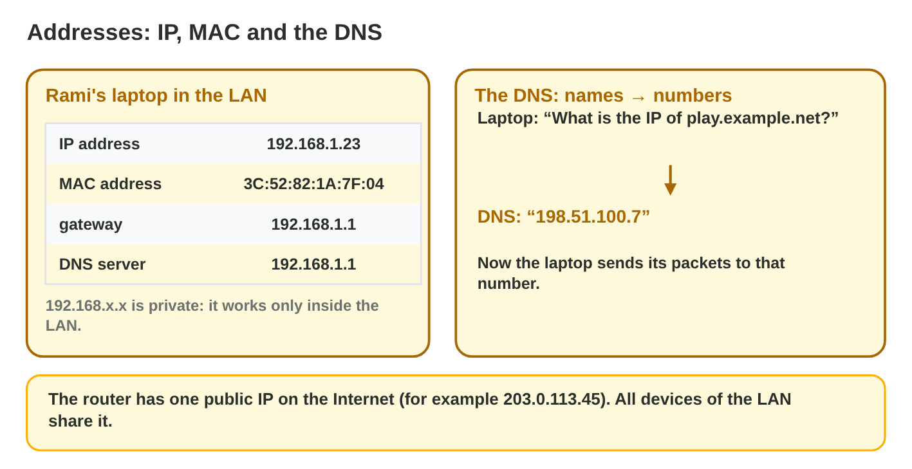
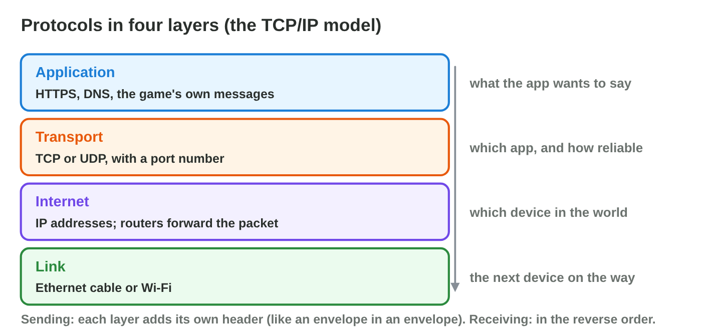
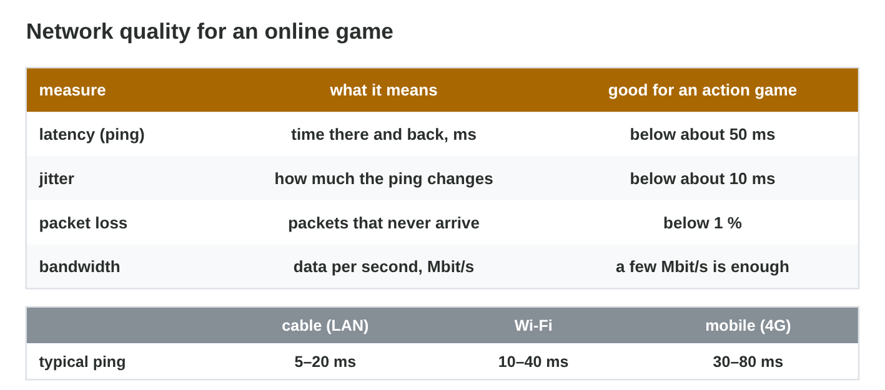

This page is the interactive version of the lesson notes (PDF). Each section
has a short summary, a picture, a **Do it** task and one set of questions.
The full explanations, examples and exercises are in the notes.

## Key terms



## 19.1 Networks: from the LAN to the Internet

- **LAN:** one place. **WAN:** places far apart. **Internet:** the network
  of networks.
- **Switch:** joins the wired devices. **Access point:** gives Wi-Fi.
- **Router:** connects the LAN through the **ISP** to the Internet.
- At home, one box often does all three.

{width=94%}

::: {.callout-warning title="Watch out!"}
Wi-Fi is not the Internet: it only reaches the access point in the room.
:::

::: {.callout-note title="Do it · Your network"}
Draw the network at your home or lab with at least five labelled parts.
:::

::: {.callout-tip title="Try it 1 · The devices"}
Choose the right answer.

::: {.match extra="a printer|a monitor"}
joins the cables of the office PCs
:   a switch

gives Wi-Fi to the test phones
:   an access point

connects the LAN to the ISP
:   a router

connects places in two cities
:   a WAN
:::
:::

## 19.2 Addresses: IP, MAC and the DNS

- **IP address:** 192.168.1.23 (IPv4). 192.168.x, 10.x: **private**, only
  in the LAN.
- **MAC address:** the fixed address of the network card.
- **DNS:** name → IP. play.example.net → 198.51.100.7.
- Packets to the Internet go through the **gateway** (the router).

{width=94%}

::: {.callout-warning title="Watch out!"}
A private address cannot be reached from outside the LAN.
:::

::: {.callout-note title="Do it · Find your address"}
Find your IP address and your gateway (phone Wi-Fi details, or `ipconfig`).
Is the address private?
:::

::: {.callout-tip title="Try it 2 · Addresses"}
Choose the right answer.

::: {.match extra="the switch|300.1.2.3"}
a private IP address
:   192.168.1.23

a MAC address
:   3C:52:82:1A:7F:04

turns play.example.net into a number
:   the DNS

the router seen from the laptop
:   the default gateway
:::
:::

## 19.3 Packets and protocols

- Data travels in **packets** with the sender's and the receiver's
  addresses.
- Four layers: **application** (HTTPS, DNS) · **transport** (TCP, UDP) ·
  **Internet** (IP) · **link** (Ethernet, Wi-Fi).
- **TCP:** every packet, in order, lost ones sent again.
- **UDP:** fast, lost packets stay lost.

{width=94%}

{width=94%}



::: {.callout-warning title="Watch out!"}
For live positions, a late packet is worse than a lost one.
:::

::: {.callout-note title="Do it · TCP or UDP?"}
In **Packet Journey**, send with TCP and with UDP at 20 % loss. Then
choose TCP or UDP for a chat message, voice chat and a level download.
:::

::: {.callout-tip title="Try it 3 · TCP or UDP"}
Use Packet Journey. Choose the protocol.

::: {.match extra="DNS|MAC"}
player positions in a race
:   UDP

a purchase of gems
:   TCP

voice chat
:   UDP

a chat message
:   TCP
:::
:::

## 19.4 Network quality for games

- **Latency (ping):** there and back, in ms. **Jitter:** how much it
  changes.
- **Packet loss:** packets that never arrive. **Bandwidth:** Mbit/s.
- Action games: ping below about 50 ms, jitter low, loss below 1 %.
- More bandwidth does not fix a weak Wi-Fi signal.

{width=94%}

::: {.callout-warning title="Watch out!"}
200 Mbit/s with 8 % loss still lags.
:::

::: {.callout-note title="Do it · Compare"}
Check the ping near the router and far from it (or on mobile data).
:::

::: {.callout-tip title="Try it 4 · Quality"}
Choose the right answer.

::: {.match extra="the colour of the cable|1000 ms"}
the time of a packet there and back
:   latency

how much the ping changes
:   jitter

a good ping for an action game
:   below about 50 ms

usually the lowest ping
:   a cable
:::
:::

## Game challenge: Net Fixer {.challenge}

Work alone. Use every section of today.

Byte Bay moves into a new office. Rami needs a device for the PCs, Wi-Fi
for the phones, a way to the Internet, the address of
*play.example.net*, a private address for a PC, and the right protocol
for positions and for purchases.



::: {.callout-tip title="Try it 5 · The new office"}
Choose the right answer.

::: {.match extra="a hard disk|Wi-Fi"}
joins four PCs with cables
:   a switch

finds the IP of play.example.net
:   the DNS

carries 30 positions per second
:   UDP

carries a purchase safely
:   HTTPS over TCP
:::
:::

::: {.callout-tip title="Try it 6 · Read the numbers (harder)"}
Choose the right answer.

::: {.match extra="public|0 %"}
Is 10.0.4.17 public or private?
:   private

Sent 8, received 6: the packet loss?
:   25 %

Ping 30, 180, 40, 210 ms: the problem?
:   high jitter

Ping 24 ms, 0 % loss: the network for a race?
:   good
:::
:::

## Summary {.summary}

- A LAN has switches and access points; a router connects it to the
  Internet.
- IP addresses find devices; private ones work only in the LAN; the DNS
  turns names into addresses.
- Data travels in packets; protocols work in four layers.
- TCP is reliable, UDP is fast: purchases over TCP, positions over UDP.
- Games need low latency, low jitter and almost no packet loss.
