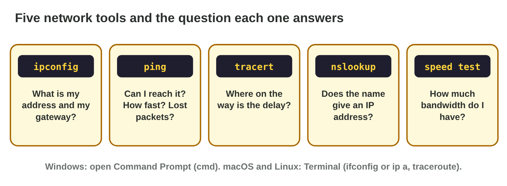
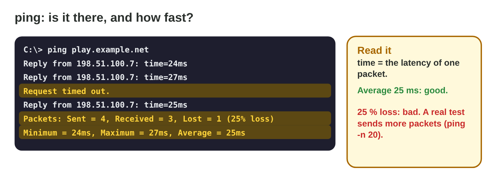
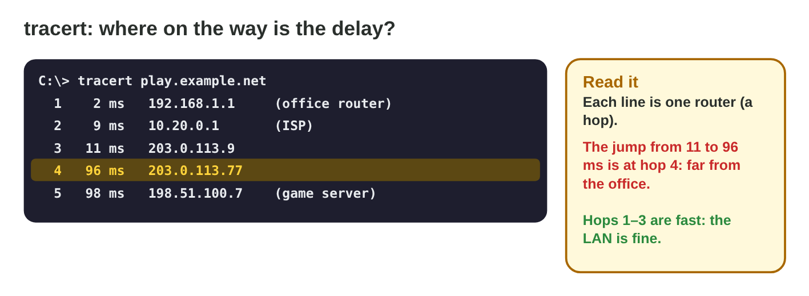
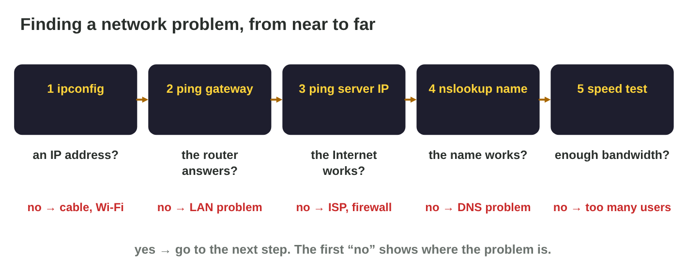

::: {.lead}
After the online mode of *Pocket Quest* goes live, the support inbox of
Byte Bay fills up: "The game lags!", "Server not found!", "I cannot
connect!". "Lag" can have many causes: a weak Wi-Fi signal, a DNS
problem, a slow route far away, a full home connection, or a phone that is
simply too slow. Rami does not guess: he uses **network tools** that every
computer has. In lecture 19 you learned how networks work. In this seminar
you **use** the tools: you run them on your own computer (or in Terminal
Lab), read their output, and find a problem step by step. Every section
ends with a task, and at the end you have a short network report of your
own connection.
:::

## Key terms



## 20.1 The tools and your address

Each tool answers one question (@fig-tools). The first one shows the
computer's own address (@fig-ipconfig).

::: {.callout-important title="Definition 20.1 — The five tools"}
- **ipconfig** (Windows; `ip a` on Linux, `ifconfig` on macOS): the IP
  address, the **default gateway** and the DNS server.
- **ping** *target*: is the target there, how long does a packet need
  (latency), are packets lost?
- **tracert** *target* (`traceroute` on Linux and macOS): the routers on
  the way and the time to each one.
- **nslookup** *name*: the IP address that the DNS gives for a name.
- **Speed test** (a website or an app): the download and upload bandwidth.

On Windows, open the **Command Prompt** (type `cmd` in the Start menu).
:::

{#fig-tools width=94%}

{#fig-ipconfig width=94%}

::: {.callout-note title="Example 20.1 — Reading ipconfig"}
1. IPv4 Address **192.168.1.23**: private, so the laptop is in a LAN.
2. Default Gateway **192.168.1.1**: the router; packets to the Internet go
   there.
3. A player writes "169.254.10.4, no gateway": the laptop got **no
   address** from the router. Check the cable or the Wi-Fi first.
:::



::: {.callout-warning title="Common mistake"}
Sharing the full output of network tools in a public forum. Private
addresses are harmless, but the public address and the names of your
networks say where you are. Share only what the helper needs.
:::

::: {.callout-note title="Do it · Your address"}
Run `ipconfig` on your computer (or on a lab PC). Write the IPv4 address
and the default gateway. If you have no computer, use **Terminal Lab** in
the office.

*Your result:* two addresses.
:::

## 20.2 ping and tracert: how fast, and where is the delay?

**ping** measures the latency and the loss to one target (@fig-ping);
**tracert** shows every router on the way (@fig-tracert).

::: {.callout-important title="Definition 20.2 — Reading ping and tracert"}
- **ping**: each reply line shows **time** = the latency of one packet;
  "Request timed out" is a lost packet. The summary gives the **loss** and
  the **average**. Big differences between the times show **jitter**.
- **tracert**: each line is one router (a **hop**) with its time. Where the
  time **jumps** and stays high, the delay begins.
- Ping first the **gateway** (near), then the **server** (far).
:::

{#fig-ping width=94%}

{#fig-tracert width=94%}

::: {.callout-note title="Example 20.2 — The café and the evening"}
1. In a café, the ping to the **gateway** jumps between 6 and 160 ms with
   25 % loss: the problem is the Wi-Fi, before the Internet. Rami sits
   near the router and the ping falls to 8 ms.
2. At home in the evening, tracert shows 2, 8, 12, then **98** ms at hop
   4: the home and the ISP are fine; the delay is on the Internet route.
   Byte Bay adds a server region closer to its players.
:::

::: {.callout-warning title="Common mistake"}
Pinging only the game server. When it is slow, you do not know if the
problem is in your room or far away. Ping the gateway too.
:::

::: {.callout-note title="Do it · ping and tracert"}
1. Ping your gateway, then a website or a game server (for example
   `ping example.com`). Write the averages and the loss.
2. Run `tracert` to the same target. How many hops? Where is the biggest
   jump?

*Your result:* two averages, one loss, one hop number.
:::

## 20.3 DNS, bandwidth and a diagnosis from near to far

Two more tools complete the set, and an order of steps turns them into a
diagnosis (@fig-diag).

::: {.callout-important title="Definition 20.3 — nslookup, speed test and the diagnosis"}
- **nslookup** *name*: if it gives no address but `ping` to the server's
  IP works, the problem is the **DNS**.
- A **speed test** measures the bandwidth; compare it with what the game
  and the other users need.
- **Diagnosis from near to far:** (1) ipconfig: an address? (2) ping the
  gateway: the LAN works? (3) ping the server's IP: the Internet works?
  (4) nslookup: the name works? (5) speed test: enough bandwidth? The first
  "no" shows where the problem is.
:::

{#fig-diag width=94%}

::: {.callout-note title="Example 20.3 — Server not found in the hotel"}
1. ipconfig: 10.0.4.17, gateway 10.0.4.1: fine.
2. ping 10.0.4.1: 3 ms. ping 198.51.100.7: 29 ms, no loss: fine.
3. nslookup play.example.net: **timed out**. The hotel's DNS does not
   answer: the name cannot be turned into the address.
4. Fix: choose another DNS server in the network settings, or ask the
   hotel.
:::

::: {.callout-warning title="Common mistake"}
Blaming the network for every stutter. If ping is 24 ms with no loss, but
the game shows 18 FPS in battles, the device is too slow, not the network.
:::

::: {.callout-note title="Do it · Your network report"}
Write a short report of your own connection: IP address type (private or
public), gateway ping, server ping and loss, number of hops, and the
download speed. End with one sentence: is it good for an online race?

*Your result:* a report of six lines.
:::

## Case study: Lag Detective

The support inbox of Byte Bay has six messages: a player with no address
(169.254.x.x), a player in a café with jumping pings, a player whose game
says "server not found", a player with lag every evening, a family with
three video streams, and a player whose game stutters in big battles. The
Game challenge of the interactive lesson uses these messages. In the
mini-game below you read the tool outputs and find each problem.



## Further reading

Microsoft Learn, "ipconfig", "ping", "tracert" and "nslookup" (Windows
commands reference). Kurose and Ross, *Computer Networking: A Top-Down
Approach*, 8th ed., Section 1.4 (delay, loss and traceroute).

## Exercises

1. Which tool shows the default gateway?
2. What does "Request timed out" mean in ping?
3. Ping times 20, 22, 21, 23 ms or 20, 150, 30, 200 ms: which has more
   jitter?
4. Which tool shows the routers on the way?
5. tracert: 2, 9, 11, 96, 98 ms. Where does the delay start?
6. nslookup fails, but ping to the server's IP works. What is the problem?
7. ipconfig shows 169.254.3.8. What does it mean?
8. Why do you ping the gateway before the server?
9. A speed test shows 1 Mbit/s while others stream videos. What helps?
10. Ping 25 ms, 0 % loss, but 15 FPS in battles. Is it the network?

## Answers to the exercises

::: {.answers}
1. ipconfig.
2. A lost packet: no reply came back in time.
3. The second one.
4. tracert (traceroute).
5. At hop 4.
6. The DNS.
7. The computer got no address from the router.
8. To see if the problem is near (LAN, Wi-Fi) or far (Internet).
9. Pause the streams and downloads, or get a faster plan.
10. No, the device is too slow.
:::
