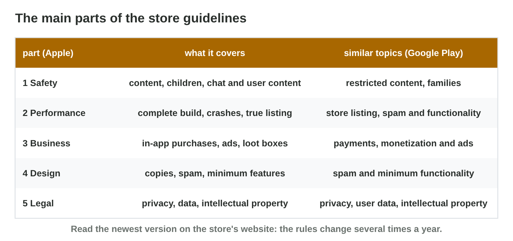
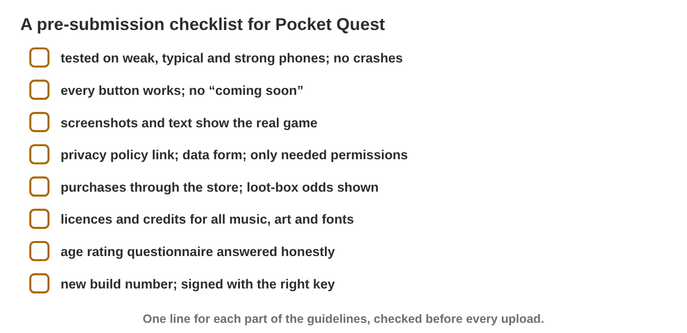

No new ideas today: two short problems on Lecture 8. Do each one alone. Tap,
sort or type your answer at every step: the page checks it at once and tells
you why.

## Recall

- Publishing has six steps: account, build, listing, rating and privacy,
  review, release.
- The **app review** checks every game and update against the store's
  **guidelines**.
- Common reasons for a rejection: crashes, an incomplete build ("coming
  soon"), a misleading listing, a missing privacy policy.

::: {.callout-tip title="Try it 1 · Recall"}
Choose the right answer.

::: {.match extra="the players|the price"}
What does the app review check a game against?
:   the store's guidelines

    Why: The review checks every new build against the store's rules.

The listing shows screenshots of another game. What will the review say?
:   misleading listing

    Why: The screenshots must show the real game.

Which step comes right before the release?
:   the review

    Why: The store checks the game before it goes live.
:::
:::

## Activity 1 · Which part of the rules, and why rejected?

Apple's **App Review Guidelines** have five parts; Google Play covers the
same topics. **Safety:** chat, children, user content. **Performance:** a
complete build without crashes, a true listing. **Business:** purchases,
ads, loot boxes and their odds. **Design:** no copies or spam. **Legal:**
privacy, intellectual property. A rejection message names the rule; the
studio fixes it and submits again.

{width=90%}



::: {.callout-note title="Activity 1 · Sort and explain · 15 min"}
1. In **Guideline Sorter**, sort all nine problems.
2. *Gem Rush* sells a mystery chest for 2 USD with random gems, and the
   odds are not shown. It is rejected. Write the part, the rule and a fix.

*Your product:* your score and three short lines.

::: {.sort}
Step 1: which part of the guidelines covers each problem? Sort them.

Safety
:   a chat for children without a way to block a player

    Why: Chat, children and user content are Safety.

Performance
:   the game crashes at the start

    Why: A complete build without crashes is Performance.

:   screenshots of another game

    Why: A true listing is Performance.

Business
:   a paid mystery chest whose odds are hidden

    Why: Purchases, ads and loot boxes are Business.

Legal
:   no privacy policy

    Why: Privacy and intellectual property are Legal.
:::

::: {.choice}
Step 2: Gem Rush is rejected. Which fix?

- [x] Show the odds of each item before the purchase: an "odds" button on the chest screen.

  Why: The rule of the Business part: loot boxes show their odds before buying.

- [ ] Make the chest cost 1 USD.

  Why: The price is not the problem; the hidden odds are.

- [ ] Take new screenshots.

  Why: The listing is not the reason for the rejection.
:::
:::

::: {.callout-tip title="Try it 2 · Which part?"}
Choose the part of the guidelines. You can use an answer more than once.

::: {.match extra="Weather|Design"}
A chat between players.
:   Safety

    Why: Safety covers chat and content made by users.

Gems sold for money.
:   Business

    Why: Business covers in-app purchases and ads.

A privacy policy.
:   Legal

    Why: Legal covers privacy, data and intellectual property.

The game crashes on start.
:   Performance

    Why: Performance asks for a complete build without crashes.
:::
:::

## Activity 2 · Review six games, then make a checklist

Today you are the reviewer. A **pre-submission checklist** turns the rules
into yes-or-no questions that a studio asks before every upload, fitted to
its game: a chat needs reporting and blocking; a game without purchases
needs no loot-box line.

{width=90%}



::: {.callout-note title="Activity 2 · Review and check · 15 min"}
1. In **Review Board**, approve or reject the six games.
2. Write a checklist of five yes-or-no lines for a game you know. Name the
   part of the guidelines for each line.

*Your product:* your score and five lines.

::: {.sort}
Step 2: a game has a chat and no purchases. Does each line fit its
checklist? Sort them.

Fits
:   No crashes on three phones? (Performance)

    Why: A yes-or-no question that every game needs.

:   Privacy policy link? (Legal)

    Why: Every game in the stores needs it.

:   Report and block in the chat? (Safety)

    Why: The game has a chat.

Does not fit
:   Loot-box odds shown before buying? (Business)

    Why: A game without purchases needs no loot-box line.

:   Is the game fun?

    Why: Not a rule of the stores, and not a fact to check with yes or no.
:::
:::

::: {.callout-tip title="Try it 3 · Why rejected?"}
Choose the right answer.

::: {.match extra="the price is too low|the icon is green"}
"Coming soon" on most buttons.
:   incomplete build

    Why: The game shows features that do not exist yet.

The heroes of a famous film, without a licence.
:   other people's content

    Why: Characters and brands of others need a licence.

A new version goes first to a small part of the players. What is this?
:   a staged rollout

    Why: The studio sees problems before every player gets the version.
:::
:::

## At home · Task with AI

::: {.callout-note .ai-task title="Task with AI · A checklist before the stores"}
An extra for the curious: let an AI assistant make the table. Copy the
prompt into an AI assistant that the university allows (for example
Microsoft Copilot with your university account), and look at the result.

::: {.prompt}
A mobile game has a chat between players, gems that players buy with
money, and a mystery chest with random items that players buy with gems.
Make a checklist table for this game before it goes to the App Store and
Google Play, with 6 rows and the columns: what to check, yes or no, why.
Use short sentences.
:::

::: {.choice}
Which lines should the table have? The AI can be wrong: compare.

- [x] Report and block in the chat, gem prices and chest odds shown before buying, store payments, a fitting age rating, a privacy policy.

  Why: The chat is Safety, the gems and the chest are Business, privacy is Legal.

- [ ] Six lines about the colours and the music of the game.

  Why: The stores check the rules, not the style of a game.
:::

::: {.try-change}
**Change:** remove the chat from the game, and ask again.

::: {.choice}
What changes?

- [x] The lines about reporting and blocking players disappear.

  Why: Without a chat, those Safety lines are not needed; the gems, the chest and privacy stay.

- [ ] Every line disappears.

  Why: The gems, the chest and privacy still need their lines.
:::
:::

::: {.try-change}
**Change:** say that players get the mystery chest for free, by playing, and ask
again.

::: {.choice}
What changes?

- [x] The line about the odds before buying can go; the gem lines stay.

  Why: The chest is not sold any more, but players still buy gems with money.

- [ ] The lines about the gems go too.

  Why: Gems are still bought with money: their lines stay.
:::
:::

**Your own idea:** change one more number or word, and look again. The AI
can be wrong: compare its result with the answers.
:::

## Wrap-up {.summary}

- You can sort problems into the parts of the store guidelines and explain
  a rejection.
- You can review a game and build a short checklist that fits it.
