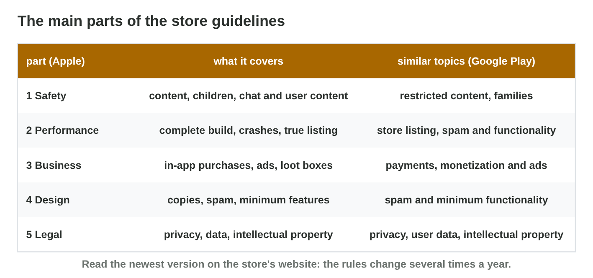
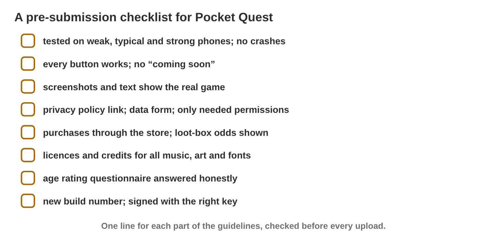

No new ideas today: two short problems on Lecture 9. Do each one alone,
then open "Check your result". Every question on this page has its answer:
try first, then check.

## Recall

- Publishing has six steps: account, build, listing, rating and privacy,
  review, release.
- The **app review** checks every game and update against the store's
  **guidelines**.
- Common reasons for a rejection: crashes, an incomplete build ("coming
  soon"), a misleading listing, a missing privacy policy.

::: {.callout-tip title="Try it 1 · Recall"}
Choose the right answer.

::: {.match extra="the players|the price"}
What does the app review check a game against?
:   the store's guidelines

    Why: The review checks every new build against the store's rules.

The listing shows screenshots of another game. What will the review say?
:   misleading listing

    Why: The screenshots must show the real game.

Which step comes right before the release?
:   the review

    Why: The store checks the game before it goes live.
:::
:::

## Activity 1 · Which part of the rules, and why rejected?

Apple's **App Review Guidelines** have five parts; Google Play covers the
same topics. **Safety:** chat, children, user content. **Performance:** a
complete build without crashes, a true listing. **Business:** purchases,
ads, loot boxes and their odds. **Design:** no copies or spam. **Legal:**
privacy, intellectual property. A rejection message names the rule; the
studio fixes it and submits again.

{width=90%}



::: {.callout-note title="Activity 1 · Sort and explain · 15 min"}
1. In **Guideline Sorter**, sort all nine problems.
2. *Gem Rush* sells a mystery chest for 2 USD with random gems, and the
   odds are not shown. It is rejected. Write the part, the rule and a fix.

*Your product:* your score and three short lines.

::: {.check}
Guideline Sorter: chat and children → Safety; crashes and listings →
Performance; purchases and loot boxes → Business; copies → Design; privacy
and licences → Legal. Gem Rush: part **Business** (loot boxes); rule: show
the odds of each item before the purchase; fix: an "odds" button on the
chest screen.
:::
:::

::: {.callout-tip title="Try it 2 · Which part?"}
Choose the part of the guidelines. You can use an answer more than once.

::: {.match extra="Weather|Design"}
A chat between players.
:   Safety

    Why: Safety covers chat and content made by users.

Gems sold for money.
:   Business

    Why: Business covers in-app purchases and ads.

A privacy policy.
:   Legal

    Why: Legal covers privacy, data and intellectual property.

The game crashes on start.
:   Performance

    Why: Performance asks for a complete build without crashes.
:::
:::

## Activity 2 · Review six games, then make a checklist

Today you are the reviewer. A **pre-submission checklist** turns the rules
into yes-or-no questions that a studio asks before every upload, fitted to
its game: a chat needs reporting and blocking; a game without purchases
needs no loot-box line.

{width=90%}



::: {.callout-note title="Activity 2 · Review and check · 15 min"}
1. In **Review Board**, approve or reject the six games.
2. Write a checklist of five yes-or-no lines for a game you know. Name the
   part of the guidelines for each line.

*Your product:* your score and five lines.

::: {.check}
Review Board: approve Pocket Quest; reject Sky Farm (incomplete build),
Gem Rush (odds hidden), Hero Wars X (no licence), Tiny Chat Pets (unsafe
chat for children) and Speed Car 3 (crashes). A good checklist: "No crashes
on three phones? (Performance)", "Screenshots of the real game?
(Performance)", "Privacy policy link? (Legal)", "Purchases through the
store? (Business)", "Report and block in the chat? (Safety)".

- ☐ Five yes-or-no questions.
- ☐ Each fits the game and names its part.
:::
:::

::: {.callout-tip title="Try it 3 · Why rejected?"}
Choose the right answer.

::: {.match extra="the price is too low|the icon is green"}
"Coming soon" on most buttons.
:   incomplete build

    Why: The game shows features that do not exist yet.

The heroes of a famous film, without a licence.
:   other people's content

    Why: Characters and brands of others need a licence.

A new version goes first to a small part of the players. What is this?
:   a staged rollout

    Why: The studio sees problems before every player gets the version.
:::
:::

## At home · Task with AI

::: {.callout-note .ai-task title="Task with AI · A checklist checked at the source"}
**Goal:** a checklist of twelve lines for *Pocket Quest* (a chat, gems for
money, a mystery chest), each line pointing to the official rule. The AI
drafts; you check.

1. **Ask the AI:** start with this prompt.

   ::: {.prompt}
   Make a pre-submission checklist of 12 yes-or-no questions for a mobile
   game with a chat between players, gems sold for money and a mystery
   chest with random items. For each question, name the part of Apple's App
   Review Guidelines that it comes from.
   :::

2. **Do it yourself:** open the official App Review Guidelines. Next to
   each line write the number of the rule and the date of the page. Remove
   lines that are not rules, and add any line that is missing.
3. **Check:** the mystery chest line must say that the odds are shown
   before the purchase; the chat line must have reporting and blocking.

*Your product:* the checked checklist, and one sentence on what the AI got
wrong or what you changed.

::: {.check}
A good product has twelve yes-or-no lines, each with a rule number from the
official page (for example 1.2 for the chat, 3.1.1 for the gems and the
odds, 5.1 for privacy) and the date of the page, and one sentence such as
"The AI gave a wrong rule number for the chat, so I took 1.2 from the page."
:::
:::

## Wrap-up {.summary}

- You can sort problems into the parts of the store guidelines and explain
  a rejection.
- You can review a game and build a short checklist that fits it.
