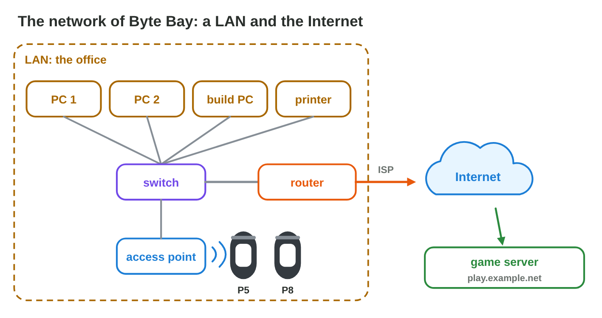
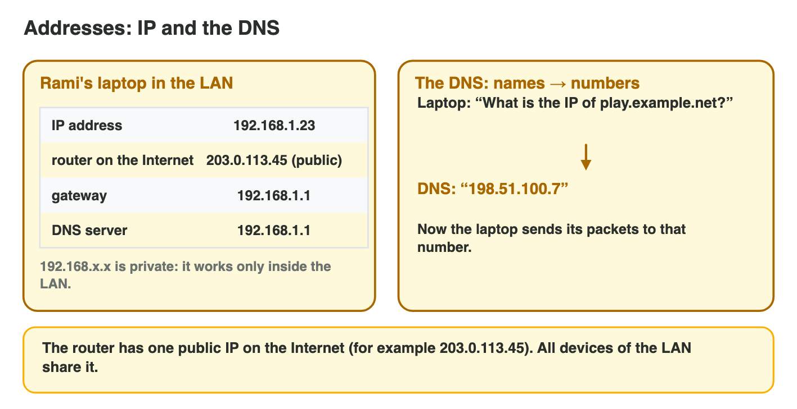
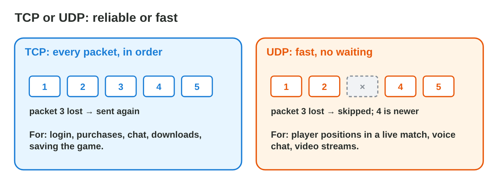
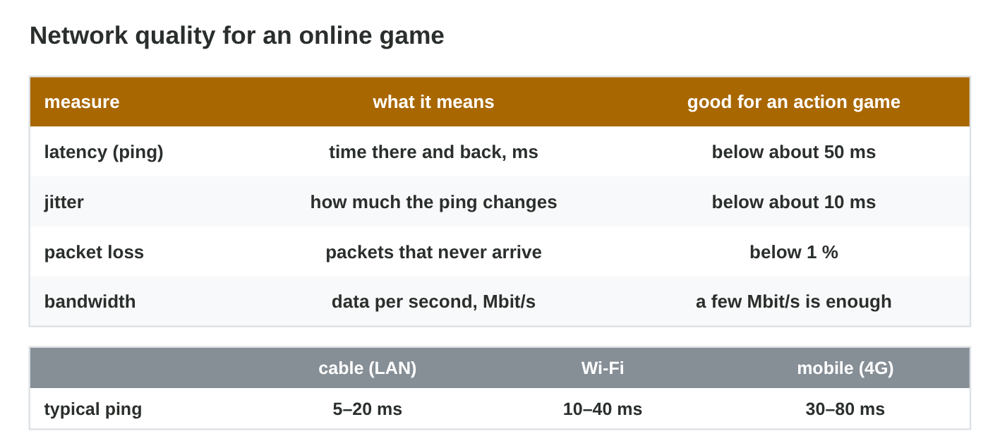

Each section: a question from a game studio, the idea, a **Do it** task and a short **Try it**.
The page checks every answer at once and tells you why. More examples
and exercises are in the lesson notes (PDF).

## Key terms



## 9.1 Networks: from the LAN to the Internet

- A **LAN** covers one place (office, lab, home); the **Internet** is the
  worldwide network of networks.
- **Switch:** joins the wired devices. **Access point:** gives Wi-Fi.
  **Router:** connects the LAN through the **ISP** to the Internet.
- At home, one box is often router, switch and access point together.

{width=90%}

::: {.callout-warning title="Watch out!"}
Wi-Fi is not the Internet: it only connects your phone to the access point.
:::

::: {.callout-note title="Do it · Your network"}
At home, one box is often the router, the switch and the access point
together. Follow a packet from a phone to the Internet.

::: {.order}
Put the way of a packet from a phone to the Internet in order.

1. the phone
2. Wi-Fi to the access point
3. the router
4. the ISP
5. the Internet

Why: Wi-Fi only reaches the box; the router and the ISP lead out to the Internet.
:::
:::

::: {.callout-tip title="Try it 1 · The devices"}
Choose the right answer.

::: {.match extra="a printer|a monitor"}
Which device joins the cables of the office PCs?
:   a switch

    Why: A switch connects the wired devices of a LAN.

Which device connects the LAN to the ISP?
:   a router

    Why: The router connects the LAN to other networks.
:::
:::

## 9.2 Addresses and names: IP and the DNS

- **IP address:** the number of a device, such as 192.168.1.23 (four
  numbers from 0 to 255).
- **Private** addresses (192.168…, 10…) work only inside a LAN; the router
  has a **public** address on the Internet.
- **Default gateway:** the router; packets to other networks go there.
- **DNS:** turns a name (video.example.org) into an IP address
  (203.0.113.80).
- `ipconfig` on a PC (or the Wi-Fi details on a phone) shows the address
  and the gateway.

{width=90%}

::: {.callout-warning title="Watch out!"}
Never write a private address in a game as the server address: players
outside the LAN cannot reach it.
:::

::: {.callout-note title="Do it · Find your address"}
Phone: Settings › Wi-Fi › the network › details. PC: `ipconfig` in the
Command Prompt. One phone shows IP address 192.168.1.37 and gateway
192.168.1.1.

::: {.sort}
Private or public? Sort the addresses.

Private: inside a LAN
:   192.168.1.37, the phone at home

    Why: An address that starts with 192.168. is private.

:   192.168.1.1, the gateway

    Why: The router's address inside the home network.

:   10.20.30.40, a phone on mobile data

    Why: 10. addresses are private, inside the network of the mobile company.

Public: on the Internet
:   203.0.113.80, the game server from the DNS

    Why: The DNS gives the public address of the server.
:::
:::

::: {.callout-tip title="Try it 2 · Addresses"}
Choose the right answer.

::: {.match extra="the switch|300.1.2.3"}
What turns play.example.net into a number?
:   the DNS

    Why: The DNS turns names into IP addresses.

What is the router, seen from the laptop?
:   the default gateway

    Why: Packets to other networks go to the gateway first.
:::
:::

## 9.3 Packets and protocols: TCP and UDP

- Data travels in **packets**: small pieces with the addresses of the sender
  and the receiver.
- A **protocol** is a set of rules, for example HTTPS for web pages and
  purchases.
- **TCP:** every packet arrives, in order; lost ones are sent again.
  Reliable, but can wait.
- **UDP:** no checks. Fast; lost packets stay lost.
- Voice in a call: UDP. A text message: TCP.

{width=90%}



::: {.callout-warning title="Watch out!"}
UDP is not "bad": for live positions and voice, a late packet is worse than
a lost one.
:::

::: {.callout-note title="Do it · TCP or UDP?"}
In **Packet Journey**, send 10 packets with TCP and with UDP, both with
20 % loss.

::: {.choice}
What does TCP do with 20 % loss?

- [x] All 10 packets arrive, in order, but it takes longer.

  Why: TCP sends the lost packets again and waits for them.

- [ ] About 2 of the 10 packets are lost.

  Why: That is UDP: it sends no packet again.

- [ ] It stops sending.

  Why: TCP keeps sending until every packet arrives.
:::
:::

::: {.callout-tip title="Try it 3 · TCP or UDP"}
Use Packet Journey. Choose the protocol.

::: {.match extra="DNS|Wi-Fi"}
Player positions in a race, 30 per second.
:   UDP

    Why: The next position replaces a lost one; waiting would make the game lag.

A purchase of gems.
:   TCP

    Why: Every byte of a purchase must arrive.
:::
:::

## 9.4 Network quality for games

- **Latency** (ping): the time there and back, in ms.
- **Jitter:** how much the ping changes. **Packet loss:** packets that
  never arrive. **Bandwidth:** data per second (Mbit/s).
- An action game: ping below about 50 ms, little jitter, almost no loss; a
  few Mbit/s is enough.
- **ping** measures latency and loss: ping the gateway (near), then the
  server (far).
- Rami's race: cable 22 ms; Wi-Fi far away 30–180 ms with 5 % loss; 4G
  60 ms, steady.

{width=90%}

::: {.callout-warning title="Watch out!"}
More bandwidth does not fix lag from a weak Wi-Fi signal.
:::

::: {.callout-note title="Do it · Compare"}
Check the ping of an online game (or a speed test) near the router and far
from it (or on mobile data). Hala measured 18 ms near the router, and
45–120 ms far from it, jumping all the time.

::: {.choice}
Where would the game lag?

- [x] far from the router

  Why: Higher latency and more jitter: the time jumps from 45 to 120 ms.

- [ ] near the router

  Why: 18 ms and steady is good for an action game.

- [ ] nowhere: both are under 200 ms

  Why: An action game needs a ping below about 50 ms and little jitter.
:::
:::

::: {.callout-tip title="Try it 4 · Quality"}
Choose the right answer.

::: {.match extra="the colour of the cable|1000 ms"}
What is the time of a packet there and back?
:   latency

    Why: Latency, the ping, is measured in milliseconds.

What is a good ping for an action game?
:   below about 50 ms

    Why: Low latency keeps the game responsive.
:::
:::

## Game challenge: Net Fixer {.challenge}

Work alone. Use every section of today.

Byte Bay moves into a **new office**: **four PCs** with cables, test phones
on **Wi-Fi**, a way to the **Internet**, a phone that must find
**play.example.net**, a PC address, and a game that sends **30 positions
per second** and **purchases** of gems.



::: {.callout-tip title="Try it 5 · The new office"}
Four PCs, Wi-Fi phones, play.example.net, positions and purchases. Choose
the right answer.

::: {.match extra="a hard disk|Wi-Fi"}
What finds the IP address of play.example.net?
:   the DNS

    Why: The DNS turns the name into an address.

What carries 30 positions per second?
:   UDP

    Why: Fast, and the next position replaces a lost one.
:::
:::

::: {.callout-tip title="Try it 6 · Read the numbers (harder)"}
Choose the right answer.

::: {.match extra="public|0 %"}
Ping 30, 180, 40, 210 ms: what is the problem?
:   high jitter

    Why: The ping changes a lot from packet to packet.
:::
:::

## Summary {.summary}

- A LAN joins the devices of one place; the router connects it to the
  Internet through the ISP.
- Devices have IP addresses (private in a LAN); the DNS turns names into
  addresses.
- Data travels in packets: TCP when every byte matters, UDP when speed
  matters.
- Games need low latency, low jitter and no loss more than bandwidth.
