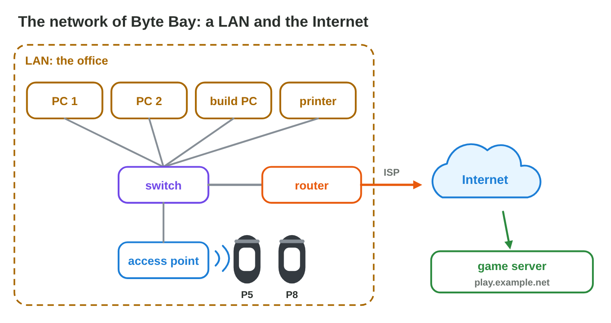
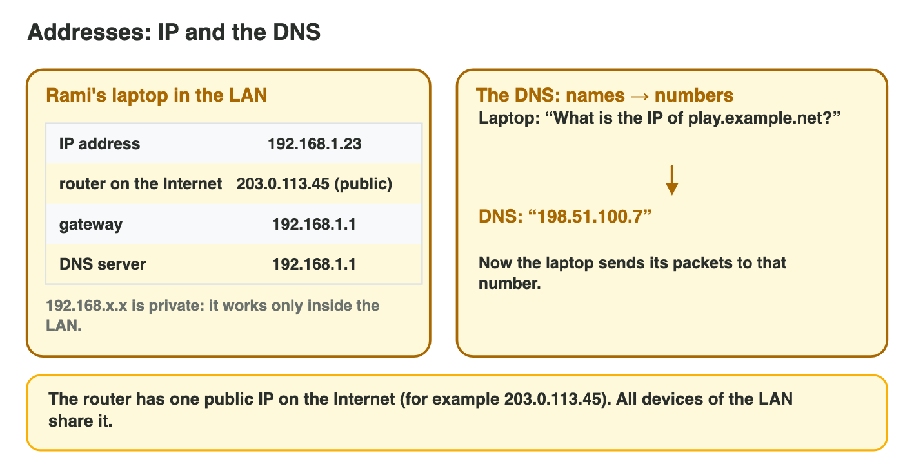
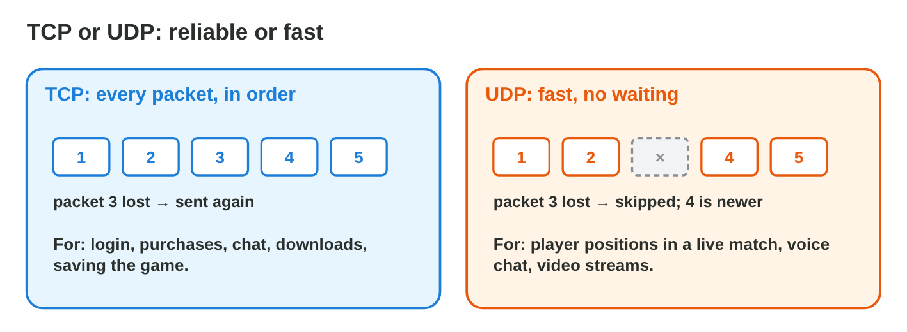

## Keywords



## 10.1 From the LAN to the Internet

:::: {.columns}
::: {.column width="50%"}
- A LAN joins the devices of one place, and the Internet joins the networks of the world.
- A switch joins the cables, and an access point gives Wi-Fi.
- The router connects the LAN through the ISP to the Internet.
- **Do it:** Draw the network of your home. Which box is the router?
:::
::: {.column width="50%"}

:::
::::

## Try it 1 · The devices

a) Which device joins the cables of the office PCs?
b) Which device gives Wi-Fi to the test phones?
c) Which device connects the LAN to the ISP?

::: {.answer}
a) a switch
b) an access point
c) a router
:::

## 10.2 Addresses and the DNS

:::: {.columns}
::: {.column width="50%"}
- Every device has an IP address, such as 192.168.1.23.
- Addresses that start with 192.168 or 10 are private and work only inside a LAN.
- The DNS turns a name into an IP address.
- **Do it:** Find the IP address and the gateway of your phone or PC. Is the address private?
:::
::: {.column width="50%"}

:::
::::

## Example · The phone finds a video site

Sara types the name video.example.org on her phone at home.
**How does the phone reach the site?**

::: {.reveal}
1. The phone asks the DNS server, which answers **203.0.113.80**.
2. The phone sends its packets to 203.0.113.80.
3. The packets go first to the **default gateway**, the home router 192.168.0.1.
:::

## Try it 2 · Addresses

a) Is the address 192.168.1.23 private or public?
b) What turns play.example.net into an IP address?
c) What is the default gateway of a laptop?

::: {.answer}
a) private
b) the DNS
c) the router
:::

## 10.3 Packets, TCP and UDP

:::: {.columns}
::: {.column width="50%"}
- Data travels in small packets with the addresses of the sender and the receiver.
- TCP checks that every packet arrives and sends lost ones again.
- UDP sends without checks, so it is fast, and lost packets stay lost.
- **Do it:** Send 10 packets with TCP and with UDP at 20 % loss in Packet Journey. What changes?
:::
::: {.column width="50%"}

:::
::::

## Live demo · Packet Journey



## Try it 3 · TCP or UDP

a) Which protocol carries the player positions of a race, 30 per second?
b) Which protocol carries a purchase of gems?
c) Why is UDP the right choice for voice chat?

::: {.answer}
a) UDP
b) TCP (inside HTTPS)
c) A late voice packet is worse than a lost one.
:::

## 10.4 Network quality for games

:::: {.columns}
::: {.column width="50%"}
- Latency is the time of a packet there and back, and jitter is how much it changes.
- An action game needs a ping below about 50 ms and almost no packet loss.
- We ping the gateway first, then the server.
- **Do it:** Check the ping near the router and far from it. What changes?
:::
::: {.column width="50%"}

:::
::::

## Example · Rami tests the race

Rami plays the online race in three places.
**Where is the race smooth, and where does it lag?**

::: {.reveal}
1. On cable at the desk, the ping is 22 ms with no loss, so the race is **smooth**.
2. On Wi-Fi two rooms away, the ping jumps from 30 to 180 ms with 5 % loss, so the cars **jump**.
3. On 4G in the bus, the ping is a steady 60 ms, so the race is **playable**.
:::

## Try it 4 · Quality

a) What do we call how much the ping changes from packet to packet?
b) What is a good ping for an action game?
c) A player has 200 Mbit/s but 8 % packet loss. Is the game smooth?

::: {.answer}
a) jitter
b) below about 50 ms
c) No, the lost packets make the players jump.
:::

## Game challenge · Net Fixer



## Try it 5 · The new office (harder)

The facts: the office has four PCs with cables and test phones on Wi-Fi. The game finds play.example.net and sends 30 positions per second and purchases of gems.

a) What joins the four PCs with cables?
b) What finds the IP address of play.example.net?
c) Which protocols carry the positions and the purchases?

::: {.answer}
a) a switch
b) the DNS
c) UDP for the positions, HTTPS over TCP for the purchases
:::

## Summary

- A LAN joins one place, and the router connects it to the Internet.
- Devices have IP addresses, and the DNS turns names into addresses.
- Data travels in packets, with TCP when every byte matters.
- UDP is used when speed matters more than every packet.
- Games need low latency, low jitter and no loss more than bandwidth.
