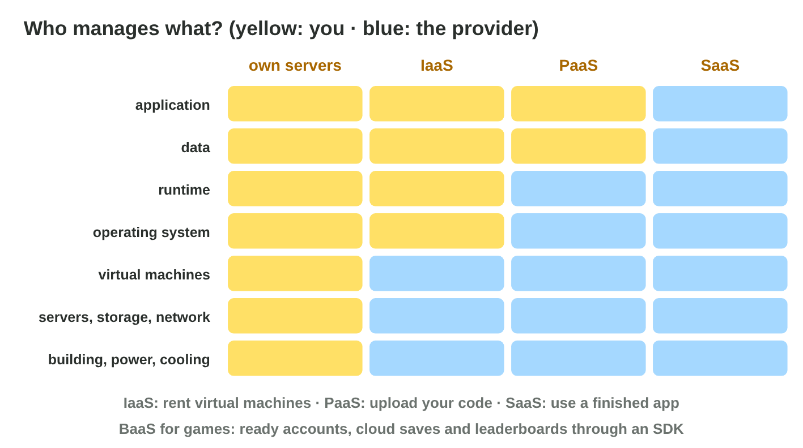
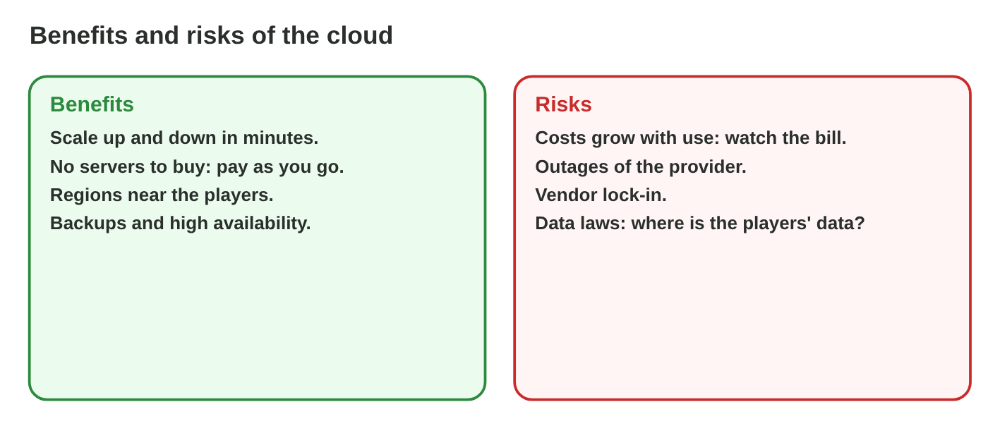

This page is the interactive version of the lesson notes (PDF). Each section
has a short summary, a picture, a **Do it** task and one set of questions.
The full explanations, examples and exercises are in the notes.

## Key terms



## 21.1 What is the cloud?

- **Cloud computing:** computing power, storage and software from a
  provider, over the Internet, when you need it.
- **Pay-as-you-go:** pay per hour or per gigabyte.
- **Data centres** in **regions**; one server runs many **virtual
  machines**.

{width=94%}

::: {.callout-warning title="Watch out!"}
The cloud costs money per use, and it can have outages.
:::

::: {.callout-note title="Do it · Cloud in your day"}
List three cloud services you used today.
:::

::: {.callout-tip title="Try it 1 · The cloud"}
Choose the right answer.

::: {.match extra="a USB stick|a printer"}
a building with thousands of servers
:   a data centre

a computer made in software
:   a virtual machine

paying per hour or per gigabyte
:   pay-as-you-go

a place in the world with data centres
:   a cloud region
:::
:::

## 21.2 Service models

- **IaaS:** rent VMs; you manage the OS and the software.
- **PaaS:** upload code; the provider runs the OS and the runtime.
- **SaaS:** use a finished app. **BaaS:** ready game services through an
  SDK.

{width=94%}



::: {.callout-warning title="Watch out!"}
Even with SaaS, the studio decides about its players' data.
:::

::: {.callout-note title="Do it · Who manages it?"}
In **Cloud Stack**, set IaaS, PaaS and SaaS right; write one thing Byte Bay
still manages in each.
:::

::: {.callout-tip title="Try it 2 · Models"}
Use Cloud Stack. Choose the model.

::: {.match extra="a USB model|a printer model"}
rent a VM and install everything
:   IaaS

upload only the code
:   PaaS

an online office suite
:   SaaS

accounts and cloud saves through an SDK
:   BaaS
:::
:::

## 21.3 Public, private and hybrid cloud

- **Public:** one provider, many customers.
- **Private:** one organization only.
- **Hybrid:** own servers + public cloud together.

{width=94%}

::: {.callout-warning title="Watch out!"}
Private is not always more secure: settings and people decide.
:::

::: {.callout-note title="Do it · Choose the kind"}
A student team with no money; a ministry that keeps data on its own
servers; a studio that needs extra power once a month.
:::

::: {.callout-tip title="Try it 3 · Kinds of cloud"}
Choose the kind of cloud.

::: {.match extra="a cable|a printer"}
a student team with no servers
:   public cloud

data only in its own data centre
:   private cloud

office servers + cloud for peaks
:   hybrid cloud
:::
:::

## 21.4 Scaling, cost and risks

- **Scalability:** add or remove servers as the users change;
  **auto-scaling** does it by rules.
- Quiet hours cost less with pay-as-you-go.
- **Risks:** growing costs, outages, **vendor lock-in**, data laws.

{width=94%}

{width=94%}



::: {.callout-warning title="Watch out!"}
Set a maximum and a cost alarm for auto-scaling.
:::

::: {.callout-note title="Do it · Play the day"}
Find the smallest number of fixed servers that turns nobody away; compare
the cost with auto-scaling.
:::

::: {.callout-tip title="Try it 4 · Launch day"}
Use Launch Day Scaling. Choose the right answer.

::: {.match extra="1|30"}
fixed servers that turn nobody away (at least)
:   9

players turned away with 5 servers at the peak
:   about 3,700

the cheaper way with nobody turned away
:   auto-scaling
:::
:::

## Game challenge: Cloud Match {.challenge}

Work alone. Use every section of today.

Six jobs: a **race server** with a special OS setting, a small
**leaderboard** program, **shared documents**, **accounts and cloud
saves** through an SDK, **payment data** in one organization's data
centre, and **office servers** with extra cloud servers for peaks.



::: {.callout-tip title="Try it 5 · The jobs"}
Choose the best fit.

::: {.match extra="a USB stick|own servers only"}
a race server with a special OS setting
:   IaaS

a small leaderboard program, no OS work
:   PaaS

payment data only for one organization
:   private cloud

office build PCs + cloud for launch peaks
:   hybrid cloud
:::
:::

::: {.callout-tip title="Try it 6 · Risks (harder)"}
Choose the risk.

::: {.match extra="too few pixels|a slow keyboard"}
a bug starts 300 servers
:   growing costs

the provider is down for two hours
:   an outage

moving to another provider is very hard
:   vendor lock-in

players' data must stay in their country
:   data laws
:::
:::

## Summary {.summary}

- The cloud: rented computing over the Internet, paid by use.
- IaaS, PaaS, SaaS, BaaS: the higher the model, the less you manage.
- Public, private and hybrid clouds differ in who shares them.
- Auto-scaling follows the players; watch costs and limits.
- Risks: costs, outages, vendor lock-in, data laws.
