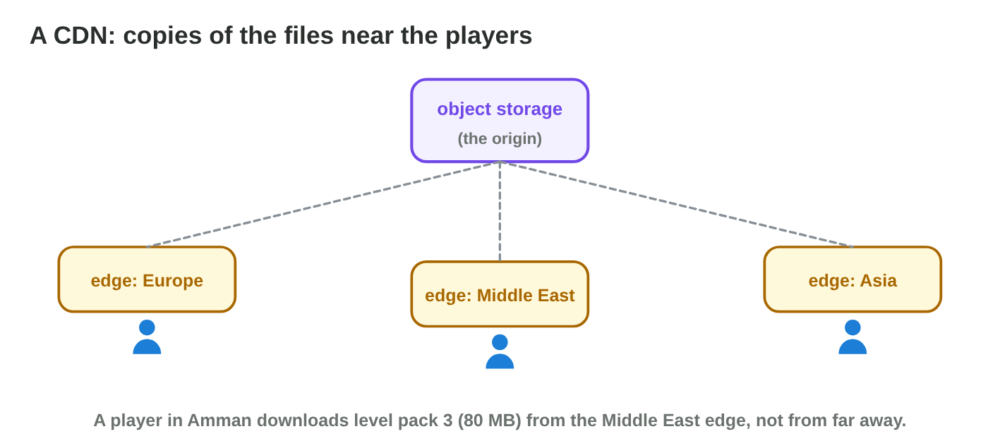
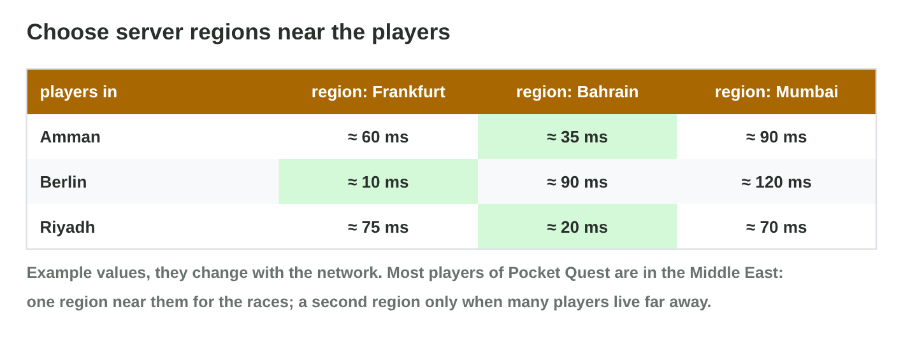
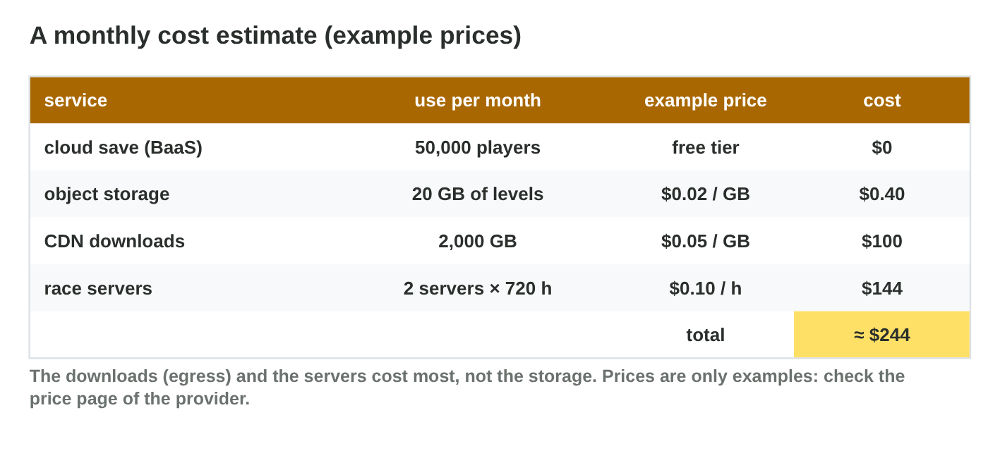

## Keywords



## 22.1 The services of an online game

:::: {.columns}
::: {.column width="50%"}
- Back-end services give accounts, cloud saves and leaderboards.
- Object storage and a CDN deliver the downloads.
- Dedicated servers run the live matches.
- **Do it:** Draw the cloud map of a game you know. Which services does it use?
:::
::: {.column width="50%"}

:::
::::

## Try it 1 · The services

a) Which service keeps level 12 for a new phone?
b) Which service delivers an 80 MB level pack fast everywhere?
c) Which service decides the winner of a live race?

::: {.answer}
a) the cloud save
b) object storage with a CDN
c) a dedicated server
:::

## 22.2 Saves, files and downloads

:::: {.columns}
::: {.column width="50%"}
- A cloud save stores a few KB of progress per player.
- Object storage keeps files with a web address.
- A CDN keeps copies near the players.
- **Do it:** Check if a game on your phone has a cloud save. How do you know?
:::
::: {.column width="50%"}

:::
::::

## Example · The lost phone

A player of Pocket Quest loses a phone with level 12 and 840 coins.
**How does the progress come back?**

::: {.reveal}
1. The **cloud save** stored level 12 and 840 coins at the last checkpoint.
2. On the new phone the player **logs in** with the same account.
3. The game **loads** the save, and nothing is lost.
:::

## 22.3 Servers, regions and safety

:::: {.columns}
::: {.column width="50%"}
- A dedicated server decides what really happens in a match.
- We choose regions near most players.
- Secret keys stay on the server, never in the app.
- **Do it:** Choose the race region for players in Jordan. Which one is it?
:::
::: {.column width="50%"}

:::
::::

## Example · The 3-second winner

Somebody wins every race in 3 seconds, and each phone sends its own time.
**How does Byte Bay stop it?**

::: {.reveal}
1. The cheater **changed the app** and sends a fake time.
2. The race now runs on a **dedicated server**, which measures the time itself.
3. The phone sends only its **inputs**, and the server writes the time to the leaderboard.
:::

## 22.4 What does it cost?

:::: {.columns}
::: {.column width="50%"}
- We multiply the use of each service by its price.
- Downloads (egress) and server hours often cost most.
- A CDN, smaller files and fewer server hours save money.
- **Do it:** Stay under $300 in Cloud Cost Planner. What did you change?
:::
::: {.column width="50%"}

:::
::::

## Live demo · Cloud Cost Planner



## Game challenge · Cloud Planner



## Try it 2 · The bill (harder)

a) What do 2,000 GB of downloads cost at $0.05 per GB?
b) What do 4 servers cost for 8 hours a day for 30 days at $0.10 per hour?
c) Why must a cost estimate say the date of the prices?

::: {.answer}
a) $100
b) $96
c) Prices change over time.
:::

## Summary

- A game uses back-end services, storage with a CDN, servers and analytics.
- Cloud saves follow the player, and big files go to object storage.
- Dedicated servers decide matches in regions near the players.
- Secret keys stay on the server.
- Downloads and server hours are the biggest costs.
