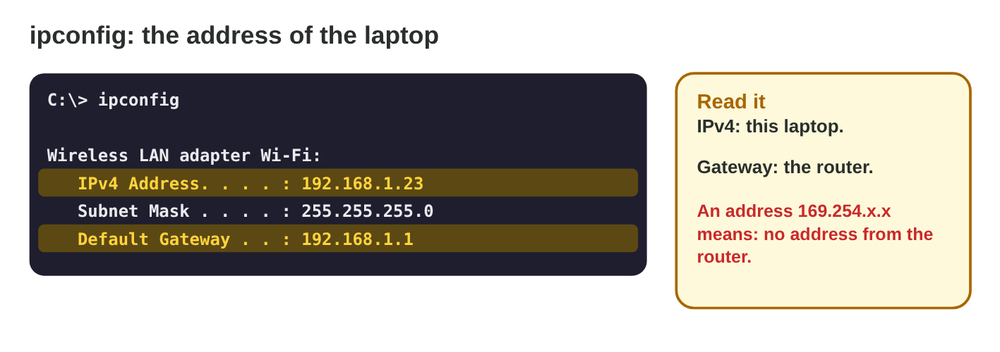
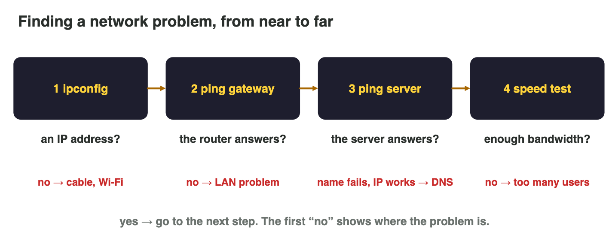

No new ideas today: two short problems on Lecture 10, with the network
tools of every computer. Do each one alone, then open "Check your result".
Every question on this page has its answer: try first, then check.

## Recall

- Every device has an **IP address** (private inside a LAN); the **default
  gateway** is the router; the **DNS** turns names into addresses.
- **Latency** (ping) is the time there and back; **jitter** is how much it
  changes; **packet loss** is the share of packets that never arrive.
- **TCP** sends lost packets again; **UDP** does not, so it is faster for
  live positions and voice.

::: {.callout-tip title="Try it 1 · Recall"}
Choose the right answer.

::: {.match extra="the switch|bandwidth"}
Which device is the default gateway?
:   the router

    Why: Packets to other networks go to the router first.

What turns play.example.net into an IP address?
:   the DNS

    Why: The DNS turns names into numbers.

What do we call the time of a packet there and back?
:   latency

    Why: Latency, the ping, is measured in milliseconds.
:::
:::

## Activity 1 · Your address, near and far

Rami's support inbox fills up: "The game lags!", "Server not found!". He
does not guess: he uses the tools that every computer has.

- **ipconfig** (Windows: type `cmd` in the Start menu, then `ipconfig`):
  the IPv4 address and the default gateway. An address **169.254.x.x** with
  no gateway means: no address from the router.
- **ping** *target*: the time of each reply, the **loss** and the
  **average**. Ping the **gateway** first (near), then a **server** (far).

{width=88%}



::: {.callout-note title="Activity 1 · Address and ping · 15 min"}
On the lab PC (or in **Terminal Lab**, Tasks 1–3):

1. Run `ipconfig`. Write the IPv4 address and the default gateway. Is the
   address private?
2. Ping your gateway, then a website (for example `ping example.com`).
   Write both averages and the loss. Where is the delay: near or far?

*Your product:* two addresses, two averages and one sentence.

::: {.check}
A good answer: "IPv4 192.168.1.23, gateway 192.168.1.1: private, because it
starts with 192.168. Gateway: average 3 ms, 0 % loss. example.com: average
42 ms, 0 % loss. The LAN is fast; most of the time is on the way to the
server."
:::
:::

::: {.callout-tip title="Try it 2 · ipconfig and ping"}
Choose the right answer.

::: {.match extra="the game server|100 %"}
ipconfig shows 169.254.10.4 and no gateway. What does it mean?
:   no address from the router

    Why: Without an address from the router, check the cable or the Wi-Fi.

What does "Request timed out" mean in ping?
:   a lost packet

    Why: No reply came back in time.

Times 20, 150, 30, 200 ms. What does this show?
:   big jitter

    Why: The times change a lot from packet to packet.
:::
:::

## Activity 2 · Find the problem, from near to far

The tools become a diagnosis when you use them in order. The first "no"
shows where the problem is:

1. **ipconfig:** an address? No → cable, Wi-Fi.
2. **ping the gateway:** does the router answer well? No → a LAN problem.
3. **ping the server** by its name and by its IP address. The name fails,
   but the IP works → a **DNS** problem.
4. **Speed test:** enough bandwidth? No → too many users.

If all four are fine but the game shows a low frame rate, the device is too
slow, not the network.

{width=90%}



::: {.callout-note title="Activity 2 · Six players · 15 min"}
In **Lag Detective**, read the tool output of six players and find the
problem of each one.

*Your product:* your score and the six problems in a list.

::: {.check}
1. 169.254.10.4, no gateway → no address from the router. 2. The café
router jumps from 8 to 171 ms with 25 % loss → the café's Wi-Fi. 3. "Server
not found", the IP works → the DNS. 4. Router 3 ms, server 104 ms in the
evening → outside the home, on the way to the server. 5. Three video
streams, 1.2 Mbit/s → too little bandwidth. 6. Ping 24 ms, 0 % loss, but
18 FPS in battles → not the network: the phone is too slow.
:::
:::

::: {.callout-tip title="Try it 3 · The diagnosis"}
Choose the right answer.

::: {.match extra="buy a new phone|TCP"}
ping play.example.net fails, but ping 198.51.100.7 works. What is the problem?
:   the DNS

    Why: The server answers by its address; only the name does not work.

Which step comes before pinging the server?
:   ping the gateway

    Why: The diagnosis goes from near to far.

Ping 24 ms, 0 % loss, but 18 FPS in battles. What is the cause?
:   the device is too slow

    Why: The network is fine; the frame rate shows the device.

A racing game sends the car positions many times per second. Which protocol fits?
:   UDP

    Why: A late position is worse than a lost one.
:::
:::

## Wrap-up {.summary}

- You can find your IP address and gateway, and read ping near and far.
- You can find a network problem from near to far, and tell it from a slow
  device.
