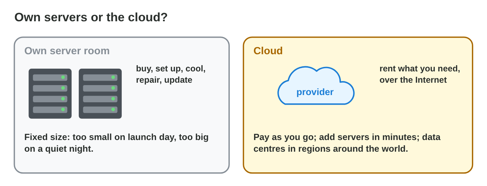
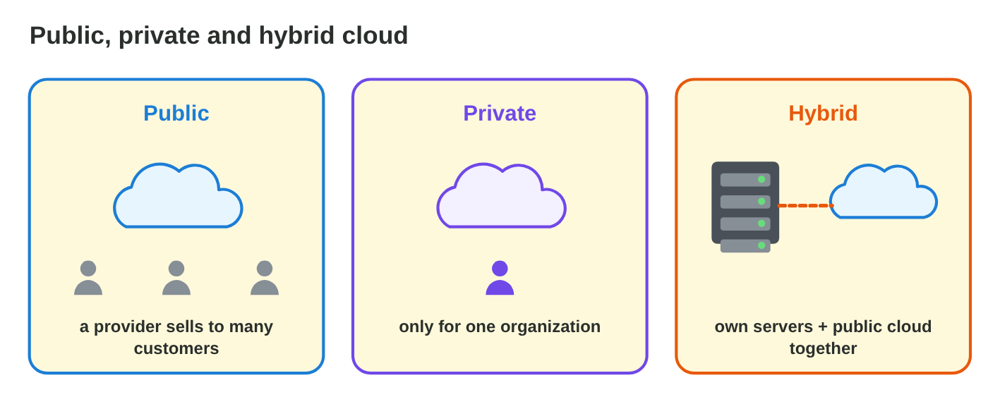
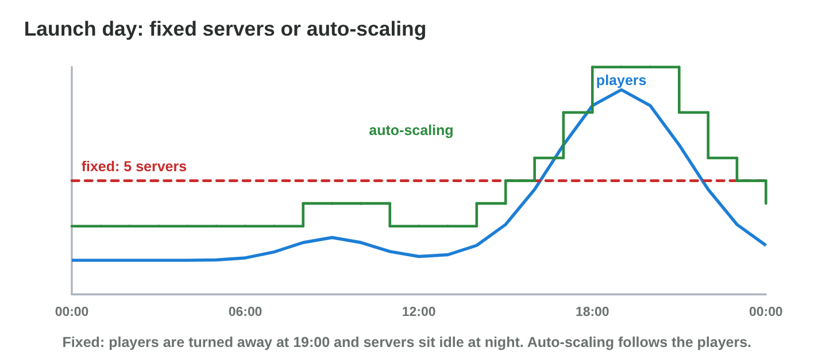

This page is the interactive version of the lesson notes (PDF). Each section
starts with a problem of an online game. Then it explains the idea behind
it. It ends with a **Do it** task and one set of questions. Every question
on this page has its answer: try first, then check.

## Key terms



## 10.1 What is the cloud?

- **Cloud computing:** computing power, storage and software from a
  provider over the Internet, when you need it; **pay-as-you-go**.
- **Data centres** with thousands of servers in **regions** around the
  world; one server runs many **virtual machines**.
- **Public cloud:** many customers. **Private cloud:** one organization.
  **Hybrid cloud:** own servers + a public cloud.
- Own servers: a fixed size, too small on launch day, idle at night. Cloud:
  rent by the hour.

{width=90%}

{width=90%}

::: {.callout-warning title="Watch out!"}
The cloud is not free and not always online: it costs per use, and
providers have outages too.
:::

::: {.callout-note title="Do it · Choose the kind"}
Which kind of cloud fits? (a) a club with no money for servers; (b) a
ministry that must keep its data on its own servers; (c) a shop with a
server in the shop for its cash registers, and its online store on rented
cloud servers.

::: {.check}
(a) **Public cloud**: rent what you need, no servers to buy. (b) **Private
cloud**: only for one organization, on its own servers. (c) **Hybrid
cloud**: own servers and a public cloud together.
:::
:::

::: {.callout-tip title="Try it 1 · The cloud"}
Choose the right answer.

::: {.match extra="a USB stick|a printer"}
What is a building with thousands of servers?
:   a data centre

    Why: Cloud providers run data centres in regions around the world.

What is a computer made in software on a real server?
:   a virtual machine

    Why: One real server runs many virtual machines.

What do we call paying per hour or per gigabyte?
:   pay-as-you-go

    Why: You pay only for what you use.

Which kind of cloud serves one organization only?
:   a private cloud

    Why: A public cloud serves many customers.
:::
:::

## 10.2 Service models: IaaS, PaaS, SaaS and BaaS

- **IaaS:** rent virtual machines; you manage the OS and the software.
- **PaaS:** upload your code; the provider runs the OS and the runtime.
- **SaaS:** use a finished application (an online office suite).
- **BaaS:** ready game services (accounts, cloud saves, leaderboards)
  through an SDK.
- More control means more work: IaaS the most control, BaaS the least
  work.

{width=90%}



::: {.callout-warning title="Watch out!"}
With SaaS or BaaS, the studio still decides about its players' data.
:::

::: {.callout-note title="Do it · Who manages it?"}
In **Cloud Stack**, set the layers right for IaaS, PaaS and SaaS. Write one
thing that Byte Bay still manages in each.

::: {.check}
IaaS: Byte Bay manages the OS, the runtime, the app and the data. PaaS:
the app and the data. SaaS: the provider runs everything; Byte Bay still
manages its data (who sees it, how long it is kept).
:::
:::

::: {.callout-tip title="Try it 2 · Models"}
Use Cloud Stack. Choose the model.

::: {.match extra="a USB model|a printer model"}
Rent a virtual machine and install everything yourself.
:   IaaS

    Why: In IaaS you manage the OS and the software.

Upload only the code.
:   PaaS

    Why: In PaaS the provider runs the OS and the runtime.

Use an online project board.
:   SaaS

    Why: SaaS is a finished application that you only use.

Ready friends lists and cloud saves through an SDK.
:   BaaS

    Why: BaaS gives ready back-end services for games.
:::
:::

## 10.3 The cloud services of a game

- **Back end (BaaS):** player accounts, **cloud saves**, leaderboards.
- **Cloud save:** the progress on a server; after a login, any phone loads
  it.
- **Object storage + CDN:** downloads (new levels); a **CDN** keeps copies
  near the players.
- **Dedicated game servers:** run the live matches in regions near the
  players.
- Star Garden: login and cloud save; a 60 MB flower pack through a CDN; no
  live matches, so no game servers.

{width=90%}

{width=90%}

::: {.callout-warning title="Watch out!"}
Do not put big level packs inside the app: keep changing content in object
storage.
:::

::: {.callout-note title="Do it · A map of services"}
Choose a mobile game you know with online features. Which cloud services
does it use (back end, storage and CDN, game servers), and for what?

::: {.check}
A good answer looks like: "A football game: an account and a cloud save
(back end); new kits and stadiums downloaded (storage and a CDN); online
matches (dedicated game servers)."

- ☐ Three services.
- ☐ For each, what it does for the player.
:::
:::

::: {.callout-tip title="Try it 3 · The services of a game"}
Choose the service.

::: {.match extra="a bigger phone|a printer"}
A player changes phone and wants to continue in garden 5.
:   a cloud save

    Why: The progress is on a server and loads after the login.

New levels download slowly far from the storage.
:   a CDN

    Why: A CDN keeps copies of the files near the players.

The live matches of an action game.
:   dedicated game servers

    Why: They run the matches in regions near the players.
:::
:::

## 10.4 Scaling, cost and risks

- **Scalability:** add or remove servers as the players change;
  **auto-scaling** does it by itself.
- Launch day: 5 fixed servers turn away about 3,700 players at 19:00; 9
  fixed servers sit idle at night; auto-scaling follows the players.
- **Risks:** costs grow with use, outages, **vendor lock-in**, data laws.

{width=90%}

{width=90%}



::: {.callout-warning title="Watch out!"}
Set a maximum and a budget alarm for auto-scaling.
:::

::: {.callout-note title="Do it · Play the day"}
In **Launch Day Scaling**, find the smallest number of fixed servers that
turns nobody away. Compare its cost with auto-scaling.

::: {.check}
9 fixed servers turn nobody away. Auto-scaling also turns nobody away and
costs less, because it uses few servers at night and many at 19:00.
:::
:::

::: {.callout-tip title="Try it 4 · Launch day"}
Use Launch Day Scaling. Choose the right answer.

::: {.match extra="1|30"}
How many fixed servers turn nobody away, at least?
:   9

    Why: With fewer, players are turned away at the peak.

How many players are turned away with 5 servers at the peak?
:   about 3,700

    Why: 5 servers are too few at 19:00.

Which way turns nobody away and costs less?
:   auto-scaling

    Why: The servers follow the players.
:::
:::

## Game challenge: Cloud Match {.challenge}

Work alone. Use every section of today.

Byte Bay and its partners have **six jobs**: a race server that needs a
special **OS setting**; a small **leaderboard program**; shared
**documents** for the team; **accounts, cloud saves and a leaderboard**
through an SDK; payment data of a **bank** that must stay in its own data
centre; and **build PCs in the office** with cloud servers for launch peaks.



::: {.callout-tip title="Try it 5 · The jobs"}
Choose the model.

::: {.match extra="a USB model"}
The race server with a special OS setting.
:   IaaS

    Why: Only IaaS lets the studio manage the OS.

The small leaderboard program, with no OS updates.
:   PaaS

    Why: In PaaS the studio brings only the code.

Shared documents and a calendar.
:   SaaS

    Why: A finished application that the team only uses.

Accounts and cloud saves through an SDK.
:   BaaS

    Why: Ready game services through an SDK.
:::
:::

::: {.callout-tip title="Try it 6 · Kinds of cloud (harder)"}
The bank keeps payment data in its own data centre; Byte Bay keeps build
PCs in the office and rents servers for peaks. Choose the right answer.

::: {.match extra="own servers only|a USB stick"}
The bank's payment data.
:   private cloud

    Why: Cloud technology for one organization only.

Build PCs in the office with cloud servers for peaks.
:   hybrid cloud

    Why: Own servers and a public cloud together.

The races of a small studio with no servers.
:   public cloud

    Why: Rent what you need from a provider.
:::
:::

## Summary {.summary}

- The cloud is rented computing over the Internet: pay-as-you-go, in data
  centres and regions.
- Public, private and hybrid clouds differ in who shares them.
- IaaS, PaaS, SaaS and BaaS differ in who manages what.
- A game uses a back end with cloud saves, storage with a CDN, and game
  servers.
- Auto-scaling follows the players; watch the cost, outages and lock-in.
