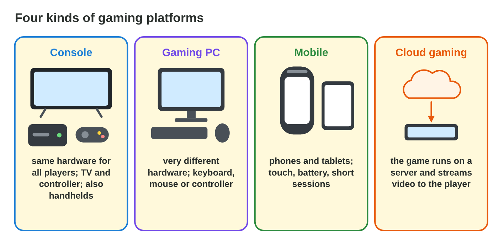
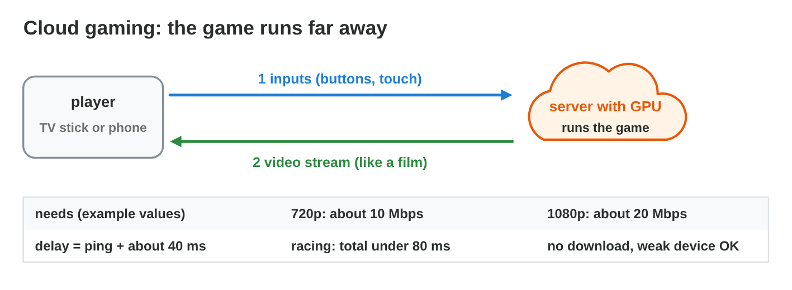
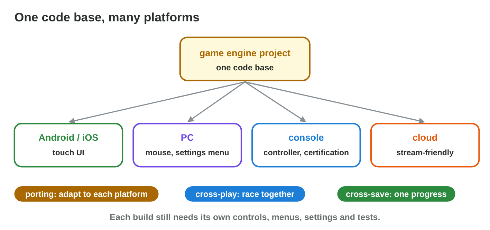

## Keywords



## 23.1 What is a gaming platform?

:::: {.columns}
::: {.column width="50%"}
- A platform is the hardware, the software, the store and its rules.
- The four kinds are consoles, gaming PCs, mobile devices and cloud gaming.
- Handheld consoles have the screen and the controls built in.
- **Do it:** List the platforms your family plays on. Which input does each use?
:::
::: {.column width="50%"}

:::
::::

## Try it 1 · Platforms

a) Which platform has the same hardware for all players?
b) Which platform has old laptops and strong desktops?
c) Which platform runs the game on a server and streams video?

::: {.answer}
a) a game console
b) a gaming PC
c) cloud gaming
:::

## 23.2 Consoles and gaming PCs

:::: {.columns}
::: {.column width="50%"}
- A console has fixed hardware, so the studio tunes and tests one target.
- Console games need a dev kit and certification.
- PC games need graphics settings and system requirements.
- **Do it:** Compare the console and the PC in Platform Profiles. What differs most?
:::
::: {.column width="50%"}

:::
::::

## Live demo · Platform Profiles



## Example · Console and PC versions

Byte Bay plans a console version and a PC version of Pocket Quest.
**How does the work differ?**

::: {.reveal}
1. On the **console**, Rami tunes the game once: 4K, high, 60 fps for every player.
2. The console version must pass **certification** before release.
3. On the **PC**, Rami adds a **settings menu** and lists the system requirements.
:::

## 23.3 Mobile and cloud gaming

:::: {.columns}
::: {.column width="50%"}
- Mobile games meet touch, battery, heat and many devices.
- Most mobile games are free-to-play.
- Cloud gaming runs the game on a server and streams a video.
- **Do it:** Find the bandwidth for sharp 1080p in Cloud Gaming Lab. How much is it?
:::
::: {.column width="50%"}

:::
::::

## Live demo · Cloud Gaming Lab



## Example · Racing through the cloud

A player streams Pocket Quest to a TV stick.
**When is the race good?**

::: {.reveal}
1. With **8 Mbps**, the 720p picture is blocky, because it needs about 10 Mbps.
2. With **25 Mbps**, 1080p is sharp, but a ping of 60 ms gives a delay of 100 ms.
3. With a ping of **30 ms**, the total is 70 ms, which is good for racing.
:::

## Try it 2 · Mobile and cloud

a) What does a 1080p stream need, in this example?
b) What is the total delay with a ping of 60 ms?
c) How does a free-to-play game earn money?

::: {.answer}
a) about 20 Mbps
b) 100 ms (60 + 40)
c) with purchases or ads inside the game
:::

## 23.4 Strengths, limits and cross-platform

:::: {.columns}
::: {.column width="50%"}
- One engine project can build the game for several platforms.
- Porting adapts the controls, menus, settings and store rules.
- Cross-play joins the players, and cross-save joins the progress.
- **Do it:** Write one strength and one limit of each platform. Which limit worries you most?
:::
::: {.column width="50%"}

:::
::::

## Game challenge · Platform Match



## Try it 3 · Cross-platform (harder)

a) Which word means a PC player and a console player race together?
b) Which word means the progress moves from the phone to the PC?
c) Why is a port not free, even with a game engine?

::: {.answer}
a) cross-play
b) cross-save
c) Controls, menus, performance, store rules and tests need work.
:::

## Summary

- A gaming platform is hardware, software, a store and its rules.
- Consoles have fixed hardware, dev kits and certification.
- PCs have varied hardware, settings and system requirements.
- Mobile reaches the most players, and cloud gaming needs a good network.
- Cross-platform games still need porting for each platform.
