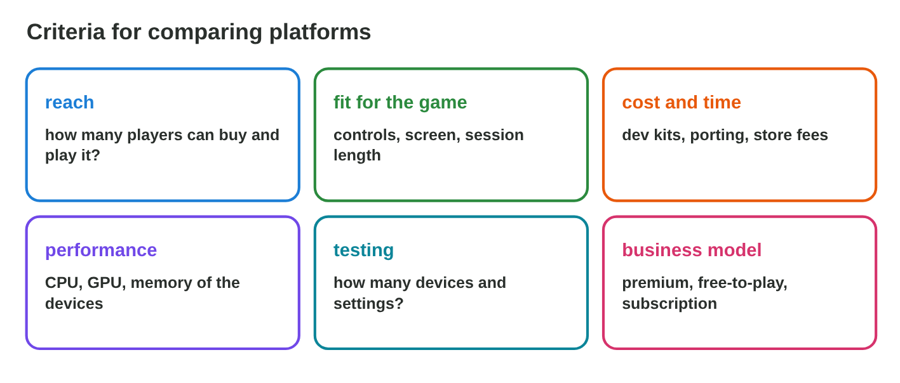
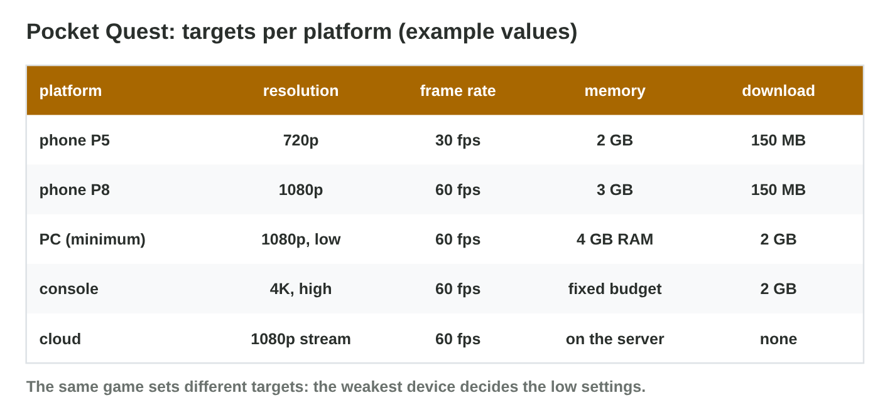
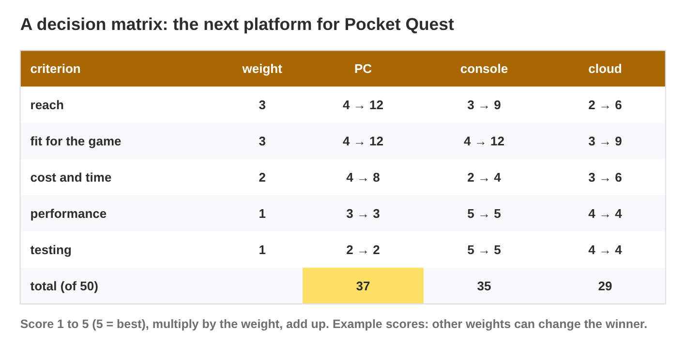
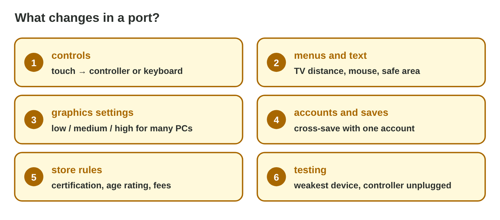

## Keywords



## 24.1 Criteria for the comparison

:::: {.columns}
::: {.column width="50%"}
- We write the criteria and the weights before we score.
- Typical criteria are reach, fit, cost, performance and testing.
- Facts come from reliable sources with a date.
- **Do it:** Write five criteria for the next platform of a game you know. Which matters most?
:::
::: {.column width="50%"}

:::
::::

## Try it 1 · Criteria

a) Which criterion is "console players spend the most"?
b) Which criterion is "thousands of PC configurations"?
c) Why do we write the weights before the scores?

::: {.answer}
a) the business model
b) testing
c) so that the favourite does not win by design
:::

## 24.2 Specifications and performance

:::: {.columns}
::: {.column width="50%"}
- The GPU, CPU and memory decide the frame rate.
- The weakest part is the bottleneck.
- The minimum and recommended requirements describe the devices.
- **Do it:** Find the best 60 fps setting for each device in Spec Check. Which device is weakest?
:::
::: {.column width="50%"}

:::
::::

## Live demo · Spec Check



## Example · Four PCs, one game

Pocket Quest runs on four PCs with example GPU points.
**Which settings and requirements follow?**

::: {.reveal}
1. The **old laptop** runs low at 80 fps; medium stutters with 4 GB RAM.
2. The **office PC** gets 40 fps on high, because the GPU is the bottleneck.
3. Minimum: GPU 2 points and 4 GB. Recommended: GPU 6 points and 8 GB.
:::

## 24.3 The decision matrix

:::: {.columns}
::: {.column width="50%"}
- Each criterion gets a weight, and each platform gets scores.
- The total is the sum of score times weight.
- A sensitivity check changes a weight and looks again.
- **Do it:** Set the Byte Bay weights in Decision Matrix. Which platform wins?
:::
::: {.column width="50%"}

:::
::::

## Live demo · Decision Matrix



## Example · The next platform

Byte Bay weights reach 3, fit 3, cost 2, performance 1 and testing 1.
**Which platform wins, and how sure is it?**

::: {.reveal}
1. The totals are **PC 37**, console 35 and cloud 29 of 50.
2. With equal weights, the **console** wins 19 to 17.
3. The margin is small, so the report names the weights that decide.
:::

## 24.4 The recommendation

:::: {.columns}
::: {.column width="50%"}
- The report gives the question, the matrix and the choice.
- A port plan lists controls, menus, settings, saves and tests.
- The risks come with ways to reduce them.
- **Do it:** Write a five-point port plan for your choice. Which point costs most?
:::
::: {.column width="50%"}

:::
::::

## Game challenge · Port Planner



## Try it 2 · Compute (harder)

a) What is the PC total for scores 4, 4, 4, 3, 2 and weights 3, 3, 2, 1, 1?
b) How many fps does a GPU of 4 points give when high needs 6?
c) What fixes a freeze when the controller is unplugged?

::: {.answer}
a) 37
b) 40 fps
c) pause, show a message, then resubmit
:::

## Summary

- Criteria and weights come first, then the scores.
- The specs decide the frame rate, and the weakest part is the bottleneck.
- Settings and requirements let many devices run the game.
- A decision matrix needs a sensitivity check.
- A recommendation includes a port plan and the risks.
