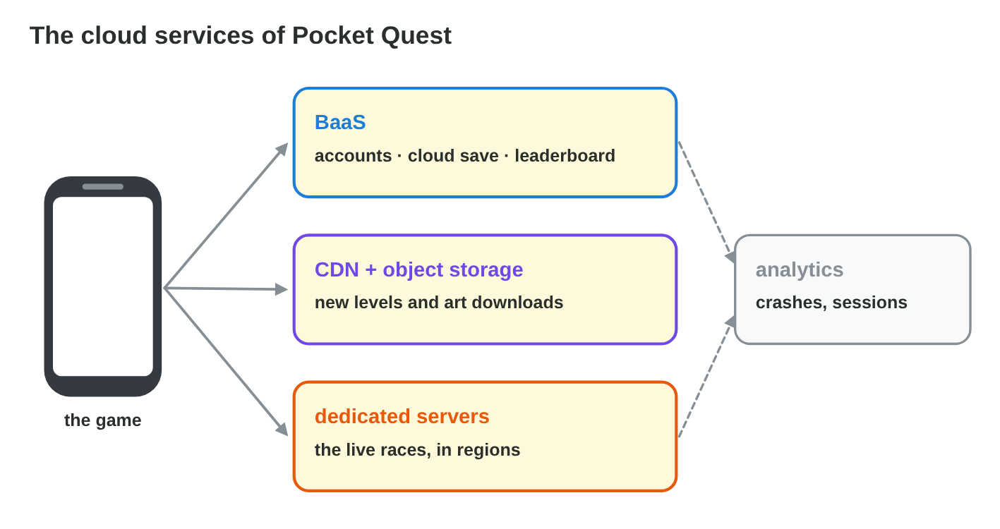

No new ideas today: two short problems on Lecture 10. Do each one alone.
Tap, sort or type your answer at every step: the page checks it at once and
tells you why.

## Recall

- **BaaS** (a game back end): player accounts, **cloud saves**,
  leaderboards.
- **Object storage + a CDN**: files that players download; the CDN keeps
  copies near the players. **Dedicated game servers** run the live matches
  in **regions** near the players.
- The cloud grows and shrinks with the players (**auto-scaling**); costs
  grow with use.

::: {.callout-tip title="Try it 1 · Recall"}
Choose the right answer.

::: {.match extra="a printer|a USB stick"}
Which service keeps the progress of a player on a server?
:   a cloud save

    Why: After a login, any device loads the progress from the server.

What keeps copies of downloads near the players?
:   a CDN

    Why: A CDN has servers in many places, near the players.

Which model gives ready accounts and leaderboards through an SDK?
:   BaaS

    Why: BaaS gives ready back-end services for games.
:::
:::

## Activity 1 · A service for each need

The studio plans *Dune Duel*, a desert race for two players. The game
needs: player accounts; the progress of each player on every phone; a
**120 MB** track pack that changes every month; **live duels** between two
players. Each need has a cloud service; a service that no need asks for is
left out.

{width=90%}

::: {.callout-note title="Activity 1 · Four needs · 15 min"}
1. Copy the table and fill it for *Dune Duel*.

   | need | cloud service | why |
   |---|---|---|
   | accounts | | |
   | progress on every phone | | |
   | 120 MB track pack | | |
   | live duels | | |

2. Open the settings of a game on your phone. Does it have a cloud save or
   an account link?

*Your product:* the filled table and one answer.

::: {.sort}
Step 1: which cloud service does each need of Dune Duel use? Sort them.

Back end (BaaS)
:   accounts

    Why: Ready accounts through an SDK.

:   progress on every phone

    Why: A cloud save loads after the login on any phone.

Object storage and a CDN
:   the 120 MB track pack

    Why: Not inside the app; copies near the players.

Dedicated game servers
:   live duels

    Why: They run the duels and decide who wins.
:::

::: {.choice}
Step 2: a game has no cloud save and no account link, and the phone is
lost. What happens?

- [x] The progress is lost.

  Why: Without an account link, the progress was only on the old phone.

- [ ] The progress loads on the new phone.

  Why: That needs a cloud save with an account.

- [ ] The store keeps the progress.

  Why: The store keeps the app, not the progress.
:::
:::

::: {.callout-tip title="Try it 2 · Needs and services"}
Choose the service.

::: {.match extra="a bigger app|a printer"}
Where does the 120 MB track pack go, so that it can change every month?
:   object storage with a CDN

    Why: Big, changing content stays out of the app package.

What runs the live duels?
:   dedicated game servers

    Why: A server runs the match and decides what really happens.

What gives the accounts with the least work?
:   a game back end (BaaS)

    Why: Ready accounts through an SDK, with no server code.
:::
:::

## Activity 2 · The inbox after an online update

After the online update of *Pocket Quest*, the inbox of Byte Bay is full: a
player who lost a phone (**level 12, 840 coins**); slow downloads of the
**80 MB** pack in **Amman**; jumping cars with a ping of **90 ms**;
**impossible race times**; a teammate who wants to put a **secret key** in
the app; and a bill that **doubled** after 50,000 downloads.



::: {.callout-note title="Activity 2 · Six problems · 15 min"}
In **Cloud Planner**, choose what solves each problem.

*Your product:* your score and the six problems, each with its solution.

::: {.sort}
What solves each problem in the inbox? Sort them.

A cloud save
:   a lost phone with level 12 and 840 coins

    Why: After the login, the progress loads on the new phone.

A CDN
:   slow downloads of the 80 MB pack in Amman

    Why: A copy near the players makes the download fast.

:   a bill that doubled after 50,000 downloads

    Why: A CDN and smaller packs: the costs grow with use.

Game servers
:   jumping cars with a ping of 90 ms

    Why: Race servers in a region near the players.

:   impossible race times

    Why: A dedicated server decides the race, not the phone.

Secrets on the server
:   a secret key in the app

    Why: Never in the app: anyone can read an app.
:::
:::

::: {.callout-tip title="Try it 3 · The inbox"}
Choose what solves it, or what it shows.

::: {.match extra="a bigger phone|yes, if the file is hidden"}
A lost phone, with level 12 and 840 coins.
:   a cloud save

    Why: The progress loads on the new phone after the login.

The 80 MB pack downloads slowly in Amman.
:   a CDN with a copy near the players

    Why: The players download from a near copy.

May the payment key go into the app?
:   never: secrets stay on the server

    Why: Anyone can unpack an app and read the key.

Which risk of the cloud does the doubled bill show?
:   costs grow with use

    Why: In pay-as-you-go, more downloads cost more.
:::
:::

## Wrap-up {.summary}

- You can choose a cloud service for each need of a game, and check the
  save of a game you play.
- You can solve the cloud problems of an online game and keep its secrets
  safe.
