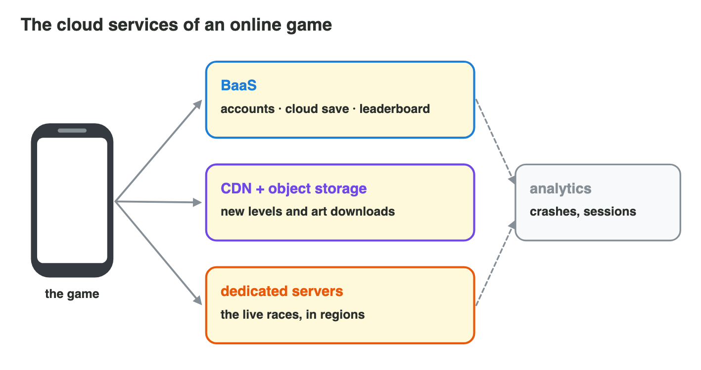
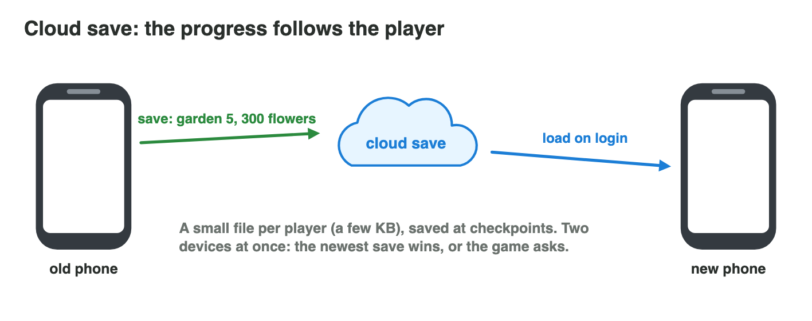
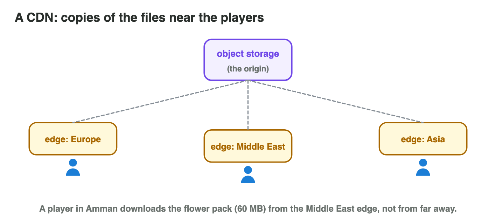

No new ideas today: you plan the cloud of a real game, with what you
learned in Lecture 11. Do each activity alone, then open "Check your
result". Every question on this page has its answer: try first, then check.

## Recall

- **BaaS** (a game back end): player accounts, **cloud saves**,
  leaderboards.
- **Object storage + a CDN**: files that players download; the CDN keeps
  copies near the players.
- **Dedicated game servers**: they run the live matches in **regions** near
  the players.
- The cloud grows and shrinks with the players (**auto-scaling**); costs
  grow with use.

::: {.callout-tip title="Try it 1 · Recall"}
Choose the right answer.

::: {.match extra="a printer|a USB stick"}
Which service keeps the progress of a player on a server?
:   a cloud save

    Why: After a login, any device loads the progress from the server.

What keeps copies of downloads near the players?
:   a CDN

    Why: A CDN has servers in many places, near the players.

Which model gives ready accounts and leaderboards through an SDK?
:   BaaS

    Why: BaaS gives ready back-end services for games.
:::
:::

## Activity 1 · The services of a new game

The studio plans *Dune Duel*, a desert race for two players. The game
needs: player accounts; the progress of each player on every phone; a
**120 MB** track pack that changes every month; **live duels** between two
players; players in **Jordan, Saudi Arabia and Egypt**.

- Each need has a cloud service: back end (accounts, saves), storage and a
  CDN (downloads), dedicated game servers (live matches).
- A service that no need asks for is left out.

{width=90%}

::: {.callout-note title="Activity 1 · A service for each need · 10 min"}
Copy the table and fill it for *Dune Duel*.

| need | cloud service | why |
|---|---|---|
| accounts | | |
| progress on every phone | | |
| 120 MB track pack | | |
| live duels | | |

*Your product:* the filled table.

::: {.check}
| need | cloud service | why |
|---|---|---|
| accounts | back end (BaaS) | ready accounts through an SDK |
| progress on every phone | cloud save (BaaS) | loads after the login on any phone |
| 120 MB track pack | object storage + CDN | not inside the app; copies near the players |
| live duels | dedicated game servers | they run the duels and decide who wins |
:::
:::

::: {.callout-tip title="Try it 2 · Needs and services"}
Choose the service.

::: {.match extra="a bigger app|a printer"}
Where does the 120 MB track pack go, so that it can change every month?
:   object storage with a CDN

    Why: Big, changing content stays out of the app package.

What runs the live duels?
:   dedicated game servers

    Why: A server runs the match and decides what really happens.

What gives the accounts with the least work?
:   a game back end (BaaS)

    Why: Ready accounts through an SDK, with no server code.
:::
:::

## Activity 2 · Saves and downloads

- A **cloud save** stores a small file of each player's progress (a few KB)
  at checkpoints. After a login, any device loads it. When two devices
  disagree, the newest save wins, or the game asks the player.
- A **CDN** keeps copies of the files on servers around the world: each
  player downloads from a near copy, which is faster.
- A player of *Star Garden* moves from an Android phone to an iPhone, logs
  in, and continues in garden 5 with 300 flowers.

{width=88%}

{width=88%}

::: {.callout-warning title="Watch out!"}
Without an account link, the progress is only on the phone: a lost phone is
lost progress.
:::

::: {.callout-note title="Activity 2 · Your game's save · 8 min"}
1. Open the settings of a game on your phone. Does it have a cloud save or
   an account link?
2. What happens to your progress if you change phone?

*Your product:* two short answers.

::: {.check}
A good answer looks like: "Yes: the game links to an account (Google Play
Games or Game Center, or its own login). On a new phone I log in and the
progress loads." Or: "No account link: the progress is only on this phone;
a new phone starts from the beginning."
:::
:::

::: {.callout-tip title="Try it 3 · Saves and downloads"}
Choose the right answer.

::: {.match extra="the CDN deletes it|the store sends it"}
Two devices have different saves. What happens?
:   the newest save wins, or the game asks

    Why: The game must choose one progress.

How big is a cloud save, usually?
:   a few KB

    Why: It stores only the progress, not the game.

Why is a download from a CDN faster?
:   it comes from a copy near the player

    Why: The data travels a shorter way.
:::
:::

## Activity 3 · Servers, regions and safety

- Choose game-server **regions** near most players: lower latency. Add a
  second region only when many players live far away.
- A **dedicated server** decides what really happens: a cheating phone
  cannot simply say "I won".
- **Secrets stay on the server:** keys for payments or admin tools never go
  into the game app; anyone can unpack an app.
- *Number Rush*, a puzzle game, first let each phone send "my score:
  1,000,000". Now the phone sends its moves, and the server counts the
  score.

{width=90%}

::: {.callout-warning title="Watch out!"}
The cheapest region is not the best one if it is far from the players.
:::

::: {.callout-note title="Activity 3 · A region and a rule · 12 min"}
Most players of *Dune Duel* live in Jordan and Saudi Arabia; 10 % live in
Germany.

1. Use the table of regions to choose the region for the duels. Is a second
   region worth it?
2. Write one safety rule for the duels and one for the payment key.

*Your product:* a region with a reason, and two safety rules.

::: {.check}
Region: **Bahrain**, about 35 ms from Amman and 20 ms from Riyadh. A second
region (Frankfurt) is not worth it yet: only 10 % of the players live in
Germany, and Bahrain still works for them (about 90 ms). Rules: "The server
runs the duel and measures the time; the phones send only their inputs."
"The payment key stays on the server, never in the app."
:::
:::

::: {.callout-tip title="Try it 4 · Regions and safety"}
Choose the right answer.

::: {.match extra="the cheapest region|in the app, hidden"}
Players in Amman and Riyadh. Which region from the table?
:   Bahrain

    Why: It has the lowest latency to both cities.

Where does the payment key go?
:   on the server only

    Why: Anyone can unpack a game app.

Who decides the score of a duel?
:   the dedicated server

    Why: A cheating phone cannot change what the server measured.
:::
:::

## Game challenge: Cloud Planner {.challenge}

Work alone. Use every activity of today.

The inbox of Byte Bay after the online update of *Pocket Quest*: a player
who lost a phone (**level 12, 840 coins**); slow downloads of the **80 MB**
pack in **Amman**; jumping cars with a ping of **90 ms**; **impossible race
times**; a teammate who wants to put a **secret key** in the app; and a
bill that **doubled** because 50,000 players downloaded the pack straight
from the storage.



::: {.callout-tip title="Try it 5 · The inbox"}
Choose what solves it.

::: {.match extra="a bigger phone|a new logo"}
A lost phone, with level 12 and 840 coins.
:   a cloud save

    Why: The progress loads on the new phone after the login.

The 80 MB pack downloads slowly in Amman.
:   a CDN with a copy near the players

    Why: The players download from a near copy.

Cars jump; the ping to the race server is 90 ms.
:   race servers in a region near the players

    Why: A near region lowers the latency.

Impossible race times; the phones decide who wins.
:   a dedicated server decides the race

    Why: The server measures the time itself.
:::
:::

::: {.callout-tip title="Try it 6 · Keys and bills (harder)"}
A teammate wants to put the payment key in the app; the bill doubled
because of downloads from far-away storage. Choose the right answer.

::: {.match extra="yes, if the file is hidden|buy more storage"}
May the payment key go into the app?
:   never: secrets stay on the server

    Why: Anyone can unpack an app and read the key.

What lowers the bill of the downloads?
:   a CDN and smaller packs

    Why: Downloads cost money; near copies and smaller files cost less.

Which risk of the cloud does the doubled bill show?
:   costs grow with use

    Why: In pay-as-you-go, more downloads cost more.
:::
:::

## Wrap-up {.summary}

- You can choose a cloud service for each need of a game.
- You can explain cloud saves and a CDN with a game you know.
- You can choose a server region from latencies, and keep the server in charge and the secrets safe.
