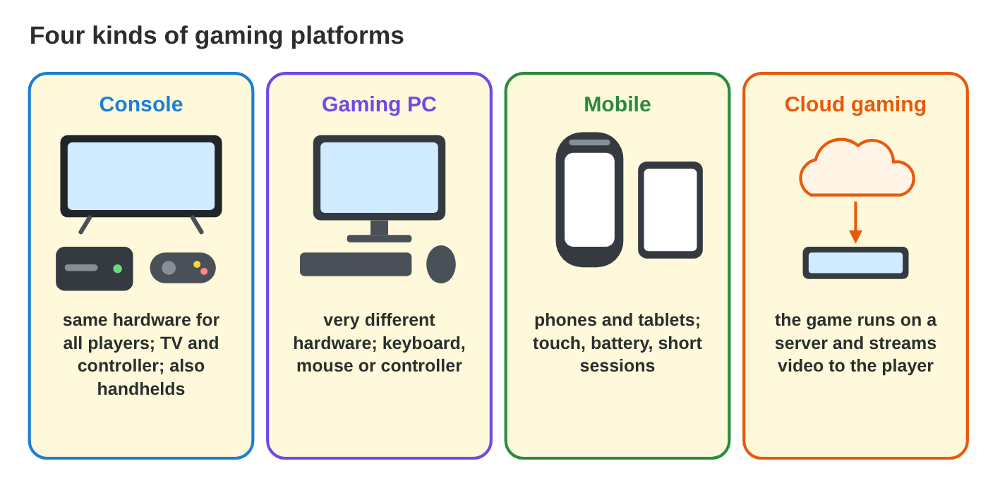
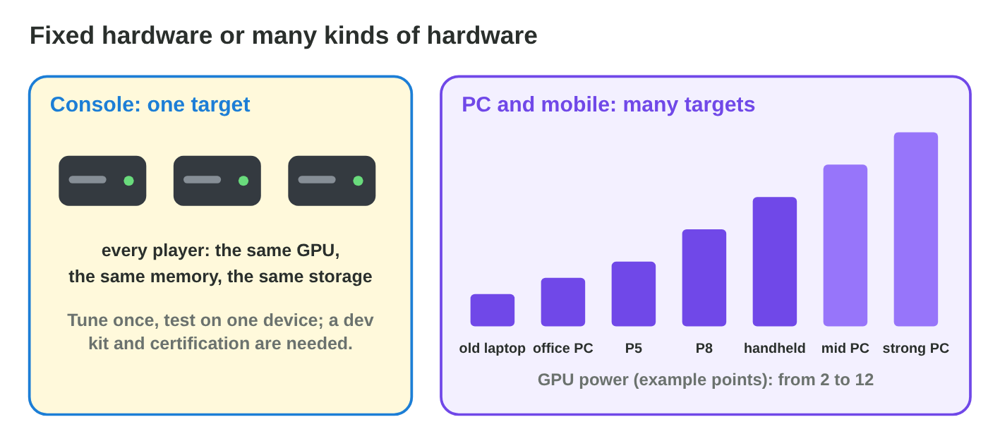
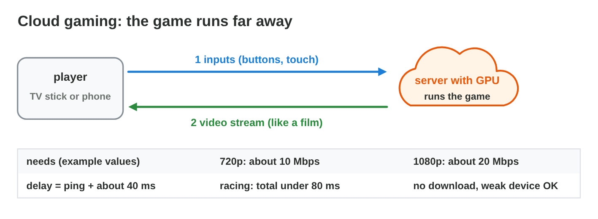
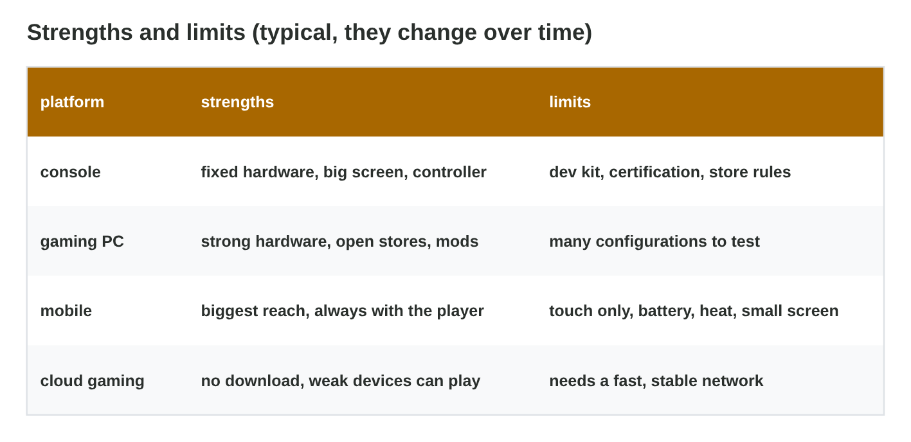
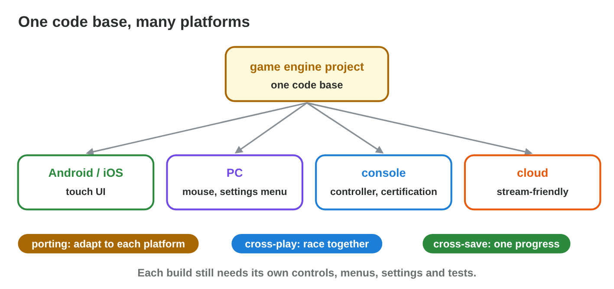
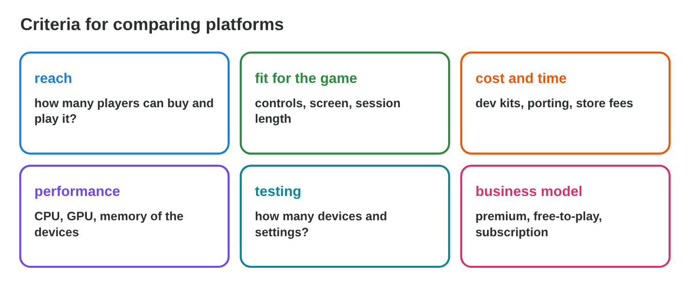
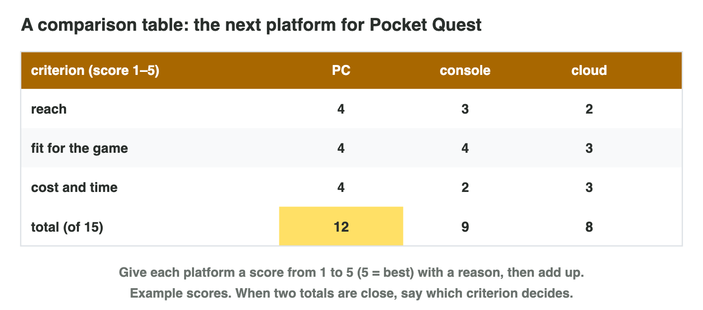

Each section: a question from a game studio, the idea, a **Do it** task and a short **Try it**.
The page checks every answer at once and tells you why. More examples
and exercises are in the lesson notes (PDF).

## Key terms



## 11.1 Consoles and gaming PCs

- A **gaming platform**: hardware + software + store + rules. Four kinds:
  consoles, gaming PCs, mobile, cloud gaming.
- **Console:** **fixed hardware** for all players; a **dev kit** and
  **certification** before release.
- **Gaming PC:** **varied hardware**; **graphics settings** (low, medium,
  high) and **system requirements** (minimum, recommended).

{width=90%}

{width=90%}



::: {.callout-warning title="Watch out!"}
Consoles are not always stronger than PCs: their strength is that all
players have the same hardware.
:::

::: {.callout-note title="Do it · Compare two platforms"}
In **Platform Profiles**, compare the console and the gaming PC.

::: {.sort}
Console or gaming PC? Sort the facts.

Console
:   the same hardware for every player

    Why: Fixed hardware: the studio tests on one device.

:   a dev kit and certification before release

    Why: The console maker checks the game first.

Gaming PC
:   many kinds of hardware

    Why: Varied hardware: many tests.

:   graphics settings: low, medium, high

    Why: Settings let the game run on weak and strong PCs.

:   system requirements: minimum and recommended

    Why: The store page says which PC the game needs.
:::
:::

::: {.callout-tip title="Try it 1 · Console or PC?"}
Choose the platform. You can use an answer more than once.

::: {.match extra="mobile|cloud gaming"}
Every player has the same GPU and memory.
:   a console

    Why: A console has fixed hardware.

The studio needs a dev kit and must pass certification.
:   a console

    Why: The console maker controls who makes games for it.
:::
:::

## 11.2 Mobile and cloud gaming

- **Mobile:** touch, many devices, battery and heat limits, short
  sessions; most games are **free-to-play** (a **premium** game is paid
  once).
- **Cloud gaming:** the game runs on a server with a GPU; the device sends
  inputs and shows a **video stream**.
- Bandwidth: 720p about 10 Mbps, 1080p about 20 Mbps.
- **Total delay = ping + about 40 ms.** Ping 80 ms → 120 ms: fine for a card
  game, too slow for racing (under about 80 ms).

{width=90%}





::: {.callout-warning title="Watch out!"}
Cloud gaming moves the hardware to the server, but the network must be fast
and stable.
:::

::: {.callout-note title="Do it · Feel and test the delay"}
In **Lag Lab**, jump over 10 blocks with +0 ms and with +120 ms. In **Cloud
Gaming Lab**, find the highest ping that is still good for racing. Total
delay = ping + about 40 ms.

::: {.fill answer="40" unit="ms" hint="Racing needs a total of 80 ms or less, and the total is ping + 40."}
What is the highest ping that is still good for racing?

Why: 40 + 40 = 80 ms, the limit for racing.
:::

::: {.choice}
In Lag Lab, why do you clear fewer blocks with +120 ms?

- [x] The jump starts too late.

  Why: The tap and the picture travel to the server and back.

- [ ] The blocks move faster.

  Why: The blocks keep their speed; only the reaction is late.

- [ ] The picture is less sharp.

  Why: The delay, not the picture, makes you hit the blocks.
:::
:::

::: {.callout-tip title="Try it 2 · Mobile and cloud"}
Choose the right answer.

::: {.match extra="4K at 2 Mbps|a bigger phone"}
Free to download, paid by purchases or ads.
:   free-to-play

    Why: A premium game is paid once instead.

Ping 60 ms: the total delay of cloud gaming?
:   about 100 ms

    Why: 60 + about 40 for the stream.
:::
:::

## 11.3 Strengths, limits and cross-platform games

- Each platform has strengths and limits (the table).
- **Cross-platform:** one code base (a game engine) for many platforms.
- **Porting:** adapting the game (controls, menus, settings, store rules).
- **Cross-play:** players on different platforms in one match.
- **Cross-save:** one progress for all platforms through one account.
- Star Garden on a console: controller and bigger menus (porting); garden 5
  continues with the same account (cross-save).

{width=90%}

{width=90%}

::: {.callout-warning title="Watch out!"}
The engine's export is only the start of a port: controls, menus, testing
and store rules take most of the time.
:::

::: {.callout-note title="Do it · Strength and limit"}
For each of the four kinds of platforms, write one strength and one limit
for *Pocket Quest*.

::: {.sort}
Which platform has this strength and this limit? Sort them.

Console
:   the same hardware for all / a dev kit and certification

    Why: Fixed hardware, but the console maker checks the game.

Gaming PC
:   strong hardware and open stores / many configurations to test

    Why: Varied hardware brings power and many tests.

Mobile
:   the most players, short races fit / battery, heat and a small touch screen

    Why: Phones are everywhere, but they are small and have no fan.

Cloud gaming
:   no download, weak devices can play / a fast network with a low ping

    Why: The server does the work, so the network must be good.
:::
:::

::: {.callout-tip title="Try it 3 · Cross-platform"}
Choose the word.

::: {.match extra="certification|streaming"}
The garden of a player continues on the console with the same account.
:   cross-save

    Why: One progress is shared through one account.

A phone player and a PC player in the same race.
:   cross-play

    Why: Players on different platforms play together.
:::
:::

## 11.4 Comparing platforms with three criteria

- Choose three **criteria** first: for example reach, fit for the game,
  cost and time.
- Score each platform from **1 to 5** with a reason or a source; add up.
- Pocket Quest: **PC 12**, console 9, cloud 8 (of 15).
- Close totals: say which criterion decides.

{width=90%}

{width=90%}

::: {.callout-warning title="Watch out!"}
Choose the criteria before you look at the scores, or the favourite always
wins.
:::

::: {.callout-note title="Do it · Your table"}
The table of Pocket Quest gives three platforms a score for three criteria:
PC 12, console 9 and cloud 8 (of 15).

::: {.choice}
Which platform does the table of Pocket Quest choose?

- [x] the PC, with 12 of 15

  Why: The highest total wins; with close totals, say which criterion decides.

- [ ] the console, with 9

  Why: 9 is less than 12.

- [ ] the cloud, with 8

  Why: The cloud has the lowest total.
:::
:::

::: {.callout-tip title="Try it 4 · The table"}
Choose the right answer.

::: {.match extra="the colour of the console|choose the favourite"}
PC: reach 4, fit 4, cost and time 4. What is its total?
:   12

    Why: 4 + 4 + 4 = 12.

When do you choose the criteria?
:   before giving the scores

    Why: Otherwise the favourite always wins.
:::
:::

## Game challenge: Platform Match {.challenge}

Work alone. Use every section of today.

Byte Bay's team reads **six notes**: the **same GPU** for every player with
a dev kit and certification; players with anything from an **old laptop to
a strong desktop**; **touch**, battery limits and **short sessions**; a **TV
stick** that plays big games through a **video stream**; a **PC player and
a console player** who want to race together; and the work of **adapting
the mobile version for the PC**.



::: {.callout-tip title="Try it 5 · The notes"}
Choose the platform or the word.

::: {.match extra="certification|streaming"}
A TV stick plays a big game through a video stream.
:   cloud gaming

    Why: The game runs on a server and is streamed.

New controls, menus and settings for the PC version.
:   porting

    Why: Adapting the game to a new platform.
:::
:::

::: {.callout-tip title="Try it 6 · Delay and choice (harder)"}
Total delay of cloud gaming = ping + about 40 ms; racing needs under about
80 ms. Choose the right answer.

::: {.match extra="4K|any ping"}
A racing player in the cloud has a ping of 70 ms. What is the total delay?
:   about 110 ms: too slow

    Why: 70 + 40 = 110 ms, over 80 ms.
:::
:::

## Summary {.summary}

- A gaming platform is hardware, software, store and rules: consoles, PCs,
  mobile, cloud.
- Consoles have fixed hardware (dev kit, certification); PCs need settings
  and requirements.
- Mobile reaches the most players; cloud gaming needs bandwidth and a low
  ping (delay = ping + about 40 ms).
- Cross-platform games still need porting; cross-play and cross-save join
  the players.
- Compare platforms with three criteria chosen first, scores with reasons,
  and totals.
