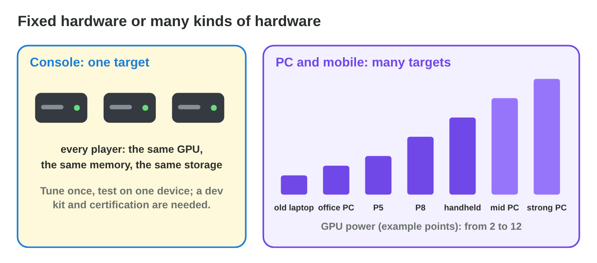
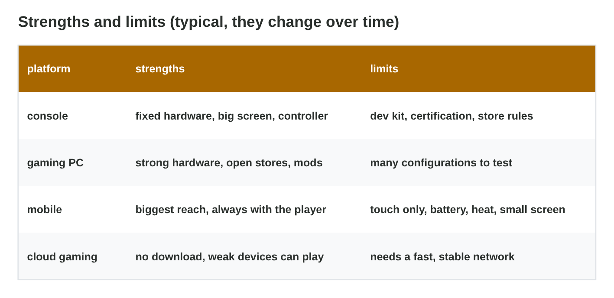
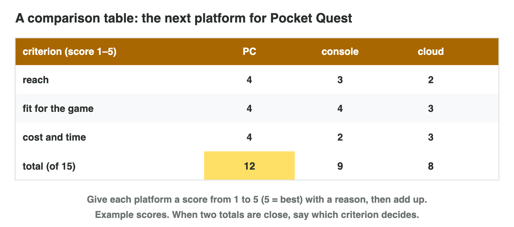

::: {.lead}
*Pocket Quest* is a success on Android and iOS phones. Now the players ask
for more: "Can I race on my PC?", "Is there a console version?", "My friend
plays games on a TV stick through the cloud, can I race with them?". Before
Byte Bay spends money on a new version, the team must know what each
platform can do and what it costs to make a game for it. In lecture 8 you
compared Android and iOS, and in lecture 11 you saw the cloud. In this
lesson you compare the four big kinds of **gaming platforms**: consoles,
gaming PCs, mobile devices and cloud gaming. Every section ends with a
short task.
:::

## Key terms



## 12.1 Consoles and gaming PCs

A **gaming platform** is more than a device: it is the hardware, the
operating system, the store and the rules that come with them
(@fig-platforms). Consoles and PCs both run big games, but they differ in
**how much the hardware differs between players** (@fig-hardware).

::: {.callout-important title="Definition 12.1 — Gaming platform; fixed and varied hardware"}
A **gaming platform** is the hardware and software on which players play a
game, with its store and its rules. The four big kinds are game consoles,
gaming PCs, mobile devices and cloud gaming.

- A **console** has **fixed hardware**: every player has the same CPU, GPU
  and memory. A studio needs a **dev kit** from the platform maker and must
  pass **certification** before release.
- A **gaming PC** has **varied hardware**, from old laptops to strong
  desktops. The game needs **graphics settings** (low, medium, high) and
  published **system requirements** (minimum and recommended).
:::

{#fig-platforms width=94%}

{#fig-hardware width=94%}

::: {.callout-note title="Example 12.1 — Where Pocket Quest could run"}
1. Today: Android and iOS phones, from the cheap P5 to the strong P8.
2. A **PC** version for players who want a bigger screen and a keyboard.
3. A **console** version for players who race on the sofa with a
   controller.
4. A **cloud gaming** version for players with a weak device and a fast
   network.
:::

::: {.callout-note title="Example 12.2 — Two ways to make a game run well"}
1. **Console:** the team tunes the game once for the console GPU: high
   settings at 60 fps. Every player sees the same.
2. Before release, the console version goes to **certification**: the
   platform maker checks, for example, that the game pauses when the
   console goes to sleep.
3. **PC:** the team adds a settings menu. An old laptop runs the game on
   low, a strong PC on high. The store page lists the minimum and
   recommended requirements.
:::



::: {.callout-warning title="Common mistake"}
"Consoles are always stronger than PCs." A new console is stronger than
most old laptops, but a strong gaming PC can be stronger than a console.
The console's strength is that **all** players have the same hardware.
:::

::: {.callout-note title="Do it · Compare two platforms"}
1. In **Platform Profiles**, compare the console and the gaming PC.
2. Write two differences that matter for Byte Bay.

*Your result:* two sentences.

::: {.check}
A good answer looks like: "The console has the same hardware for every
player, so Byte Bay tests on one device; the PC has many kinds of hardware,
so it needs settings and many tests." And: "The console needs a dev kit and
certification; the PC store is open." Check: two differences, each with
what it means for the studio.
:::
:::

## 12.2 Mobile and cloud gaming

Mobile devices reach the most players; cloud gaming lets weak devices play
big games, but every tap must travel to a server and back (@fig-cloud).

::: {.callout-important title="Definition 12.2 — Mobile and cloud gaming"}
- **Mobile:** touch screens, many devices (fragmentation), and limits of
  **battery, heat** and screen size. Players play short sessions, and most
  games are **free-to-play**: free to download, paid by purchases or ads.
  A **premium game** is paid once.
- **Cloud gaming:** the game runs on a **server with a GPU**; the player's
  device sends the inputs and shows a **video stream**. It needs
  **bandwidth** for the picture (720p about 10 Mbps, 1080p about 20 Mbps)
  and a **low delay** for the controls: the total delay is the ping plus
  about 40 ms for the stream.
:::

{#fig-cloud width=94%}

::: {.callout-note title="Example 12.3 — Which games can be streamed?"}
A player has a ping of 80 ms to the cloud server: the total delay is
80 + 40 = **120 ms** for every tap.

1. A card game or a puzzle game does not need fast reactions: 120 ms does
   not matter.
2. A racing or fighting game needs a total delay under about 80 ms: 120 ms
   is easy to feel, and the player loses.
3. So cloud gaming suits slow games best, unless the server is near the
   player.
:::





::: {.callout-warning title="Common mistake"}
"Cloud gaming needs no hardware." The player's device can be weak, but the
**network** must be fast and stable, and the provider's servers do the
work. A slow or busy home network ruins the game.
:::

::: {.callout-note title="Do it · Feel and test the delay"}
1. In **Lag Lab**, jump over 10 blocks with +0 ms and with +120 ms. Compare
   your results.
2. In **Cloud Gaming Lab**, find the bandwidth for a sharp 1080p picture
   and the highest ping that is still good for racing.

*Your result:* two results from Lag Lab and two numbers from Cloud Gaming
Lab.

::: {.check}
Lag Lab: most players clear almost all blocks with +0 ms and clearly fewer
with +120 ms: the jump starts too late. Cloud Gaming Lab: 1080p needs about
20 Mbps; for racing the total must stay at 80 ms or less, so the ping can be
at most 40 ms (40 + 40 = 80).
:::
:::

## 12.3 Strengths, limits and cross-platform games

Each platform has strengths and limits (@fig-limits). Many studios make one
game for several platforms (@fig-cross).

::: {.callout-important title="Definition 12.3 — Cross-platform games"}
A **cross-platform** game is built from one code base, usually in a game
engine, for several platforms. Still, each build needs work:

- **Porting:** adapting the game to a new platform (controls, menus,
  settings, store rules).
- **Cross-play:** players on different platforms play in the same match.
- **Cross-save:** the player's progress is shared between platforms through
  one account.
:::

{#fig-limits width=94%}

{#fig-cross width=94%}

::: {.callout-note title="Example 12.4 — Star Garden on a console"}
1. **Porting:** touch becomes the controller; the menus get bigger, because
   the TV is far from the sofa.
2. **Cross-save:** a player logs in with the same account and continues in
   garden 5 on the console.
3. **Cross-play** is not needed: Star Garden has no live matches.
:::

::: {.callout-warning title="Common mistake"}
"The engine exports to every platform, so the port is free." The export is
only the start: controls, menus, performance on the weakest device, store
rules and testing take most of the time.
:::

::: {.callout-note title="Do it · Strength and limit"}
For each of the four kinds of platforms, write one strength and one limit
for *Pocket Quest*.

*Your result:* a small table with four rows.

::: {.check}
A good table: console: the same hardware for all, a big screen / a dev kit
and certification. Gaming PC: strong hardware, open stores / many
configurations to test. Mobile: the most players, short races fit / battery,
heat, small touch screen. Cloud: no download, weak devices can play / needs
a fast network with a low ping.
:::
:::

## 12.4 Comparing platforms with three criteria

The managers have money for **one** new platform this year. Opinions are
not enough: a fair comparison starts with criteria chosen before the
scores (@fig-criteria).

::: {.callout-important title="Definition 12.4 — A comparison with three criteria"}
1. Choose the three **criteria** that matter most for the game, for example
   **reach** (how many players), **fit for the game** (controls, screen,
   session length) and **cost and time** (dev kits, porting, store rules).
   Others are performance, testing and the business model.
2. Give each platform a **score** from 1 to 5 (5 = best) for each
   criterion, with a reason or a reliable source.
3. Add up. If two totals are close, say which criterion decides.
:::

{#fig-criteria width=94%}

{#fig-table width=94%}

::: {.callout-note title="Example 12.5 — The next platform for Pocket Quest"}
1. Reach: PC 4, console 3, cloud 2 (most of its players have a PC or a
   phone).
2. Fit: PC 4, console 4, cloud 3 (a racing game needs a low delay).
3. Cost and time: PC 4, console 2 (dev kit and certification), cloud 3.
4. Totals: **PC 12**, console 9, cloud 8: the PC comes first.
:::

::: {.callout-warning title="Common mistake"}
Choosing the criteria after looking at the platforms, so that the favourite
wins. Write the criteria first, then score.
:::

::: {.callout-note title="Do it · Your table"}
Choose a game you know. Make a table with three criteria and three
platforms. Give each score a reason, and add up.

*Your result:* a table with scores, reasons and totals.

::: {.check}
A good table looks like the one for Pocket Quest: three criteria chosen for
this game (for example reach, fit for the game, cost and time), a score
from 1 to 5 with a short reason in every cell, and the totals. If two totals
are close, one sentence says which criterion decides.
:::
:::

## Case study: Platform Match

Byte Bay's team reads six notes: a platform with the same GPU for every
player, a dev kit and certification; players with anything from an old
laptop to a strong desktop; touch controls, battery limits and short
sessions; a TV stick that plays big games through a video stream; a PC
player and a console player who want to race together; and the work of
adapting the mobile version for the PC. The Game challenge of the
interactive lesson uses these notes. In the mini-game below you match each
note with the platform or the word that fits.



## Further reading

Unity Documentation, "Platform-specific settings"; the developer pages of
the console makers (for example "Developing games for Xbox" and "PlayStation
Partners"). Check the date on each page: platforms change every year.

## Exercises

1. What is a gaming platform?
2. Why can a studio test a console game on few devices?
3. What are a dev kit and certification?
4. Why does a PC game need graphics settings?
5. What is the difference between free-to-play and premium?
6. Which two things does cloud gaming need from the network?
7. The ping is 80 ms. What is the total delay of cloud gaming, and is it
   good for racing?
8. What are porting, cross-play and cross-save?
9. Why choose the criteria before giving the scores?
10. PC 12, console 11. What do you say about this result?

## Answers to the exercises

::: {.answers}
1. The hardware and software on which players play, with its store and
   rules.
2. All players have the same hardware.
3. A dev kit is the special kit of the platform maker for making games;
   certification is the maker's check before release.
4. PCs have very different hardware; each player chooses what runs well.
5. Free-to-play is free to download and paid by purchases or ads; premium
   is paid once.
6. Bandwidth for the picture and a low ping for the controls.
7. 80 + 40 = 120 ms: too slow for racing (under about 80 ms is needed).
8. Adapting a game to a new platform; playing together across platforms;
   sharing the progress through one account.
9. So that the favourite does not win only because the criteria fit it.
10. The totals are close: say which criterion decides.
:::
