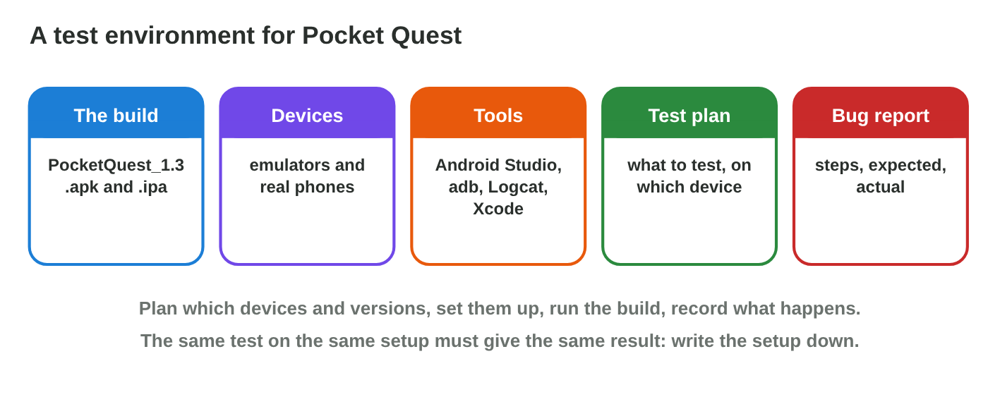
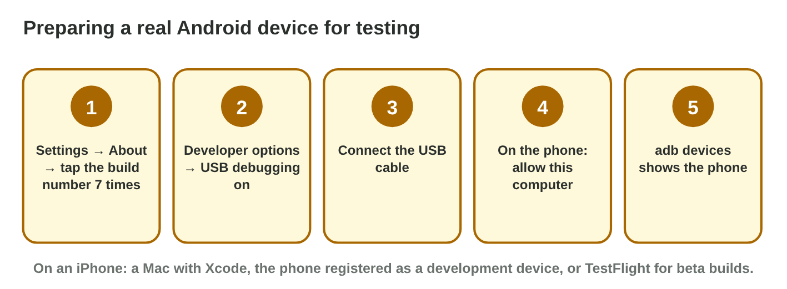

## Keywords



## 25.1 What is a test environment?

:::: {.columns}
::: {.column width="50%"}
- A test environment has a build, devices, tools and a test plan.
- A bug report lets others repeat what happened.
- We write down the build and the OS version of every device.
- **Do it:** Write the test setup for one game on your phone. Which OS version is it?
:::
::: {.column width="50%"}

:::
::::

## Try it 1 · The parts

a) Which part is "PocketQuest_1.3, build 42"?
b) Which part says which test runs on which device?
c) Why is "it works on my phone" not a test result?

::: {.answer}
a) the build
b) the test plan
c) Nobody knows the device, the OS or the build.
:::

## 25.2 Emulators and simulators

:::: {.columns}
::: {.column width="50%"}
- An emulator runs the real app on a copied device.
- An AVD joins a device profile and a system image.
- The iOS Simulator runs only on a Mac.
- **Do it:** Create the P5 twin in AVD Builder. Which system image does it need?
:::
::: {.column width="50%"}

:::
::::

## Live demo · AVD Builder



## Example · The P5 twin

Rami wants to test Pocket Quest on a copy of the P5 and on Android 8.
**Which AVDs does Rami create?**

::: {.reveal}
1. The **P5 twin**: 720 × 1600, 4 GB and Android 11 (API 30).
2. The **oldest phone**: the same profile with API 26, and a **tablet** with API 33.
3. The emulator needs **virtualization** in the BIOS to run fast.
:::

## Try it 2 · Emulators

a) Which part of an AVD sets the Android version?
b) On which computer does the iOS Simulator run?
c) Which two things can an emulator not test well?

::: {.answer}
a) the system image
b) a Mac with Xcode
c) for example heat and battery
:::

## 25.3 Real devices

:::: {.columns}
::: {.column width="50%"}
- We show developer options by tapping the build number seven times.
- USB debugging lets the computer install the build.
- An iPhone needs a Mac with Xcode or TestFlight.
- **Do it:** Find the USB debugging switch on an Android phone. Where is it?
:::
::: {.column width="50%"}

:::
::::

## Example · The P5 on the cable

Rami connects the P5 and runs adb devices.
**What happens, and what does the real phone show?**

::: {.reveal}
1. The P5 is **unauthorized** until Rami taps "Allow" on the phone.
2. Then adb devices shows **device**, and Rami installs the build.
3. After 20 minutes the P5 is hot and drops to **41 fps**, which the emulator never showed.
:::

## 25.4 A device matrix

:::: {.columns}
::: {.column width="50%"}
- The matrix covers the oldest and newest OS versions.
- It includes the weakest device and the main screen sizes.
- It covers both platforms with real devices where needed.
- **Do it:** Cover every row in Matrix Builder for $300. What did you choose?
:::
::: {.column width="50%"}

:::
::::

## Live demo · Matrix Builder



## Game challenge · Emulator or Real?



## Try it 3 · The matrix (harder)

a) Which free setup tests the start on Android 8?
b) Which setup tests the gyroscope for tilt steering?
c) Why must the weakest supported device be a real phone?

::: {.answer}
a) an AVD with API 26
b) a real phone
c) Only a real phone shows its real speed and heat.
:::

## Summary

- A test environment has a build, devices, tools, a plan and reports.
- Emulators test many versions and sizes for free.
- Real devices show the speed, heat, battery and sensors.
- Developer options and USB debugging prepare an Android phone.
- A device matrix covers versions, sizes, platforms and the weakest device.
