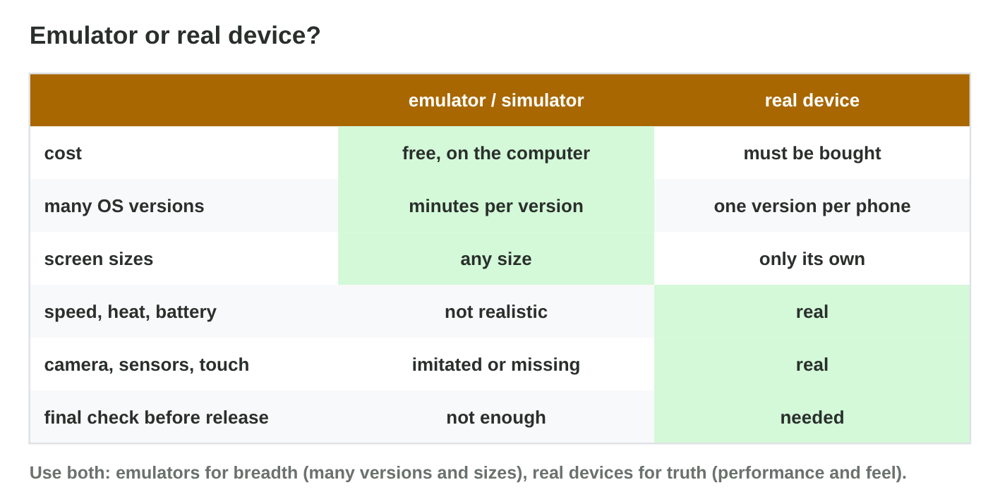

This page is the interactive version of the lesson notes (PDF). Each section
has a short summary, a picture, a **Do it** task and one set of questions.
The full explanations, examples and exercises are in the notes.

## Key terms



## 25.1 What is a test environment?

- **The build** (exact version), **the devices** (with OS versions),
  **the tools**, **the test plan**, **the bug report**.
- Write the setup down, so that others can repeat the test.

{width=94%}

::: {.callout-warning title="Watch out!"}
"It works on my phone" is not a test result.
:::

::: {.callout-note title="Do it · Your test setup"}
For a game on your phone: the version, the device, the OS version, two
tests.
:::

::: {.callout-tip title="Try it 1 · The parts"}
Choose the part of the test environment.

::: {.match extra="the logo|the price"}
PocketQuest_1.3, build 42
:   the build

the P5 with Android 11
:   a test device

Android Studio, adb, Logcat
:   the tools

which test runs on which device
:   the test plan
:::
:::

## 25.2 Emulators and simulators

- **Emulator:** copies the device; the real app runs. **AVD** = device
  profile + **system image**.
- **iOS Simulator:** in Xcode, on a Mac only; imitates iOS.
- Good for versions and sizes; **not** for speed, heat, battery, sensors.

{width=94%}

{width=94%}



::: {.callout-warning title="Watch out!"}
60 fps in the emulator says nothing about the P5.
:::

::: {.callout-note title="Do it · Build three AVDs"}
In **AVD Builder**, create the P5 twin, the oldest supported phone and the
tablet.
:::

::: {.callout-tip title="Try it 2 · AVDs"}
Use AVD Builder. Choose the right answer.

::: {.match extra="a cable|a USB stick"}
screen size and RAM of an AVD
:   the device profile

the Android version of an AVD
:   the system image

Android 8
:   API 26

the setting that makes the emulator smooth
:   hardware graphics
:::
:::

## 25.3 Real devices

- Android: **developer options** (tap the build number 7 times) → **USB
  debugging** → cable → allow → `adb devices`.
- iPhone: a Mac with Xcode, or TestFlight.
- **Device farm:** rented real phones in the cloud.

{width=94%}

::: {.callout-warning title="Watch out!"}
Switch USB debugging off after testing.
:::

::: {.callout-note title="Do it · Prepare a phone"}
Find the build number, developer options and USB debugging on an Android
phone; the iOS version on an iPhone.
:::

::: {.callout-tip title="Try it 3 · Real devices"}
Choose the right answer.

::: {.match extra="restart the router|buy a new phone"}
how to show developer options
:   tap the build number 7 times

adb devices shows "unauthorized"
:   allow the computer on the phone

testing an iPhone build
:   a Mac with Xcode, or TestFlight

15 real phones for a few hours
:   a device farm
:::
:::

## 25.4 Choosing a device matrix

- Cover the **oldest and newest OS**, the **weakest device** (real), the
  **screen sizes**, **both platforms**.
- Emulators for breadth, real devices for truth, a device farm for the
  final check.

{width=94%}



::: {.callout-warning title="Watch out!"}
Do not test only on the newest phone of the team.
:::

::: {.callout-note title="Do it · Your matrix"}
In **Matrix Builder**, cover every row for $300 or less; then write a
five-row matrix for a game you know.
:::

::: {.callout-tip title="Try it 4 · The matrix"}
Use Matrix Builder. Choose the right answer.

::: {.match extra="$1,050|the newest phone only"}
the free way to test Android 8
:   an AVD with API 26

the row only a real phone covers
:   speed, heat and touch

a real iPhone for $60
:   10 hours on a device farm

the cost of the $300 solution in the lab
:   $210
:::
:::

## Game challenge: Emulator or Real? {.challenge}

Work alone. Use every section of today.

Six tests: **six screen sizes**, **heat** on the P5, **Android 8**, the
**iPhone menu** without an iPhone, **15 real phones**, and **tilt
steering**.



::: {.callout-tip title="Try it 5 · The tests"}
Choose the best environment.

::: {.match extra="a printer|a router"}
the menu on six screen sizes
:   an Android emulator

heat after a 20-minute race
:   a real phone

the iPhone menu, no iPhone today
:   the iOS Simulator on a Mac

the gyroscope for tilt steering
:   a real phone
:::
:::

## Summary {.summary}

- A test environment: build, devices, tools, test plan, bug report.
- Emulators (AVDs) and the iOS Simulator: many versions and sizes, free.
- Real devices: speed, heat, battery, sensors and touch.
- Prepare Android phones with developer options and USB debugging.
- A device matrix covers versions, sizes, platforms and the weakest
  device.
