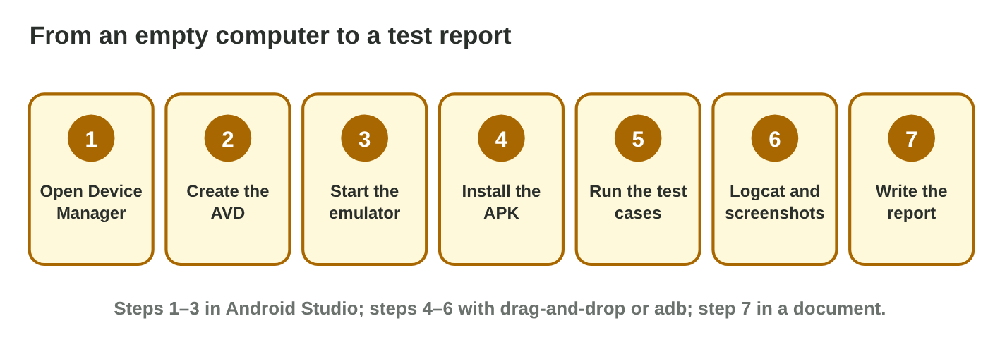
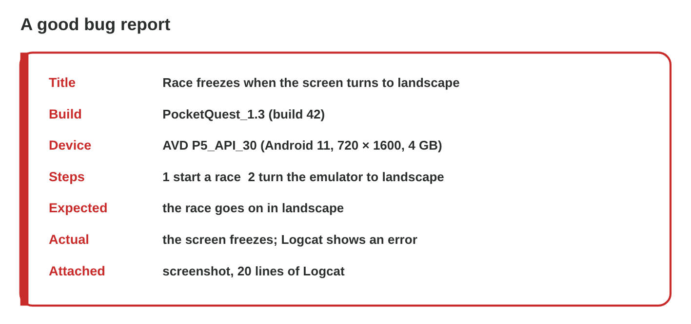

## Keywords



## 26.1 Create and start the AVD

:::: {.columns}
::: {.column width="50%"}
- We create the AVD in the Device Manager of Android Studio.
- The first cold boot is slow, and quick boots are faster.
- The command emulator -avd starts it from a terminal.
- **Do it:** Create and start P5_API_30. How long does the first boot take?
:::
::: {.column width="50%"}

:::
::::

## Example · The first boot in the lab

Rami prepares the lab computers for the seminar.
**What happens before the home screen appears?**

::: {.reveal}
1. Rami creates **P5_API_30** with 720 × 1600, 4 GB and Android 11.
2. The **system image** of about 1 GB is downloaded before the seminar.
3. The first boot takes **18 seconds**, then Android 11 starts.
:::

## 26.2 Install the build

:::: {.columns}
::: {.column width="50%"}
- We drag the APK onto the emulator, or we use adb install.
- The command adb devices must list the emulator first.
- The command adb uninstall removes the app again.
- **Do it:** Install the build in both ways. What does adb devices print?
:::
::: {.column width="50%"}

:::
::::

## Live demo · Emulator Lab



## Try it 1 · Installing

a) What does "adb: no devices/emulators found" mean?
b) What does adb print after a good install?
c) Which command shows the system log?

::: {.answer}
a) No emulator or phone is connected.
b) Success
c) adb logcat
:::

## 26.3 Run the tests and collect evidence

:::: {.columns}
::: {.column width="50%"}
- We follow the test plan in order and mark pass or fail.
- The extended controls change rotation, battery and network.
- We keep a screenshot and the log lines of the error.
- **Do it:** Run test case 7 and read the log. Which line shows the error?
:::
::: {.column width="50%"}

:::
::::

## Example · Test case 7

A student starts a race and turns the emulator to landscape.
**What happens, and what is the evidence?**

::: {.reveal}
1. The race **freezes**, and Android says the app is not responding.
2. Logcat shows a **NullReferenceException** in RaceHud.cs at line 118.
3. The student **repeats** the steps and saves a screenshot and 20 log lines.
:::

## 26.4 Write the bug report

:::: {.columns}
::: {.column width="50%"}
- The report gives the title, the build and the device.
- It lists the steps, the expected and the actual result.
- It attaches a screenshot and the log, with one bug per report.
- **Do it:** Write the bug report of test case 7. Which part was hardest?
:::
::: {.column width="50%"}

:::
::::

## Game challenge · Report Doctor



## Try it 2 · Reports (harder)

a) What is missing in a report that says only "looks bad"?
b) Why must the build number be in every report?
c) What do you do with a report that lists three bugs?

::: {.answer}
a) the expected and the actual result
b) A newer build may already fix the bug.
c) Split it into three reports.
:::

## Summary

- We create and start an AVD in the Device Manager.
- We install the APK by drag and drop or with adb install.
- We run the test cases and use the extended controls.
- We keep a screenshot and the Logcat lines of the error.
- A bug report lets a developer repeat the bug alone.
