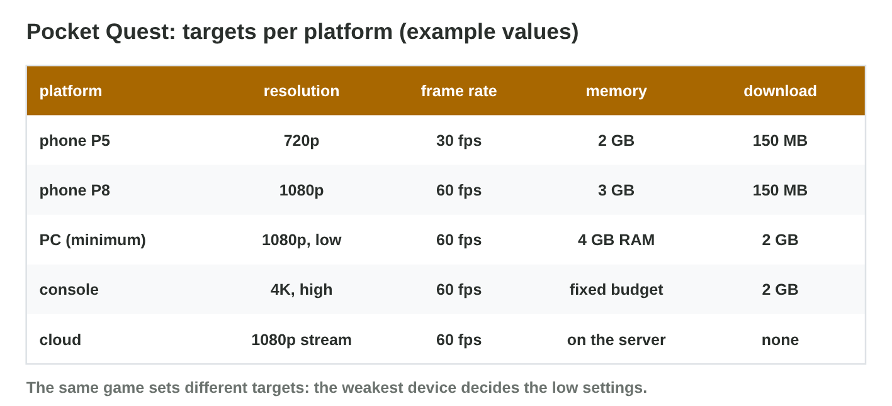
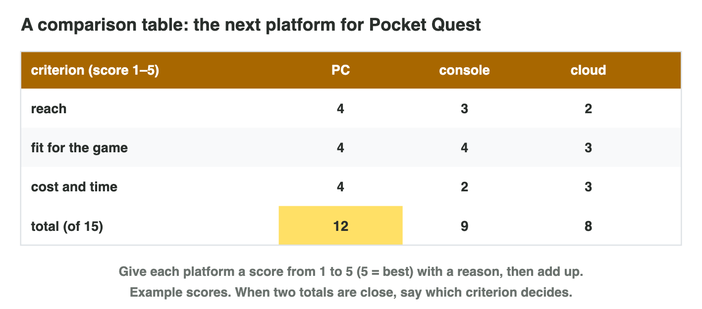

No new ideas today: two short problems on Lecture 11. Do each one alone.
Tap, sort or type your answer at every step: the page checks it at once and
tells you why.

## Recall

- A console has **fixed hardware** (dev kit, certification); a gaming PC
  has **varied hardware** (graphics settings, minimum and recommended
  requirements).
- Cloud gaming: total delay = ping + about 40 ms; racing needs under about
  80 ms. **Cross-save** keeps one progress on all platforms.
- A comparison: three criteria chosen first, scores from 1 to 5 with
  reasons, totals.

::: {.callout-tip title="Try it 1 · Recall"}
Choose the right answer.

::: {.match extra="the colour of the box|a bigger screen"}
Why does a PC game need graphics settings?
:   PC players have very different hardware

    Why: Each player chooses the setting that runs well on the PC.

What does a console studio need before release?
:   certification

    Why: The console maker checks the game before it goes on sale.

Which feature lets a player continue on a new platform with one account?
:   cross-save

    Why: Cross-save shares the progress between platforms.
:::
:::

## Activity 1 · Will it run well on four PCs?

The PC version of *Pocket Quest* must run on very different PCs. A higher
setting costs more GPU work per frame; if the memory is too small for a
setting, the game stutters. The weakest part is the **bottleneck**. The
**minimum** requirements come from the weakest supported PC at low
settings.

{width=90%}



::: {.callout-note title="Activity 1 · Four PCs · 15 min"}
1. In **Spec Check**, find the highest setting that runs at 60 fps or more
   on each of the four devices.
2. Write the minimum requirements in your own words.

*Your product:* a table of four devices and one requirement line.

::: {.sort}
Step 1: which is the highest setting at 60 fps or more on each device? Sort
the devices.

Low
:   old laptop (GPU 2, 4 GB)

    Why: Low gives 80 fps; medium is too much for its GPU.

Medium
:   office PC (GPU 4, 8 GB)

    Why: Medium gives 80 fps; high gives only 40.

High
:   handheld PC (GPU 6, 16 GB)

    Why: High gives exactly 60 fps.

Ultra
:   gaming PC (GPU 12, 16 GB)

    Why: Ultra gives 72 fps.
:::

::: {.choice}
Step 2: what are the minimum requirements?

- [x] a GPU of 2 points and 4 GB of RAM, for low at 60 fps

  Why: The minimum comes from the weakest supported PC at low settings.

- [ ] a GPU of 12 points and 16 GB of RAM

  Why: That is the gaming PC: it fits ultra, not the minimum.

- [ ] a GPU of 4 points and 8 GB of RAM

  Why: The old laptop with less also runs the game at low.
:::
:::

::: {.callout-tip title="Try it 2 · Specs"}
Use Spec Check (example points). Choose the right answer.

::: {.match extra="ultra|the RAM"}
What is the best 60 fps setting on the old laptop?
:   low

    Why: Medium needs 6 GB of RAM; the laptop has 4 GB.

What is the frame rate of the office PC on high?
:   40 fps

    Why: High needs 6 points for 60 fps; the office PC has 4.

What is the bottleneck of the office PC on high?
:   the GPU

    Why: Its 8 GB of RAM are enough; the GPU is too weak.
:::
:::

## Activity 2 · Three platforms for Star Garden

The two friends of *Star Garden*, a calm puzzle game with short sessions
and no live matches, want **one** new platform: PC, console or cloud
gaming. They have one Windows laptop and little money. Most of their
players use phones or PCs. They compare with three criteria: **reach**,
**fit for the game**, **cost and time**.

{width=90%}

::: {.callout-note title="Activity 2 · The table and the advice · 15 min"}
1. Make the table: three criteria, three platforms, a score from 1 to 5
   with a reason in every cell, and the totals.
2. Write one sentence of advice: which platform first, and why.

*Your product:* a table with scores, reasons and totals, and one sentence.

::: {.fill answer="13" hint="Add the three scores of the PC."}
Step 1: the model table gives the PC 4 for reach, 4 for fit and 5 for cost
and time. What is its total?

Why: 4 + 4 + 5 = 13; the console gets 6 and the cloud 10.
:::

::: {.choice}
Step 2: which advice fits the table?

- [x] "Port Star Garden to the PC first: the laptop already builds it, and many players have a PC."

  Why: The PC has the highest total, and the advice gives the reasons of its scores.

- [ ] "Port it to the console first: it has the biggest screen."

  Why: The console has 6 points: the dev kit and the certification cost too much.

- [ ] "Port it to the cloud first: the delay does not matter."

  Why: The cloud fits the game, but few players use it: 10 points.
:::
:::

::: {.callout-tip title="Try it 3 · The comparison"}
Choose the right answer.

::: {.match extra="the console|the favourite of the team"}
Why does the console get 1 for cost and time?
:   a dev kit and certification cost money and time

    Why: Console studios need both before release.

Why does cloud gaming fit Star Garden well?
:   a calm puzzle game does not mind the delay

    Why: The delay of the stream matters only for fast games.

PC 13, cloud 10, console 6. Which platform comes first?
:   the PC

    Why: It has the highest total.

Cloud players have a ping of 70 ms. What is their total delay?
:   about 110 ms

    Why: 70 + about 40 for the stream = about 110 ms.
:::
:::

## Wrap-up {.summary}

- You can find the best setting of a game on four PCs and write its
  minimum requirements.
- You can compare three platforms for one game with three criteria, scores
  and reasons.
