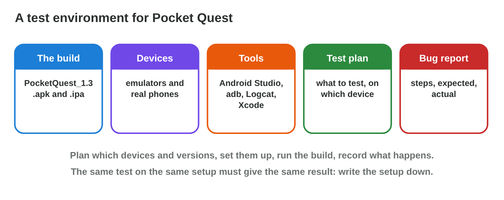
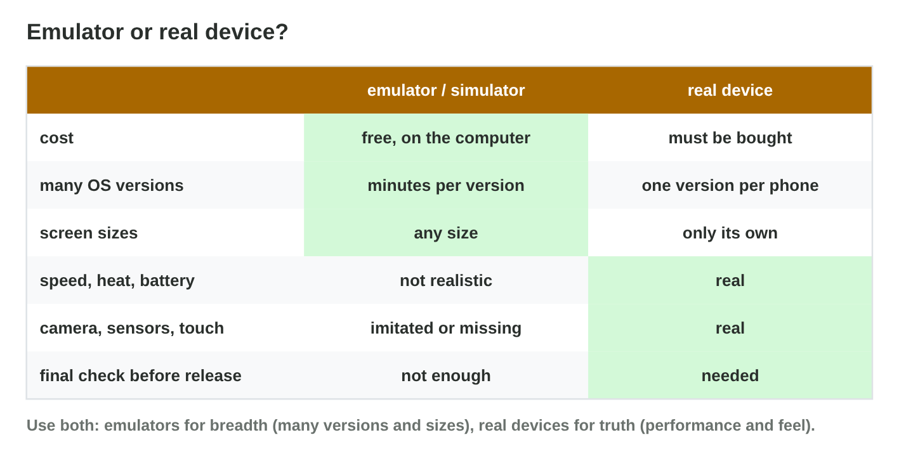
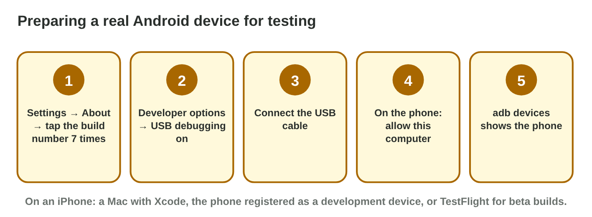
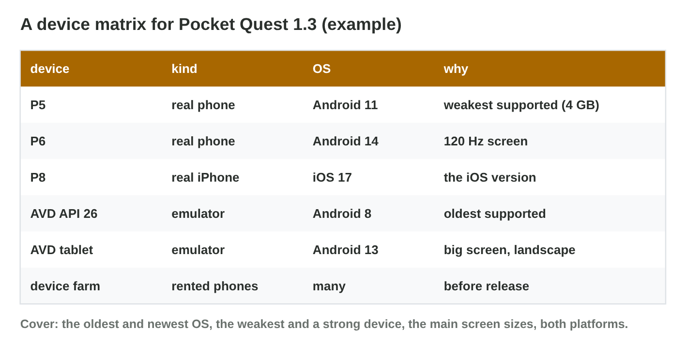

This page is the interactive version of the lesson notes (PDF). Each section
starts with a problem of a tester. Then it explains the idea behind it. It
ends with a **Do it** task and one set of questions. Tap, sort or type your
answer: the page checks it at once and tells you why.

## Key terms



## 12.1 What is a test environment?

- **The build** (one exact version), **the devices** (with their OS
  versions), **the tools** (Android Studio, adb, Logcat; Xcode), **the test
  plan**, **the bug report**.
- Write the setup down, so that others can repeat the test.
- Star Garden 2.0, build 17: a tablet emulator, an emulator with Android 9,
  the team's phone for the reminders, the iOS Simulator on a Mac.

{width=90%}

::: {.callout-warning title="Watch out!"}
"It works on my phone" is not a test result: name the build, the device and
the OS version.
:::

::: {.callout-note title="Do it · Your test setup"}
Write the test environment for one game on your phone: the build (the
version in the store), the device, the OS version, and two tests.

::: {.sort}
Which part of a test environment is each line? Sort them.

The build
:   version 3.2.1, from the store page

    Why: The exact version that was tested.

The device
:   Samsung A35

    Why: The phone the test ran on.

The OS version
:   Android 14

    Why: A bug may appear on one version only.

A test
:   the first level on mobile data

    Why: A step that someone else can repeat.

:   the settings menu in landscape

    Why: A second test, just as exact.
:::

::: {.choice}
Which one is a test result that someone else can repeat?

- [x] "Build 3.2.1, Samsung A35, Android 14: the first level fails on mobile data."

  Why: It names the build, the device, the OS version and the test.

- [ ] "It works on my phone."

  Why: No build, no device, no OS version: nobody can repeat it.

- [ ] "The game is slow sometimes."

  Why: No setup and no exact steps.
:::
:::

::: {.callout-tip title="Try it 1 · The parts"}
Choose the part of the test environment.

::: {.match extra="the logo|the price"}
PocketQuest_1.3, build 42.
:   the build

    Why: The build is one exact version of the game.

The P5 with Android 11.
:   a test device

    Why: A device with a known OS version.

Android Studio, adb, Logcat.
:   the tools

    Why: The tools build, install and read the log.

Which test runs on which device.
:   the test plan

    Why: The plan connects tests and devices.
:::
:::

## 12.2 Emulators and simulators

- **Emulator:** copies the device; the real app runs. **AVD** = a device
  profile (screen, RAM) + a **system image** (Android version, for example
  API 30).
- **iOS Simulator:** in Xcode, on a Mac only; imitates iOS.
- Good for versions and sizes; **not** for speed, heat, battery, sensors.
- The P5 twin: 720 × 1600, 4 GB, API 30. The oldest supported: API 26
  (Android 8). A tablet: API 33.
- The emulator needs **virtualization** on in the BIOS.

{width=90%}



::: {.callout-warning title="Watch out!"}
60 fps in the emulator does not mean 60 fps on the phone: the computer is
much stronger.
:::

::: {.callout-note title="Do it · Build three AVDs"}
In **AVD Builder**, create the P5 twin (720 × 1600, 4 GB, API 30), the
oldest supported phone (API 26, Android 8) and a tablet (API 33).

::: {.sort}
What can the AVDs test, and what needs a real phone? Sort them.

An AVD can test it
:   the layout and the menus of the P5

    Why: The twin has the same screen size and memory.

:   whether the game starts on Android 8

    Why: The API 26 AVD runs the oldest supported version.

:   the tablet layout

    Why: The tablet AVD has the size of a tablet.

Only a real phone
:   the heat after a long race

    Why: An emulator does not get hot.

:   the battery

    Why: An emulator has no real battery.

:   the real speed of the P5

    Why: The computer is much stronger than the phone.
:::
:::

::: {.callout-tip title="Try it 2 · AVDs"}
Use AVD Builder. Choose the right answer.

::: {.match extra="a cable|a USB stick"}
The screen size and the RAM of an AVD.
:   the device profile

    Why: The profile says which device the AVD copies.

The Android version of an AVD.
:   the system image

    Why: One system image is one Android version.

Android 8 as a system image.
:   API 26

    Why: Each Android version has an API level; Android 8 is API 26.

What must be on in the BIOS for a fast emulator?
:   virtualization

    Why: The processor helps to run the virtual device.
:::
:::

## 12.3 Real devices

- Android: **developer options** (tap the build number 7 times) → **USB
  debugging** → cable → allow the computer → `adb devices` → `adb install`.
- iPhone: a Mac with Xcode, or a beta build through TestFlight.
- **Device farm:** real phones in the cloud, rented by the hour.
- Only a real phone shows the heat of a long race, the battery and the
  sensors.

{width=90%}

::: {.callout-warning title="Watch out!"}
Switch USB debugging off on a personal phone after testing, and install
builds only from your studio.
:::

::: {.callout-note title="Do it · Prepare a phone"}
On an Android phone, find the build number, switch on developer options and
find USB debugging. Change nothing else. On an iPhone, find the iOS version
(Settings › General › About).

::: {.order}
Put the steps on the Android phone in order.

1. Settings › About phone (› Software information) › Build number
2. Tap the build number seven times: "You are now a developer".
3. Settings › System › Developer options › USB debugging
4. Connect the cable and allow the computer.

Why: Developer options appear only after the seven taps; then the computer can use adb.
:::

::: {.choice}
The test on a personal phone is over. What do you do?

- [x] Switch USB debugging and developer options off again.

  Why: A personal phone stays safer without them; install builds only from your studio.

- [ ] Leave them on for next time.

  Why: Switch them off after testing on a personal phone.

- [ ] Install builds from any website to test more.

  Why: Install builds only from your studio.
:::
:::

::: {.callout-tip title="Try it 3 · Real devices"}
Choose the right answer.

::: {.match extra="restart the router|buy a new phone"}
How do you show the developer options?
:   tap the build number 7 times

    Why: It is in About phone.

adb devices shows "unauthorized". What do you do?
:   allow the computer on the phone

    Why: The phone has not trusted this computer yet.

How do you test an iPhone build?
:   a Mac with Xcode, or TestFlight

    Why: iPhones get test builds only these ways.

15 real phones for a few hours?
:   a device farm

    Why: A device farm rents real phones in the cloud.
:::
:::

## 12.4 Choosing a device matrix

- Cover the **oldest and newest OS**, the **weakest device** (real), the
  main **screen sizes**, **both platforms**, and real devices for speed,
  heat, battery and sensors.
- Emulators for breadth, real devices for truth, a device farm for the
  final check.

{width=90%}



::: {.callout-warning title="Watch out!"}
Do not test only on the newest phone of the team: most players have weaker
devices.
:::

::: {.callout-note title="Do it · Your matrix"}
In **Matrix Builder**, cover every row for $300 or less. Then write a
five-row matrix for a game you know: device, kind, OS, why.

::: {.choice}
Which choice covers every row for $300 or less?

- [x] the free AVDs (API 26, API 34, tablet), the real P5 and a few device-farm hours

  Why: Emulators for breadth, the real P5 for the truth, the farm for the iOS rows.

- [ ] five new phones

  Why: Buying phones costs far more than $300.

- [ ] only the newest phone of the team

  Why: Most players have weaker devices, and the iOS rows are missing.
:::

::: {.sort}
Emulators, real devices or a device farm? Sort the jobs.

Emulators: breadth
:   many OS versions and screen sizes

    Why: Free and fast to create.

:   the oldest supported Android

    Why: An AVD with API 26 shows if the game starts.

Real devices: truth
:   the heat, the battery and the sensors

    Why: Only a real phone shows them.

A device farm: the final check
:   real phones in the cloud, rented by the hour

    Why: Real devices without buying them.
:::
:::

::: {.callout-tip title="Try it 4 · The matrix"}
Use Matrix Builder. Choose the right answer.

::: {.match extra="the newest phone only|a printer"}
The free way to test Android 8?
:   an AVD with API 26

    Why: A system image for each version is free.

Which row can only a real phone cover?
:   speed, heat and touch

    Why: An emulator runs on the computer's power.

Real iPhones and tablets without buying them?
:   a device farm

    Why: The team rents real devices by the hour.

Why test on the weakest supported phone?
:   it sets the minimum requirements

    Why: If it runs there, it runs for all supported players.
:::
:::

## Game challenge: Emulator or Real? {.challenge}

Work alone. Use every section of today.

Rami's test plan for **Pocket Quest 1.3** has **six tests**: the menu on
**six screen sizes**, **heat** on the P5 after **20 minutes**, the start on
**Android 8**, the new menu on **iPhone screens** with no iPhone at hand, a
final check on **15 real phones**, and tilt steering with the
**gyroscope**.



::: {.callout-tip title="Try it 5 · The tests"}
Choose the best environment. You can use an answer more than once.

::: {.match extra="a printer|a router"}
The menu on six screen sizes.
:   Android emulators

    Why: AVDs give any screen size for free.

Heat after a 20-minute race.
:   a real phone

    Why: An emulator does not heat up like a phone.

The iPhone menu, with no iPhone today.
:   the iOS Simulator on a Mac

    Why: The Simulator shows iPhone screens.

Tilt steering with the gyroscope.
:   a real phone

    Why: Emulators do not have real sensors.
:::
:::

::: {.callout-tip title="Try it 6 · Plan and setup (harder)"}
Choose the right answer.

::: {.match extra="the newest phone|the P8 only"}
The start on Android 8, with no Android 8 phone.
:   an AVD with API 26

    Why: A system image gives any Android version.

A final check on 15 real phones.
:   a device farm

    Why: Rented real phones cover many models.

What must Rami write next to every test result?
:   the build, the device and the OS version

    Why: Then others can repeat the test.
:::
:::

## Summary {.summary}

- A test environment: build, devices, tools, test plan, bug report.
- Emulators (AVDs) and the iOS Simulator: many versions and sizes, free.
- Real devices: speed, heat, battery, sensors and touch.
- Prepare Android phones with developer options and USB debugging.
- A device matrix covers versions, sizes, platforms and the weakest device.
