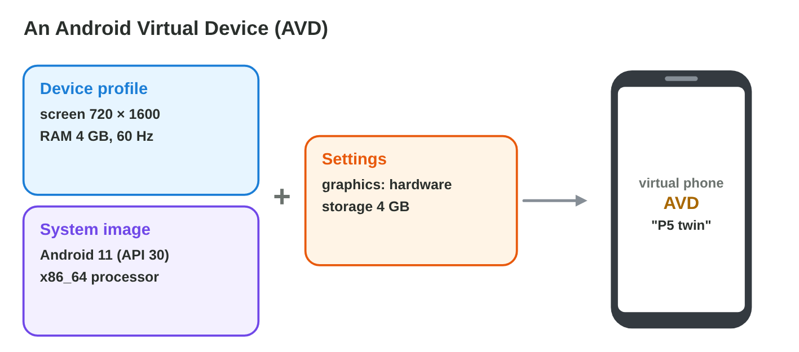
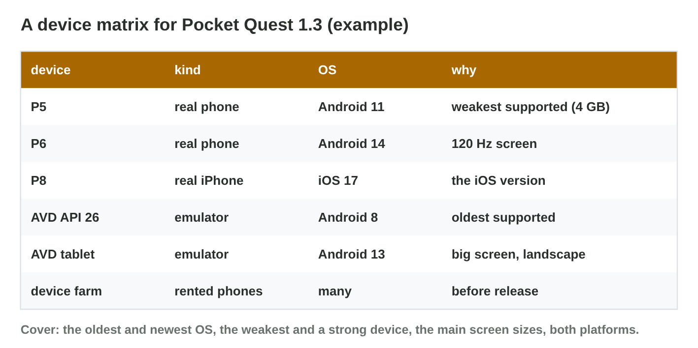

::: {.lead}
*Pocket Quest 1.3* is almost ready: a new tablet layout, a tilt steering
option and support for Android 8. Rami, the tester of Byte Bay, has only
two phones on the desk: the P5 (Android, 4 GB) and the P8 (an iPhone). How
can Rami test six screen sizes, five Android versions, a tablet, the heat of
a long race and the gyroscope, without buying twenty phones? In lectures 7
and 8 you met the mobile operating systems and the tools of each platform.
In this lesson you set up a **test environment**: **emulators** for many
versions and sizes, **real devices** for speed, heat and sensors, and a
**device matrix** that says which test runs where. Every section ends with
a short task.
:::

## Key terms



## 13.1 What is a test environment?

A test is only useful if somebody else can repeat it on the same setup
(@fig-env).

::: {.callout-important title="Definition 13.1 — Test environment"}
A **test environment** is everything a team needs to test a game:

- **the build:** one exact version, for example `PocketQuest_1.3` as an
  `.apk` for Android and an `.ipa` for iOS;
- **the devices:** emulators and real **test devices**, each with a known
  OS version;
- **the tools:** Android Studio, adb and Logcat (the log of the device) for
  Android; Xcode for iOS;
- **the test plan:** which test runs on which device;
- **the bug report:** what happened, written so that others can repeat it.
:::

{#fig-env width=94%}

::: {.callout-note title="Example 13.1 — A plan for Star Garden 2.0"}
1. *Build:* `StarGarden_2.0`, build 17, for Android and iOS.
2. *Tests:* the garden on a tablet screen; the start on Android 9; the
   watering reminders (notifications); the iPhone version.
3. *Environment:* a tablet emulator and an emulator with Android 9; the
   team's Android phone for the reminders; the iOS Simulator on a borrowed
   Mac.
:::

::: {.callout-warning title="Common mistake"}
"It works on my phone." Without the build number, the device and the OS
version, nobody can repeat the test or know which players are affected.
:::

::: {.callout-note title="Do it · Your test setup"}
Write the test environment for one game on your own phone: the build (the
version number in the store), the device, the OS version, and two tests you
would run.

*Your result:* four lines.

::: {.check}
A good answer looks like: "Build: version 3.2.1 (from the store page).
Device: Samsung A35. OS: Android 14. Tests: the first level on mobile data;
the settings menu in landscape." Check: an exact version, a device, an OS
version and two tests that someone else could repeat.
:::
:::

## 13.2 Emulators and simulators

An emulator brings many devices into one computer (@fig-evr).

::: {.callout-important title="Definition 13.2 — Emulator and simulator"}
- An **emulator** copies the hardware and the operating system of a
  device, so the **real app** runs on the computer. The Android Emulator in
  **Android Studio** runs **Android Virtual Devices (AVDs)**: a device
  profile (screen size, RAM) plus a **system image** (one Android version,
  for example API 30) (@fig-avd).
- The **iOS Simulator** in Xcode runs only on a **Mac**. It imitates iOS
  with apps built for the Mac's processor; it does not copy the iPhone's
  hardware.
- **Strengths:** free, quick, any OS version and screen size, easy
  screenshots. **Limits:** the speed, the heat, the battery, the camera,
  the sensors and the feel of touch are not those of a real phone.
:::

{#fig-evr width=94%}

{#fig-avd width=94%}

::: {.callout-note title="Example 13.2 — The P5 twin"}
1. In the Device Manager, Rami creates an AVD with a 720 × 1600 screen,
   4 GB RAM and the system image Android 11 (API 30): the "P5 twin".
2. A second AVD uses API 26 (Android 8), the oldest version that *Pocket
   Quest* supports; a third is a tablet with API 33.
3. The emulator needs **virtualization** switched on in the computer's
   BIOS; without it, the emulator is very slow or does not start.
:::



::: {.callout-warning title="Common mistake"}
"60 fps in the emulator, so 60 fps on the P5." The emulator runs on the
computer's much stronger CPU and GPU. Performance needs a real device.
:::

::: {.callout-note title="Do it · Build three AVDs"}
1. In **AVD Builder**, create the P5 twin, the oldest supported phone and
   the tablet.
2. Write one thing each AVD can test and one thing it cannot.

*Your result:* three AVD names and six short lines.

::: {.check}
P5 twin (720 × 1600, 4 GB, API 30): the layout and the menus of the P5 /
not its speed or heat. Oldest phone (API 26): does the game start on
Android 8? / not the real speed. Tablet (API 33): the tablet layout / not
touch on a real 10-inch screen, nor the battery.
:::
:::

## 13.3 Real devices

Real devices show what players really feel: the speed, the heat of a long
race (lecture 3), the battery and the sensors (@fig-real).

::: {.callout-important title="Definition 13.3 — Preparing a real device"}
**Android:** switch on **developer options** (tap the build number seven
times in About phone), switch on **USB debugging**, connect the cable, and
allow the computer on the phone. Then `adb devices` lists the phone, and
the build can be installed with `adb install`.

**iPhone:** a Mac with Xcode and the phone registered as a development
device, or a **beta build** through TestFlight.

**Device farm:** a cloud service with many real phones that the team rents
by the hour.
:::

{#fig-real width=94%}

::: {.callout-note title="Example 13.3 — The P5 on the cable"}
1. Rami switches on USB debugging on the P5 and connects it.
2. `adb devices` shows the P5 as `unauthorized`: the phone has not
   allowed the computer yet. Rami taps "Allow" on the phone.
3. Now `adb devices` shows `device`. Rami installs the build and races for
   20 minutes: the phone gets hot and the frame rate drops. The emulator
   never showed this.
:::

::: {.callout-warning title="Common mistake"}
Leaving USB debugging on a personal phone for ever. Switch it off after
testing: any computer the phone trusts can install apps on it. Install
builds only from your studio.
:::

::: {.callout-note title="Do it · Prepare a phone"}
On an Android phone (yours or the lab's), find the build number, switch on
developer options, and find the USB debugging switch. Do not change other
developer settings. On an iPhone, find the iOS version in Settings.

*Your result:* the path to each setting and the OS version.

::: {.check}
Android: Settings › About phone › (Software information) › Build number,
tapped seven times: "You are now a developer". Then Settings › System ›
Developer options › USB debugging (on Samsung: Settings › Developer
options). iPhone: Settings › General › About › iOS version. Switch
developer options off again on a personal phone.
:::
:::

## 13.4 Choosing a device matrix

Nobody can test on every device. A **device matrix** chooses a few that
cover the most important differences (@fig-matrix).

::: {.callout-important title="Definition 13.4 — Device matrix"}
A **device matrix** is the table of test setups for one release. It should
cover:

- the **oldest** and the **newest** supported OS versions;
- the **weakest** supported device (real) and a strong one;
- the main **screen sizes** (small phone, big phone, tablet);
- **both platforms** (Android and iOS);
- real devices for speed, heat, battery and sensors.

Use emulators for breadth, real devices for truth, and a device farm for
the final check on many models.
:::

{#fig-matrix width=94%}

::: {.callout-note title="Example 13.4 — A matrix for a small budget"}
1. Free: the AVDs for API 26 and API 34, and the iOS Simulator on the
   office Mac.
2. Real: the P5, the weakest supported phone.
3. Rented: a few hours on a device farm, with real iPhones and tablets.
4. Every row of the checklist is covered, within the budget of $300.
:::



::: {.callout-warning title="Common mistake"}
Testing only on the newest, strongest phone of the team. Most players have
older, weaker devices: the minimum requirements come from the weakest
device.
:::

::: {.callout-note title="Do it · Your matrix"}
1. In **Matrix Builder**, cover every row for $300 or less.
2. Write a device matrix of five rows for a game you know: device, kind,
   OS, why.

*Your result:* a cost and a matrix.

::: {.check}
In Matrix Builder: the free AVDs (API 26, API 34, tablet), the real P5 and
a few device-farm hours cover every row for less than $300. A good matrix
of five rows has the oldest and the newest OS, the weakest real phone, a
tablet or a big screen, and an iPhone (real, farm or Simulator), each with
a reason.
:::
:::

## Case study: Emulator or Real?

Rami's test plan for *Pocket Quest 1.3* has six tests: the menu on six
screen sizes, heat on the P5 after 20 minutes, the start on Android 8, the
new menu on iPhone screens with no iPhone at hand, a final check on 15 real
phones, and tilt steering with the gyroscope. The Game challenge of the
interactive lesson uses these tests. In the mini-game below you choose the
best test environment for each one.



## Further reading

Android Developers, "Run apps on the Android Emulator" and "Run apps on a
hardware device" (developer.android.com). Apple Developer, "Running your
app in Simulator or on a device" (developer.apple.com).

## Exercises

1. Name the five parts of a test environment.
2. What is the difference between an emulator and the iOS Simulator?
3. What are the two parts of an AVD?
4. Name three things an emulator cannot test well.
5. Why does the Android Emulator need virtualization in the BIOS?
6. How do you switch on developer options on Android?
7. What does `unauthorized` in `adb devices` mean?
8. What is a device farm?
9. Name four things a device matrix should cover.
10. Why is the weakest supported device important?

## Answers to the exercises

::: {.answers}
1. The build, the devices, the tools, the test plan, the bug report.
2. The emulator copies the device's hardware and OS; the iOS Simulator only
   imitates iOS on the Mac.
3. A device profile and a system image.
4. For example speed, heat, battery, camera, sensors, the feel of touch.
5. To run the virtual device fast with the processor's help.
6. Tap the build number seven times in About phone.
7. The phone has not allowed this computer yet.
8. A cloud service with many real devices to rent for tests.
9. For example the oldest and newest OS, the weakest device, screen sizes,
   both platforms.
10. It shows whether the game runs for all supported players; it sets the
    minimum requirements.
:::
