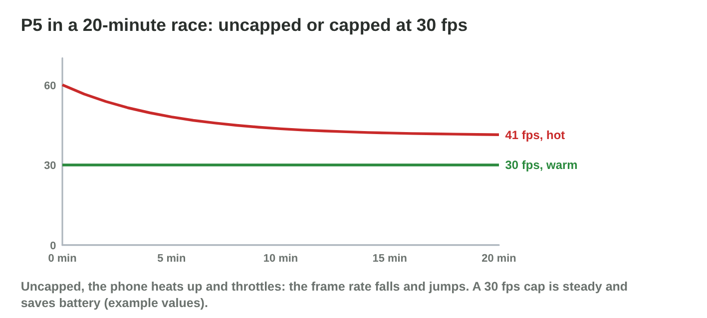
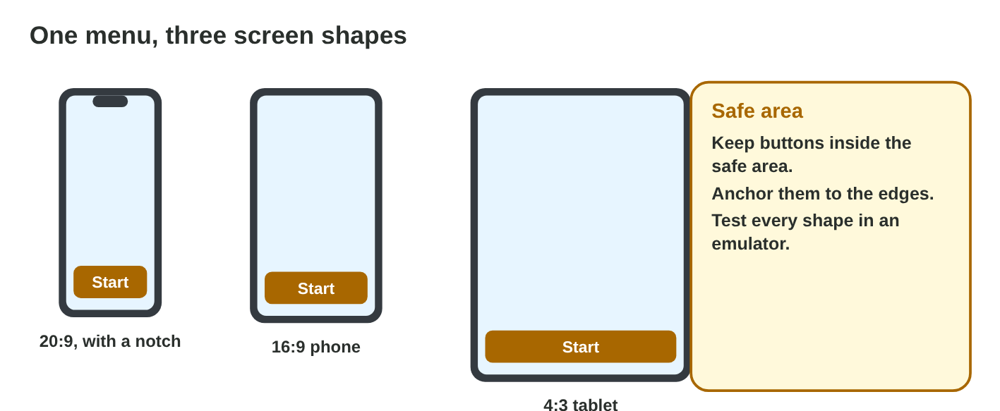

::: {.lead}
*Pocket Quest 1.3* is in the stores, and the reviews arrive: "Smooth on my
new phone!", "It jerks every few seconds", "After 15 minutes my phone is
hot and the game slows down", "It closes at once on my old phone", "The
Start button is cut off on my tablet". Some players use phones that Byte
Bay never tested, and a new OS update is coming. In lectures 25 and 26 you
set up a test environment and ran the game on an emulator. In this lesson
you study **real cases** of performance and compatibility: how to measure
smoothness, why phones slow down when they are hot, why a build fails on
some devices, and how to follow new platform versions with **reliable
sources**. Every section ends with a short task.
:::

## Key terms



## 27.1 Measuring performance

The average frame rate is not the whole story (@fig-frames).

::: {.callout-important title="Definition 27.1 — Measures of performance"}
- **Frame time:** the time of one frame in milliseconds; 60 fps ≈ 16.7 ms,
  30 fps ≈ 33.3 ms.
- **Average fps:** frames per second over a whole race.
- **1 % low:** the frame rate of the slowest 1 % of frames. A low 1 % low
  means **stutters**: single long frames that the player feels as jerks.
- **Load time, battery use and temperature** complete the picture.

Measure on real devices, with the same race each time, and write the
results down.
:::

{#fig-frames width=94%}

::: {.callout-note title="Example 27.1 — \"It jerks every few seconds\""}
1. The fps counter shows 57 fps on average: it looks fine.
2. The frame-time graph shows four frames of about 50 ms: four stutters.
3. The 1 % low is about 20 fps. The developers find that the game loads a
   new track piece in those frames, and load it earlier.
:::

::: {.callout-warning title="Common mistake"}
Reporting only the average fps. A game with a high average and many
stutters feels worse than a steady 30 fps.
:::

::: {.callout-note title="Do it · Frame times"}
Compute the frame time of 30, 60 and 120 fps. A frame takes 50 ms: what
frame rate would that be if all frames took that long?

*Your result:* four numbers.
:::

## 27.2 Case study: heat, throttling and a cap

Phones get hot under load, and a hot chip slows down (lecture 7;
@fig-thermal).

::: {.callout-important title="Definition 27.2 — Throttling and caps"}
Under a long, heavy load the phone's chip heats up. To protect itself, it
lowers its speed: **thermal throttling**. The frame rate then falls and
jumps. A **frame-rate cap** (for example 30 fps) or lower graphics
settings reduce the load: the race stays steady, the phone stays cooler,
and the battery lasts longer.
:::

{#fig-thermal width=94%}

::: {.callout-note title="Example 27.2 — Twenty minutes on the P5"}
1. High graphics, no cap: the frame rate starts at 60 and falls to about
   45; the 1 % low drops to about 25; the phone reaches 46 °C.
2. Cap 30 fps: a steady 30 fps, 42 °C, and less battery.
3. Low graphics with a 60 fps cap: a steady 60 fps on the P5 with a good
   1 % low. Byte Bay makes this the default for weak phones.
:::



::: {.callout-warning title="Common mistake"}
Testing for two minutes only. Throttling starts after several minutes;
test as long as players play.
:::

::: {.callout-note title="Do it · The long race"}
1. In **Performance Lab**, try the P5 uncapped, capped at 30, and with low
   graphics capped at 60.
2. Write which setting you would choose for the P5, and why.

*Your result:* three results and one choice.
:::

## 27.3 Case study: compatibility

A build can fail on some devices even when it runs well on others
(@fig-compat).

::: {.callout-important title="Definition 27.3 — Three causes of incompatibility"}
- **Minimum OS version:** a build made for Android 11 (API 30) cannot start
  on Android 8.
- **Graphics API:** the game talks to the GPU through a **graphics API**
  (Vulkan, OpenGL ES, Metal). An old GPU without Vulkan shows a black screen
  if the build has no other path.
- **Screen shapes:** 20:9 phones with notches, 16:9 phones and 4:3 tablets
  need anchored layouts in the **safe area** (@fig-aspect).

A **compatibility matrix** records each test device and each check.
:::

{#fig-compat width=94%}

{#fig-aspect width=94%}

::: {.callout-note title="Example 27.3 — Build 43"}
1. Minimum Android 8 (API 26): the AVD with Android 8 starts the game; the
   team must avoid newer features or check for them.
2. Vulkan + OpenGL ES 3: the old phone shows the picture; one more graphics
   path to test.
3. Menu anchored to the safe area: the tablet and the notch phone show the
   whole Start button.
:::



::: {.callout-warning title="Common mistake"}
Supporting every old device "for more players" without counting the cost.
Each older version and each graphics path adds testing; check how many
players really use them (market share, lecture 15).
:::

::: {.callout-note title="Do it · The matrix"}
In **Compatibility Lab**, make every row green. Write the cost of each
setting you changed.

*Your result:* three settings and their costs.
:::

## 27.4 Following developments with reliable sources

Platforms change every year. A tester must follow the changes
(@fig-sources).

::: {.callout-important title="Definition 27.4 — Following platform changes"}
- Read the **release notes** of new OS and engine versions: they list
  behaviour changes that can break a game.
- Prefer **reliable sources**: official documentation, release notes,
  benchmarks that explain their method, and your own written tests.
- Treat ads, forum rumours and undated posts as claims to check.
- After an update, run the test plan again on at least one updated device.
:::

{#fig-sources width=94%}

::: {.callout-note title="Example 27.4 — \"Every game 30 % faster\""}
1. A forum post claims that a new OS update makes every game 30 % faster.
2. Rami reads the official release notes: they mention a new power mode,
   no general speed-up.
3. Rami installs the update on a test phone and runs the 20-minute race:
   the same frame rate, 2 °C cooler. Rami writes the result in the test
   log, with the date.
:::

::: {.callout-warning title="Common mistake"}
Copying a number from a video into a report without its source and date.
A reliable report says where each number comes from.
:::

::: {.callout-note title="Do it · A release note"}
Find the release notes of the newest Android or iOS version on the
official developer site. Write two changes that could affect a game, with
the source and the date.

*Your result:* two changes with source and date.
:::

## Case study: Performance Detective

Players of *Pocket Quest* send six reports: a race that jerks at 58 fps, a
hot phone that slows down after 15 minutes, a crash on Android 8, a black
screen on an old phone, a Start button cut off on a tablet, and a forum
claim about an OS update. The Game challenge of the interactive lesson uses
these reports. In the mini-game below you find the cause or the best fix
for each one.



## Further reading

Android Developers, "Android vitals" and "Optimize for different screen
sizes" (developer.android.com). Apple Developer, "Improving your app's
performance" (developer.apple.com). The release notes of the newest
Android and iOS versions.

## Exercises

1. What is the frame time at 60 fps?
2. Why can a game with 57 fps on average still feel bad?
3. What does the 1 % low show?
4. What is thermal throttling?
5. Name two ways to keep a long race steady on a weak phone.
6. Why must a performance test be as long as a real session?
7. A build needs Android 11. What happens on Android 8?
8. What is a graphics API? Name two.
9. How do you keep a menu inside the screen of a tablet and a notch phone?
10. Name two reliable sources for platform changes.

## Answers to the exercises

::: {.answers}
1. About 16.7 ms.
2. It can have stutters: a few very long frames.
3. The frame rate of the slowest 1 % of frames.
4. The chip slows down to protect itself when it is too hot.
5. For example a frame-rate cap, lower graphics settings.
6. Throttling starts only after several minutes.
7. It cannot be installed or started.
8. The interface between the game and the GPU; for example Vulkan, OpenGL
   ES, Metal, DirectX.
9. Anchor it to the safe area.
10. For example official release notes, developer documentation,
    benchmarks with a method.
:::
