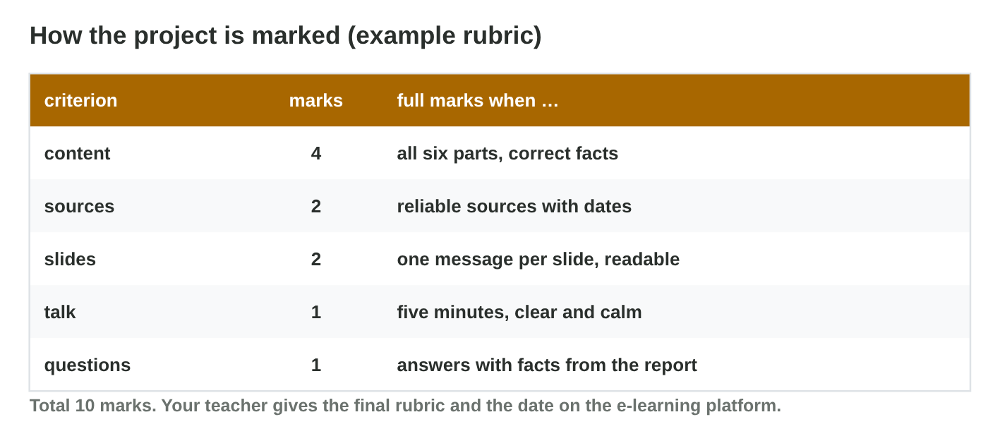

This page is the interactive version of the lesson notes (PDF). Each section
is one step of the seminar. It ends with a **Do it** task and one set of
questions. The full explanations, examples and exercises are in the notes.
You work alone.

## Key terms



## 28.1 Step 1: the project report

- A **platform report** for one game, 2–3 pages, individual.
- Six parts: **game**, **platforms**, **specs**, **test plan**, **risks**,
  **publishing**.
- Every fact with a **reliable source and a date**.

{width=94%}

::: {.callout-warning title="Watch out!"}
A small game and one clear question make a better report.
:::

::: {.callout-note title="Do it · Your project plan"}
Your game, your question, three sources with dates.
:::

::: {.callout-tip title="Try it 1 · The report"}
Choose the part of the report.

::: {.match extra="the price of the PC|a joke"}
emulators, a weak laptop, a device farm
:   the test plan

PC and console compared with criteria
:   platforms

60 fps on a weak PC, 4K on the console
:   specs and targets

store rules and cloud saves
:   publishing
:::
:::

## 28.2 Step 2: six slides

- Question → platforms → specs → test plan → risks → **recommendation**.
- One message per slide, as a sentence in the title.
- Numbers with sources; 24 pt or bigger.

{width=94%}



::: {.callout-warning title="Watch out!"}
Do not read full slides aloud.
:::

::: {.callout-note title="Do it · Your slide titles"}
Sort Lina's slides in **Slide Sorter**; write your own six titles.
:::

::: {.callout-tip title="Try it 2 · Slides"}
Use Slide Sorter. Choose the right answer.

::: {.match extra="the sources list|a thank-you slide"}
the first slide
:   the game and the question

the last slide
:   the recommendation

a good slide title
:   one message as a sentence

time per slide in five minutes
:   about 50 seconds
:::
:::

## 28.3 Step 3: presenting and answering

- About 50 seconds per slide; practise with a timer.
- Speak to the audience; pause after key numbers.
- Answer with facts; if unsure, offer to check the source.

::: {.callout-warning title="Watch out!"}
Never invent a number to answer a question.
:::

::: {.callout-note title="Do it · Rehearse"}
Present alone with a timer; write three likely questions and answers.
:::

::: {.callout-tip title="Try it 3 · The talk"}
Choose the best behaviour.

::: {.match extra="read every slide|speak twice as fast"}
the talk takes 11 minutes
:   cut words, not facts

a question you cannot answer
:   say so and offer to check

where to look while speaking
:   at the audience

after an important number
:   a short pause
:::
:::

## 28.4 Step 4: check before you present

- Example rubric: content 4, sources 2, slides 2, talk 1, questions 1.
- Fix the weakest criterion first; practise again.

{width=94%}



::: {.callout-warning title="Watch out!"}
The report, the sources and your answers are marked too.
:::

::: {.callout-note title="Do it · Self-check"}
Answer the six questions in **Project Check**; fix the two items that give
the most marks.
:::

::: {.callout-tip title="Try it 4 · The rubric"}
Choose the criterion.

::: {.match extra="the font colour|the file name"}
all six parts, correct facts
:   content

dates under every table
:   sources

one message per slide
:   slides

five minutes, clear and calm
:   talk
:::
:::

## Game challenge: Talk Doctor {.challenge}

Work alone. Use every section of today.

Six rehearsals: a **crowded slide**, an **11-minute talk**, a number
**without a source**, a chart **without axes**, a **hard question**, and no
**recommendation**.



::: {.callout-tip title="Try it 5 · The rehearsals"}
Choose the advice.

::: {.match extra="use a smaller font|add more colours"}
14 lines read aloud
:   one message, say the rest

a number without a source
:   add the source and the date

a chart without labels
:   add a title, axes and units

the talk ends after the risks
:   end with the recommendation
:::
:::

## Summary {.summary}

- The project: a platform report for one game, six parts, dated sources.
- Six slides: question first, recommendation last.
- About five minutes; practise with a timer.
- Answer questions with facts, or offer to check.
- Check your work against the rubric before you present.
