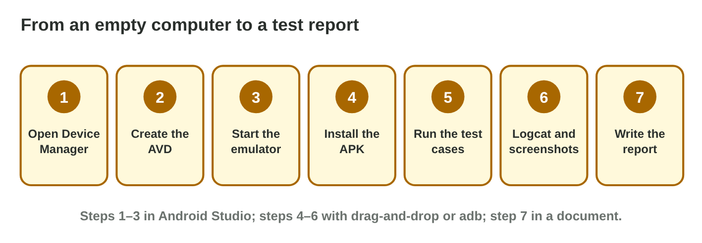
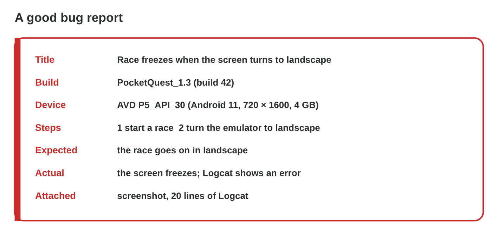

No new ideas today: two short problems on Lecture 12, on the lab computer.
Do each one alone. Tap, sort or type your answer at every step: the page
checks it at once and tells you why.

## Recall

- An **AVD** is a device profile (screen, RAM) plus a **system image** (one
  Android version, for example API 30); it runs in the Android Emulator.
- **adb** talks to the emulator or the phone: `adb devices`, `adb install`,
  `adb logcat`.
- An emulator is good for versions and sizes, not for speed, heat or
  sensors. A test result names the build, the device and the OS version.

::: {.callout-tip title="Try it 1 · Recall"}
Choose the right answer.

::: {.match extra="a USB cable|the Play Store"}
What gives an AVD its Android version?
:   the system image

    Why: One system image is one Android version.

Which command lists the connected devices and emulators?
:   adb devices

    Why: adb talks to every connected device.

What can an emulator not test well?
:   the heat of a long race

    Why: It runs on the computer, not on a phone.
:::
:::

## Activity 1 · Start the emulator and install the build

Each student gets the same build, `PocketQuest_1.3.apk`. In Android
Studio: **Device Manager** › **Create device**, choose the profile and the
**system image**, name the AVD (`P5_API_30`) and press **Start**. The first
start (a **cold boot**) takes longer. Then install the build: drag the
`.apk` onto the emulator, or run `adb install PocketQuest_1.3.apk`.

{width=90%}



::: {.callout-warning title="Watch out!"}
If the emulator does not start, virtualization may be off in the BIOS, or
the computer has too little free RAM. Close other programs, and ask the lab
technician.
:::

::: {.callout-note title="Activity 1 · Start and install · 18 min"}
On the lab computer (or in **Emulator Lab**, Tasks 1–3):

1. Create and start `P5_API_30`: 720 × 1600, 4 GB, Android 11.
2. Run `adb devices`, then `adb install PocketQuest_1.3.apk`.

*Your product:* a running emulator with the game, and the output of
`adb devices`.

::: {.order}
Put the steps in order.

1. Create `P5_API_30`: 720 × 1600, 4 GB, Android 11.
2. Start it: the first start is a cold boot.
3. Run `adb devices`: it shows `emulator-5554 device`.
4. Run `adb install PocketQuest_1.3.apk`: it prints `Success`.

Why: adb can install the build only on a device that is running.
:::

::: {.choice}
`adb devices` prints `no devices/emulators found`. What do you do first?

- [x] Start the emulator.

  Why: adb finds no running device to install on.

- [ ] Run adb install again.

  Why: Without a running device, the install fails again.

- [ ] Delete the AVD.

  Why: The AVD is fine; it is just not started.
:::
:::

::: {.callout-tip title="Try it 2 · Start and install"}
Choose the right answer.

::: {.match extra="the Play Store|Restart the router"}
Where do you create an AVD in Android Studio?
:   the Device Manager

    Why: The Device Manager creates, starts and deletes AVDs.

What is the slow first start of an AVD called?
:   a cold boot

    Why: Later starts use a saved state: a quick boot.

adb says "no devices/emulators found". What do you do?
:   start the emulator first

    Why: adb can install only on a running device.

What does adb print after a good install?
:   Success

    Why: Then the game's icon appears on the emulator.
:::
:::

## Activity 2 · Run test case 7 and report the bug

Follow the test plan in order, and keep the **evidence**: a **screenshot**
and the lines of the log (`adb logcat`) around the moment of the problem.
Repeat a failed case once. A **bug report** lets a developer repeat the
bug: a title, the build, the device with its OS version, numbered steps,
the expected and the actual result, and the evidence.

{width=90%}

::: {.callout-note title="Activity 2 · Test case 7 · 15 min"}
Test case 7: "Start a race, then turn the device to landscape."

1. Run it in Emulator Lab (Tasks 4 and 5) or on your AVD. Read the log and
   take a screenshot.
2. Write the bug report with all its parts.

*Your product:* one complete bug report.

::: {.sort}
The race freezes in landscape. Which part of the bug report is each line?
Sort them.

Title
:   The race freezes when the device turns to landscape.

    Why: The problem in one short sentence.

Steps
:   1. Start a race. 2. Turn the device to landscape.

    Why: Numbered steps that repeat the bug.

Expected and actual result
:   Expected: the race goes on in landscape.

    Why: What should happen.

:   Actual: the race freezes; "Pocket Quest isn't responding".

    Why: What really happened.

Evidence
:   the screenshot and the log line `E/Unity: NullReferenceException: RaceHud.OnScreenRotate ()`

    Why: Proof for the developer, from the moment of the problem.
:::

::: {.choice}
Why does the report also name the build (PocketQuest_1.3, build 42) and the
device (AVD P5_API_30, Android 11)?

- [x] So that a developer can repeat the bug on the same setup.

  Why: A bug may appear only on one build or one OS version.

- [ ] To make the report look longer.

  Why: Every part has a job: here, to repeat the bug.

- [ ] Because the store asks for it.

  Why: The report is for the team, not for the store.
:::
:::

::: {.callout-tip title="Try it 3 · The test and the report"}
Choose the right answer.

::: {.match extra="the battery|a nicer font"}
What freezes the race in test case 7?
:   turning to landscape

    Why: The error comes from OnScreenRotate.

Which file does the error name, and at which line?
:   RaceHud.cs, line 118

    Why: The log line shows the file and the line.

A report says "Race freezes", without the device. What must be added?
:   the device and its OS version

    Why: The developer must use the same setup.

A report says only "looks bad". What must be written instead?
:   the expected and the actual result

    Why: Facts show what is wrong; an opinion does not.
:::
:::

## At home · Task with AI

::: {.callout-note .ai-task title="Task with AI · A test table of four setups"}
An extra for the curious: let an AI assistant make the table. Copy the
prompt into an AI assistant that the university allows (for example
Microsoft Copilot with your university account), and look at the result.

::: {.prompt}
Make a test table for a mobile racing game. Rows: rotate the phone during a
race; a phone call during a race; a slow network; a 20-minute race to test
heat and battery; the tilt sensor to steer; the screen of a tablet.
Columns: an emulator with Android 11, an emulator with Android 8, a tablet
emulator, a real phone with 4 GB of RAM. Put a tick where the test makes
sense on that setup, and a dash where it does not.
:::

::: {.choice}
Which ticks should the table show? The AI can be wrong: compare.

- [x] The 20-minute race and the tilt sensor: only the real phone; the tablet screen: the tablet emulator; the rest: every setup.

  Why: An emulator does not get hot, and its sensors are only simulated.

- [ ] A tick on every setup for every test.

  Why: Heat, battery and real sensors need a real phone.
:::

::: {.try-change}
**Change:** add a fifth column: an old real phone with Android 8 and 2 GB of RAM.
Ask again.

::: {.choice}
What changes?

- [x] The 20-minute race and the tilt sensor now have two ticks.

  Why: The old phone is real too, and it shows if the race is smooth on a weak phone.

- [ ] Nothing changes.

  Why: A second real phone can do the real-phone tests.
:::
:::

::: {.try-change}
**Change:** remove the real phone, and ask again.

::: {.choice}
What changes?

- [x] The 20-minute race and the tilt sensor have no tick at all.

  Why: These tests need a real phone.

- [ ] The emulators take over the heat test.

  Why: An emulator does not get hot.
:::
:::

**Your own idea:** change one more number or word, and look again. The AI
can be wrong: compare its result with the answers.
:::

## Wrap-up {.summary}

- You can start an Android Virtual Device and install a build with adb.
- You can run a test case, keep the evidence and write a bug report that a
  developer can repeat.
