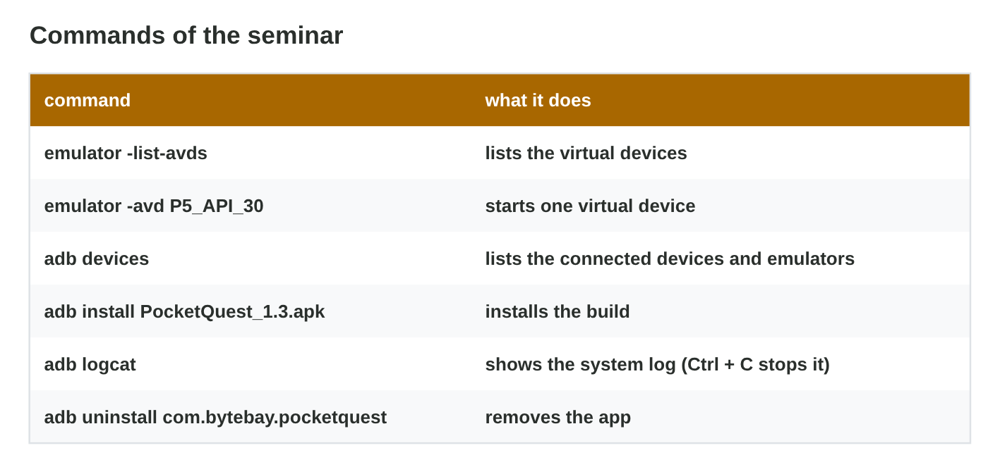

## Recall · Lecture 13

a) What gives an AVD its Android version?
b) Which command lists the connected devices and emulators?
c) What can an emulator not test well?

::: {.answer}
a) the system image
b) adb devices
c) the speed, the heat, the battery and the sensors
:::

## Activity 1 · Start P5_API_30 · 10 min

:::: {.columns}
::: {.column width="50%"}
- In Android Studio we open the Device Manager and create a device.
- We choose the profile and the system image, name the AVD, and press Start.
- **Do it:** Create and start P5_API_30 with 720 × 1600, 4 GB and Android 11. How long did the first boot take?
:::
::: {.column width="50%"}

:::
::::

## Live demo · Emulator Lab



## Check 1 · Start P5_API_30

What does a good result show?

::: {.reveal}
1. The emulator shows the home screen of Android 11.
2. The first cold boot took about 15 to 60 seconds on a lab PC.
3. Later starts are faster, because they use a quick boot.
:::

## Activity 2 · Two installs · 8 min

:::: {.columns}
::: {.column width="50%"}
- We can drag the APK onto the emulator or use adb install.
- adb devices must list the emulator first.
- **Do it:** Install the build twice, by drag and drop and with adb install. What does adb devices print?
:::
::: {.column width="50%"}

:::
::::

## Check 2 · Two installs

What do the commands print?

::: {.reveal}
1. adb devices prints emulator-5554 with the word device.
2. adb install PocketQuest_1.3.apk prints Success, and the icon appears.
3. "No devices found" means that we must start the emulator first.
:::

## Activity 3 · Test case 7 · 12 min

:::: {.columns}
::: {.column width="50%"}
- Test case 7 says: start a race, then turn the device to landscape.
- We keep a screenshot and the lines of the log, and we repeat the case once.
- **Do it:** Run test case 7, read the log, take a screenshot, and write pass or fail.
:::
::: {.column width="50%"}

:::
::::

## Check 3 · Test case 7

What happens in test case 7?

::: {.reveal}
1. The race freezes in landscape, and Android says that Pocket Quest isn't responding.
2. The log shows a NullReferenceException in RaceHud.cs at line 118.
3. The case fails, and it fails again when we repeat it.
:::

## Activity 4 · The bug report · 10 min

:::: {.columns}
::: {.column width="50%"}
- A bug report has a title, the build, the device, numbered steps, the expected and actual result, and attachments.
- One report holds one bug, with facts and no opinions.
- **Do it:** Write the bug report of test case 7 with all its parts.
:::
::: {.column width="50%"}

:::
::::

## Check 4 · The bug report

What does a complete bug report of test case 7 say?

::: {.reveal}
1. The title says that the race freezes when the device turns to landscape.
2. It names PocketQuest_1.3 build 42, the AVD P5_API_30 and Android 11, with two numbered steps.
3. It gives the expected and the actual result, and it attaches the screenshot and the log line.
:::

## Game challenge · Report Doctor



## Wrap-up

- You can create and start an Android Virtual Device.
- You can install a build with adb and solve the common install errors.
- You can run a test case, keep the evidence and write a bug report.
