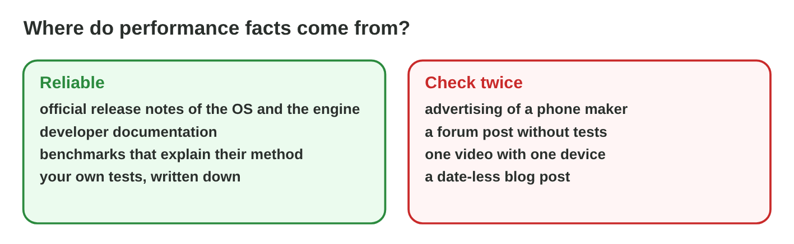

## Keywords



## 14.1 Measuring performance

:::: {.columns}
::: {.column width="50%"}
- The frame time is the time of one frame, about 16.7 ms at 60 fps.
- The 1 % low shows the slowest frames, which the player feels as stutters.
- We test as long as players play, because a hot chip slows down.
- **Do it:** Compute the frame time of 30, 60 and 120 fps. Which frame rate is a 50 ms frame?
:::
::: {.column width="50%"}

:::
::::

## Example · The jerk of Star Garden

The counter of Star Garden shows 59 fps, but players feel a jerk.
**Where is the problem, and what is the fix?**

::: {.reveal}
1. The frame-time graph shows **one frame of 70 ms** every 10 seconds.
2. In that frame the game **saves to the cloud**.
3. The developers save **in the background**, and the stutter is gone.
:::

## Try it 1 · Measures

a) What is the frame time at 60 fps?
b) Which number shows the stutters of a race?
c) A phone is hot after 15 minutes and slows down. What is happening?

::: {.answer}
a) about 16.7 ms
b) the 1 % low
c) thermal throttling
:::

## 14.2 Compatibility

:::: {.columns}
::: {.column width="50%"}
- A build for a newer Android version cannot start on an older one.
- An old GPU without Vulkan needs another graphics path, such as OpenGL ES.
- Menus must sit in the safe area of every screen shape.
- **Do it:** Make every row of build 43 green in Compatibility Lab. What does each fix cost?
:::
::: {.column width="50%"}

:::
::::

## Live demo · Compatibility Lab



## Try it 2 · Compatibility

a) The game crashes at start on Android 8. Which setting of the build is wrong?
b) An old phone shows a black screen. What is a likely cause?
c) The Start button is cut off on a tablet. What is the fix?

::: {.answer}
a) the minimum Android version
b) Its GPU does not support Vulkan.
c) anchor the menu to the safe area
:::

## 14.3 Following developments

:::: {.columns}
::: {.column width="50%"}
- Release notes list the changes of a new OS or engine version.
- Official pages and our own dated tests are reliable sources.
- Forum posts and undated videos are claims to check.
- **Do it:** Find two changes of the newest Android or iOS that could affect a game.
:::
::: {.column width="50%"}

:::
::::

## Example · Twice the frame rate?

A video says that the new engine version doubles the frame rate on old phones.
**How does Rami check the claim?**

::: {.reveal}
1. He reads the **official release notes**: they mention faster loading only.
2. He **tests** the new version on the P5 with the same race.
3. The levels load 2 seconds faster, the frame rate is the same, and he **writes it down with the date**.
:::

## Try it 3 · Sources

a) Are the official release notes of an OS a reliable source?
b) What is a forum post without tests?
c) What does a tester do after an OS update?

::: {.answer}
a) yes, reliable
b) a claim to check
c) run the test plan again on an updated device
:::

## Game challenge · Performance Detective



## Try it 4 · Fixes (harder)

The facts: a race jerks at 58 fps. A phone gets hot and slows down after 15 minutes. A forum says that an OS update makes every game 30 % faster.

a) Which number shows the problem of the jerking race?
b) What keeps the hot phone steady in long races?
c) What does Rami do with the forum claim?

::: {.answer}
a) the 1 % low and the frame times
b) a 30 fps cap or lower settings
c) He reads the release notes and tests it.
:::

## Summary

- We measure frame times and the 1 % low in long tests on real devices.
- A frame-rate cap or lower settings keep a hot phone steady.
- Builds fail from the OS version, the graphics API or the screen shape.
- A compatibility matrix shows each device and each check.
- We follow platform changes in release notes and test after every update.
