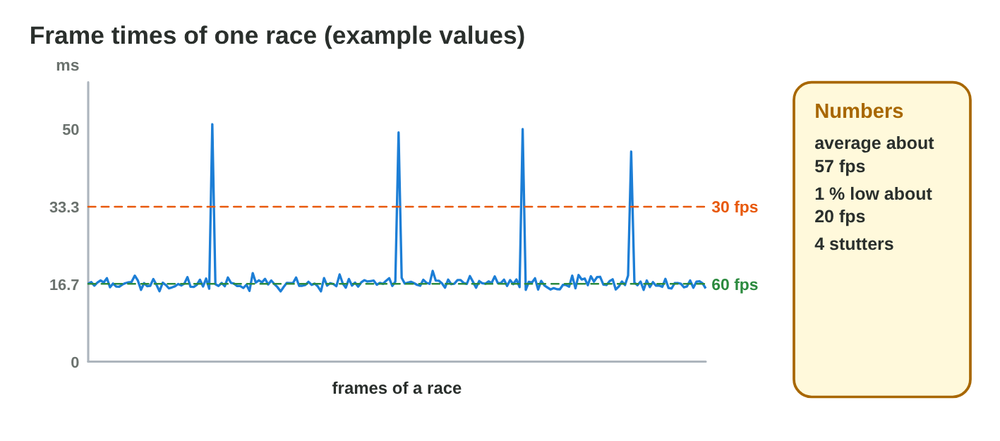
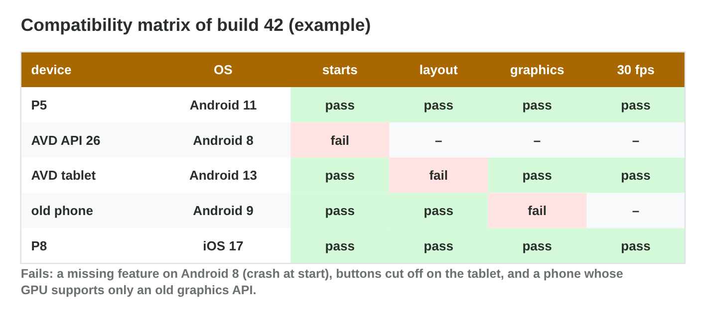

No new ideas today: two short case studies that use Lectures 3, 5, 6, 7 and
12. Do each one alone, then open "Check your result". Every question on
this page has its answer: try first, then check.

## Recall

- A hot chip slows itself down: **thermal throttling** (Lecture 3). Apps in
  the background take RAM and CPU time (Lecture 5).
- A build needs a minimum OS version, and a game is tested on emulators and
  on real devices (Lectures 6 and 12).
- Reliable sources: official documentation, release notes and your own
  tests with dates; a video or a forum post is a claim to check (Lecture 7).

::: {.callout-tip title="Try it 1 · Recall"}
Choose the right answer.

::: {.match extra="a faster network|a bigger icon"}
A phone is hot after 15 minutes and the game slows down. What is it?
:   thermal throttling

    Why: a hot chip lowers its speed to cool down.

Where do you check what a new OS version changes for games?
:   the official release notes

    Why: they list the changes that can break a game.

A forum post says "the game runs twice as fast after the update". What is it?
:   a claim to check

    Why: it has no test and no source.
:::
:::

## Activity 1 · Frames and a hot phone

A game shows frames one after the other. The time of one frame is
1000 ms ÷ the frame rate: at 60 frames per second (fps), one frame takes
about 16.7 ms. One frame that takes much longer than the others is a
**stutter**: the player sees a jerk. Players of *Pocket Quest* send six
reports, for example a race that jerks at 58 fps and a phone that gets hot
and slows down after 15 minutes.

{width=88%}



::: {.callout-note title="Activity 1 · Read the frames · 15 min"}
1. Find the frame time at 30 fps and at 60 fps.
2. In a 60 fps race, one frame takes 70 ms. What does the player see?
3. The phone is hot after 15 minutes and the game slows down. Name the
   cause and one fix.
4. Play **Performance Detective** and answer the six reports.

*Your product:* two frame times, two short answers and your score.

::: {.check}
1. 1000 ÷ 30 ≈ 33.3 ms; 1000 ÷ 60 ≈ 16.7 ms.
2. A stutter: one frame takes more than four normal frames, so the race
   jerks although the average is 58 fps.
3. Thermal throttling: the hot chip slows down. Fixes: cap the frame rate
   at 30 fps or lower the graphics settings, and test as long as players
   play.
4. Performance Detective: the frame times (a stutter), thermal throttling,
   the minimum Android version, a graphics API that the GPU lacks, the safe
   area of the screen, and the official release notes with your own test.
:::
:::

::: {.callout-tip title="Try it 2 · Frames"}
Choose the right answer.

::: {.match extra="0 ms|100 ms"}
What is the frame time at 50 fps?
:   20 ms

    Why: 1000 ÷ 50 = 20.

A race has 60 fps on average and one frame of 80 ms. What does the player see?
:   a stutter

    Why: one very long frame is a jerk, even with a high average.

The game slows down only after 20 minutes of play. What should the test do?
:   play as long as players do

    Why: throttling starts only when the chip is hot.
:::
:::

## Activity 2 · One build for every device

Build 43 of *Pocket Quest* must run on five test devices. It needs Android 11
or newer; one old phone has Android 8, one old GPU has no Vulkan, and a
tablet has a 4:3 screen that cuts off the Start button. A video says the
next OS update gives "twice the frame rate on old phones"; the official
release notes say only "faster loading".

{width=88%}



::: {.callout-note title="Activity 2 · Make every row green · 15 min"}
1. In **Compatibility Lab**, make every row green. Write each setting you
   changed and what it costs.
2. Which source do you trust about the update: the video or the release
   notes? What do you do before you write it in the report?

*Your product:* three settings with their cost, and one sentence about the
source.

::: {.check}
1. Minimum Android 8: the game must also be tested on Android 8. A second
   graphics path (OpenGL ES next to Vulkan): one more path to test. The menu
   anchored to the safe area: one more layout check per screen shape. Every
   fix costs more testing.
2. The release notes: they are official. Before the report, test the update
   yourself on one device and write the date and the source.
:::
:::

::: {.callout-tip title="Try it 3 · Devices and sources"}
Choose the right answer.

::: {.match extra="a bigger icon|a faster network"}
Build 43 crashes at the start on Android 8. Which setting fixes it?
:   minimum Android 8

    Why: the build asked for Android 11 or newer.

The Start button is cut off on a tablet. What fixes it?
:   anchor the menu to the safe area

    Why: the menu then stays inside the visible part of every screen.

Is an undated video with one device a reliable source?
:   no, it is a claim to check

    Why: it has no date, no method and only one device.
:::
:::

## Wrap-up {.summary}

- You can read frame times and explain a stutter and a hot phone.
- You can make one build work on many devices and say what it costs.
- You can check a claim about a platform with a reliable source.
