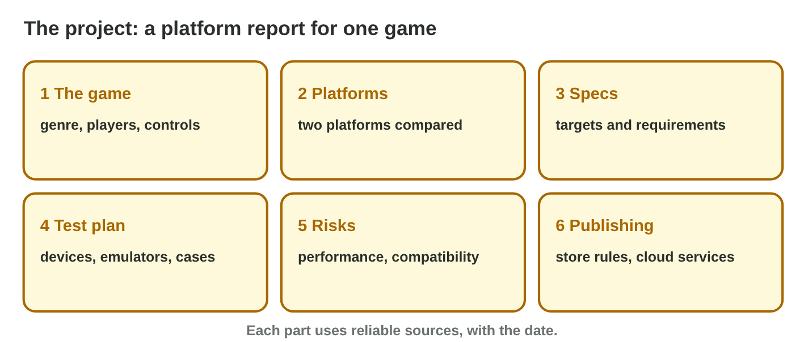

## Recall · Lectures 7–12

a) Which device sets the minimum requirements of a game?
b) What does every number in a report need?
c) When do you choose the criteria of a comparison?

::: {.answer}
a) the weakest supported device
b) a reliable source with a date
c) before the scores
:::

## Activity 1 · Plan and titles · 15 min

:::: {.columns}
::: {.column width="50%"}
- The report has six parts, and the talk has six slides with one message each.
- **Do it:** Write your game, your question and three sources with dates. Put Lina's slides in order in Slide Sorter, then write your six slide titles.
- Your product is a question, three sources and six titles.
:::
::: {.column width="50%"}

:::
::::

## Live demo · Slide Sorter



## Check 1 · Plan and titles

What does a good plan of the talk look like?

::: {.reveal}
1. It has one small game and one clear question, for example "PC or console next?".
2. It names three sources with dates, such as the developer pages read on 30 October 2026.
3. The slides go from the question, through the comparison, specs, test plan and risks, to the recommendation.
:::

## Activity 2 · Time and rubric · 15 min

:::: {.columns}
::: {.column width="50%"}
- A five-minute talk gives about 50 seconds to each slide.
- **Do it:** Present your six slides alone with a timer. Then answer the six questions of Project Check. Which fix gives the most marks?
- Your product is a time, an expected mark and one fix.
:::
::: {.column width="50%"}

:::
::::

## Check 2 · Time and rubric

What does a good rehearsal show?

::: {.reveal}
1. The talk takes about five minutes, for example 4 min 50 s.
2. The expected mark comes from the rubric, for example 8 of 10.
3. The first fix is the criterion with the most missing marks, for example dates under the tables.
4. A talk that is too long loses words, not facts.
:::

## Wrap-up

- You can plan a platform report and a talk of six slides with dated sources.
- You can rehearse a five-minute talk and check it against a rubric.
