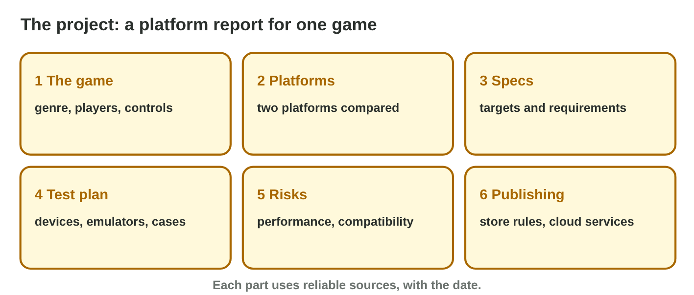
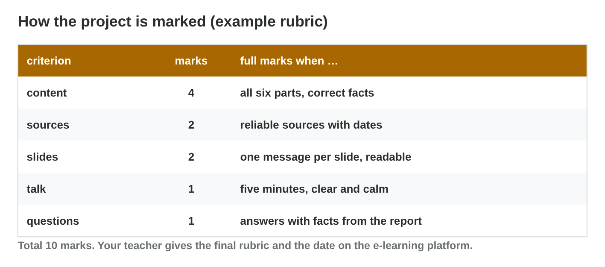

No new ideas today: two short problems for your project, on Lectures 7–12.
Do each one alone. Tap, sort or type your answer at every step: the page
checks it at once and tells you why.

## Recall

- Compare platforms with **three criteria** chosen first, scores with
  reasons, and totals; the weakest supported device sets the minimum
  requirements.
- A **test plan** uses emulators for breadth and real devices for truth;
  performance and compatibility risks need fixes.
- Every fact in a report needs a **reliable source with a date**.

::: {.callout-tip title="Try it 1 · Recall"}
Choose the right answer.

::: {.match extra="the newest phone|a forum post"}
Which device sets the minimum requirements?
:   the weakest supported device

    Why: If the game runs there, it runs for all supported players.

What does every number in a report need?
:   a reliable source with a date

    Why: The reader must be able to check it.

When do you choose the criteria of a comparison?
:   before the scores

    Why: Otherwise the favourite always wins.
:::
:::

## Activity 1 · The plan of the report and its slides

Lina chose the puzzle game *Tile Garden* and asked: "PC or console next?"
Her report has six parts: the game and the question, two platforms
compared, specs and targets, the test plan, risks and fixes, and
publishing. Her five-minute talk has six slides, one message each, and ends
with the recommendation. Your teacher gives the deadline and the rubric on
the e-learning platform.

{width=90%}



::: {.callout-note title="Activity 1 · Plan and titles · 15 min"}
1. Write your game, your question, and three sources you will use (name
   and date).
2. In **Slide Sorter**, put Lina's slides in order. Then write the six
   slide titles of your own talk as short sentences.

*Your product:* your question, three sources and six titles.

::: {.order}
Step 2: put Lina's six slides in order.

1. the game and the question
2. two platforms compared
3. specs and targets
4. the test plan
5. risks and fixes
6. the recommendation

Why: The talk answers the question at the end, after the facts that lead to it.
:::

::: {.choice}
Step 2: which slide title is good?

- [x] "Test plan: two emulators and one weak laptop."

  Why: A short sentence with one message.

- [ ] "Test plan"

  Why: One word gives no message.

- [ ] "Tests, devices, laptops, emulators and more"

  Why: A list of words with no single message.
:::

::: {.choice}
Step 1: which source is good for the report?

- [x] the developer pages of both platforms, with the date you read them

  Why: Official pages with a date: a reliable source.

- [ ] a video without a date

  Why: Without a date and an author, the fact cannot be checked.

- [ ] a friend's opinion

  Why: An opinion is not a source.
:::
:::

::: {.callout-tip title="Try it 2 · The report and the slides"}
Choose the right answer.

::: {.match extra="the price of the PC|a thank-you slide"}
Emulators, a weak laptop and a device farm. Which part of the report?
:   the test plan

    Why: The test plan says where each test runs.

Which slide comes first?
:   the game and the question

    Why: The audience must know the question first.

Which slide comes last?
:   the recommendation

    Why: The talk ends with the answer to the question.
:::
:::

## Activity 2 · Rehearse and check

Practise with a timer: about 50 seconds per slide. Speak to the audience,
not to the screen. Answer questions with facts from your report; if you do
not know, say so and offer to check. A **rubric** lists the criteria and
the marks: content 4, sources 2, slides 2, talk 1, questions 1.

{width=88%}



::: {.callout-note title="Activity 2 · Time and rubric · 15 min"}
1. Present your six slides alone with a timer. Write the time.
2. In **Project Check**, answer the six questions for your project. Write
   your expected mark and the one fix that gives the most marks.

*Your product:* a time, an expected mark and one fix.

::: {.fill answer="5" unit="minutes" hint="Six slides × about 50 seconds."}
Step 1: about how long is a talk of six slides at about 50 seconds each?

Why: 6 × 50 = 300 seconds = 5 minutes.
:::

::: {.choice}
Step 1: the talk takes more than six minutes. What do you cut?

- [x] words

  Why: Keep the question, the numbers and the answer; cut the extra words.

- [ ] the recommendation

  Why: The recommendation is the answer: it stays.

- [ ] the numbers

  Why: The numbers are the facts of the talk.
:::

::: {.choice}
Step 2: the rubric gives content 4, sources 2, slides 2, talk 1 and
questions 1. Two tables have no dates. Which fix gives a mark?

- [x] Add the dates under the two tables.

  Why: Sources with dates: +1 mark.

- [ ] Change the colours of the slides.

  Why: The rubric gives no mark for colours.

- [ ] Speak faster.

  Why: A faster talk is harder to follow; it gives no mark.
:::
:::

::: {.callout-tip title="Try it 3 · The talk"}
Choose the best answer.

::: {.match extra="speak twice as fast|use a smaller font"}
The talk takes 11 minutes. What do you do?
:   cut words, not facts

    Why: The question, the numbers and the answer must stay.

Someone asks a question you cannot answer. What do you do?
:   say so and offer to check

    Why: Never invent a number.

A slide shows a number without a source. What do you add?
:   the source and the date

    Why: Every number must be checkable.

Which criterion of the rubric gives the most marks?
:   content

    Why: Content is worth 4 of the 10 marks.
:::
:::

## Wrap-up {.summary}

- You can plan a platform report and a talk of six slides with dated
  sources.
- You can rehearse a five-minute talk and check it against a rubric.
