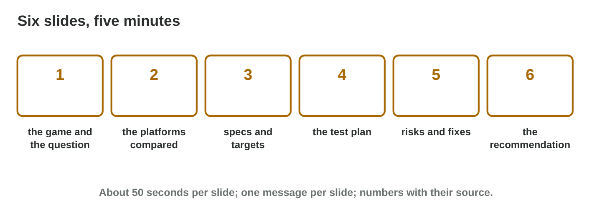

::: {.lead}
In this course you looked at a game from many sides: the hardware, the
operating systems, the platforms and their stores, the network and the
cloud, the test devices and the performance. The **project** puts these
sides together for one game of your choice: a short **platform report** and
a **five-minute presentation**. Today there are no new ideas: you finish
the report, build six clear slides, rehearse the talk and check your work
against the rubric. You work alone. The results of the activities are at
the end of this worksheet.
:::

## Recall

- Compare platforms with **three criteria** chosen first, scores with
  reasons, and totals (Lectures 8 and 12).
- Specs set **targets** and **system requirements**; the weakest supported
  device sets the minimum (Lecture 12).
- A **test plan** uses emulators for breadth and real devices for truth
  (Lecture 13).
- Every fact in a report needs a **reliable source with a date** (Lectures
  8 and 14).

::: {.callout-tip title="Try it 1 · Recall"}
Choose the right answer.

::: {.match extra="the newest phone|a forum post"}
Which device sets the minimum requirements?
:   the weakest supported device

    Why: If the game runs there, it runs for all supported players.

What does every number in a report need?
:   a reliable source with a date

    Why: The reader must be able to check it.

When do you choose the criteria of a comparison?
:   before the scores

    Why: Otherwise the favourite always wins.
:::
:::

## Activity 1 · The project report

Lina chose the puzzle game *Tile Garden* and asked: "PC or console next?"
The report has six parts, 2–3 pages:

1. **The game:** genre, players, controls, the question of the report.
2. **Platforms:** two platforms compared with three criteria (Lectures 8
   and 12).
3. **Specs:** targets and system requirements (Lectures 2–4 and 12).
4. **Test plan:** emulators, real devices, a device matrix (Lecture 13).
5. **Risks:** performance and compatibility, with fixes (Lecture 14).
6. **Publishing:** store rules and cloud services (Lectures 9 and 11).

Your teacher gives the deadline and the final rubric on the e-learning
platform.

{width=90%}

::: {.callout-warning title="Watch out!"}
A game that is too big ("an open world on all platforms") makes a weak
report. A small game and one clear question make a better one.
:::

::: {.callout-note title="Activity 1 · Your plan · 10 min"}
Write your game, your question, and three sources you will use (name and
date). Then write one line for each of the six parts.

*Your product:* a plan of about ten lines.

::: {.check}
A good plan looks like: "Game: Tile Garden, a calm puzzle game, 5-minute
sessions. Question: PC or console next? Sources: the developer pages of
both platforms (read 30 October 2026), a dated market report, my own test
in an emulator." Then one line for each part.

- ☐ One small game and one clear question.
- ☐ Three sources with names and dates.
- ☐ A line for each of the six parts.
:::
:::

::: {.callout-tip title="Try it 2 · The report"}
Choose the part of the report.

::: {.match extra="the price of the PC|a joke"}
Emulators, a weak laptop and a device farm.
:   the test plan

    Why: The test plan says where each test runs.

PC and console compared with three criteria.
:   platforms

    Why: Part 2 compares the platforms.

Store rules and cloud saves.
:   publishing

    Why: Part 6 covers the stores and the cloud.
:::
:::

## Activity 2 · Six slides

A five-minute talk needs about six slides:

1. the game and the question; 2. the two platforms compared; 3. specs and
   targets; 4. the test plan; 5. risks and fixes; 6. the recommendation.

- One message per slide, written as a short sentence in the title.
- Numbers with their source; text large enough to read (24 pt or more).
- The slide shows the message and the number; you say the rest.

{width=90%}



::: {.callout-note title="Activity 2 · Your slide titles · 10 min"}
1. In **Slide Sorter**, put Lina's slides in order.
2. Write the six slide titles of your own talk as short sentences.

*Your product:* six titles.

::: {.check}
Lina's order: the question; two platforms compared; specs and targets; the
test plan; risks and fixes; the recommendation (PC first, 11 of 15). Your
titles are sentences with one message each, for example "Test plan: two
emulators, one weak laptop, a device farm."
:::
:::

::: {.callout-tip title="Try it 3 · Slides"}
Use Slide Sorter. Choose the right answer.

::: {.match extra="the sources list|a thank-you slide"}
Which slide comes first?
:   the game and the question

    Why: The audience must know the question first.

Which slide comes last?
:   the recommendation

    Why: The talk ends with the answer to the question.

How long is each slide in a five-minute talk?
:   about 50 seconds

    Why: Six slides in five minutes.
:::
:::

## Activity 3 · Rehearse the talk and its questions

- **Time:** about 50 seconds per slide; practise with a timer.
- **Voice:** speak to the audience, not to the screen; pause after the
  important numbers.
- **Questions:** answer with facts from your report. If you do not know,
  say so and offer to check the source. Never invent a number.
- Lina is asked how many players use a console in her country. Her source
  gives only worldwide numbers, so she says so and offers to check a local
  report.

::: {.callout-warning title="Watch out!"}
Do not speak faster to fit more in: cut words and side topics, not the
question, the numbers or the answer.
:::

::: {.callout-note title="Activity 3 · Rehearse · 10 min"}
Present your six slides alone with a timer. Write the time, and three
questions the audience may ask, with short answers.

*Your product:* a time and three questions with answers.

::: {.check}
A good result: "4 min 50 s." Three likely questions with short, factual
answers from the report, for example "Why not the console? — It needs a dev
kit and certification, and few of our players have one (score 2 of 5)."
If you are over six minutes, cut words, not facts.
:::
:::

::: {.callout-tip title="Try it 4 · The talk"}
Choose the best behaviour.

::: {.match extra="read every slide|speak twice as fast"}
The talk takes 11 minutes.
:   cut words, not facts

    Why: The question, the numbers and the answer must stay.

A question you cannot answer.
:   say so and offer to check

    Why: Never invent a number.

Where do you look while you speak?
:   at the audience

    Why: You talk to people, not to the screen.
:::
:::

## Activity 4 · Check before you present

A **presentation rubric** lists the criteria and the marks. The example
rubric: content 4, sources 2, slides 2, talk 1, questions 1 (10 marks).
Check each criterion honestly, fix the weakest first, and practise again.

{width=88%}



::: {.callout-note title="Activity 4 · Self-check · 8 min"}
In **Project Check**, answer the six questions for your project. Then fix
the two items that give the most marks.

*Your product:* an expected mark and two fixes.

::: {.check}
A good result looks like Lina's: "Expected 8 of 10. Fix 1: add the dates
under two tables (sources, +1). Fix 2: split the crowded slide 3 (slides,
+1). New expected mark: 10." The fixes come from the criteria with the most
marks missing.
:::
:::

::: {.callout-tip title="Try it 5 · The rubric"}
Choose the criterion.

::: {.match extra="the font colour|the file name"}
All six parts, with correct facts.
:   content

    Why: Content is worth the most marks (4).

Dates under every table.
:   sources

    Why: Sources are marked on reliability and dates.

One message per slide.
:   slides

    Why: Slides are marked on clarity.
:::
:::

## Case study: Talk Doctor

Six students rehearse their talks: a crowded slide read aloud, an 11-minute
talk, a number without a source, a chart without axis names, a question
without an answer, and a talk that ends without the recommendation. The
Game challenge of the interactive page uses these rehearsals. In the
mini-game below you choose the best advice for each one.



## Exercises

1. Name the six parts of the project report.
2. Why is a small game with one question a good choice?
3. Which slide comes first, and which last?
4. What does a good slide title look like?
5. A question comes that you cannot answer. What do you do?
6. Which criterion of the example rubric gives the most marks?

## Answers to the exercises

::: {.answers}
1. The game, platforms, specs, test plan, risks, publishing.
2. It can be covered well in 2–3 pages and five minutes.
3. First the game and the question; last the recommendation.
4. One message as a short sentence.
5. Say so, and offer to check the source; never invent a number.
6. Content (4 of 10).
:::
