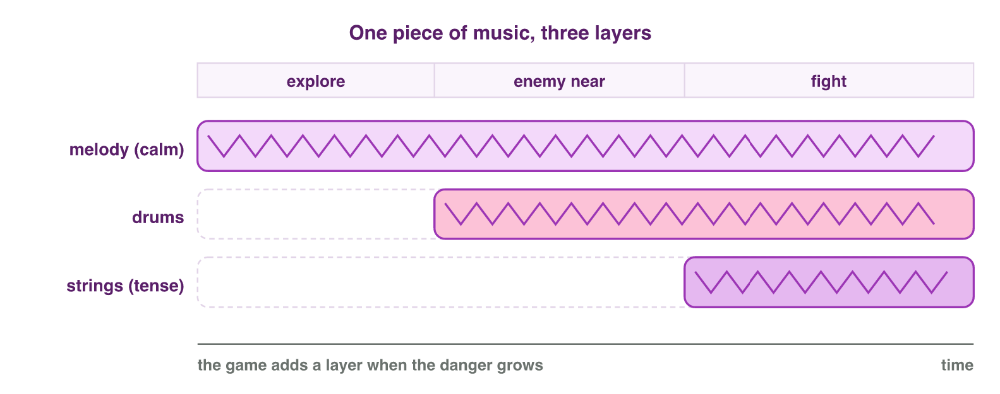

::: {.lead}
A small studio is making *Lantern Keeper*, a mobile game about a lantern
spirit in a dark forest. The rules are ready: tap to float, collect
fireflies. But the game still feels empty. It needs pictures, music, sounds,
words and a story. Players meet a game through these **media**. This course is
about how game media are planned, made and protected. In this first lesson you
learn what digital media are, why game media are different from the media of
a film, how all parts of a game work together for the player, and how a team
makes media step by step. Every section ends with a short task on the lab
computer, on your phone or in a mini-game.
:::

## Key terms



## 1.1 What digital media are

A **medium** (plural *media*) is a way to share content: writing, pictures,
sound, moving pictures. **Digital media** are media stored as numbers, so
that a computer can keep, change, copy and send them. Games use six main
types:

- **text**: dialogue, menus, item names, subtitles;
- **images**: characters, backgrounds, icons;
- **audio**: music, sound effects, voices;
- **video**: cut-scenes and trailers;
- **animation**: pictures or poses in a sequence that make movement;
- **interactive media**: content that answers the user. The game itself is
  the best example.

A work that combines several types is **multimedia**.

Sound and light in the real world change smoothly. A computer must turn them
into a list of numbers. This is **digitization**. For sound, the computer
measures the sound wave many times per second (for example 44 100 times). For
a picture, it measures the colour of many small points, the pixels
(@fig-sampling). More measurements give better quality, but bigger files.
This is why games **compress** their media: formats such as MP3, Ogg, PNG,
JPEG and MP4 make the files much smaller.

{#fig-sampling width=86%}

Images can be stored in two ways (@fig-raster-vector):

- a **raster image** is a grid of pixels. It is good for photos and painted
  art, but it looks blocky when you make it bigger;
- **vector graphics** store shapes: lines, curves and colours. The computer
  draws them again at any size, so they always stay sharp. They are good for
  logos, icons and buttons.

{#fig-raster-vector width=80%}

::: {.callout-important title="Definition 1.1 — Digital media"}
**Digital media** are text, images, audio, video, animation and interactive
content stored as numbers. A computer can store, edit, copy and send them
without losing quality.
:::

::: {.callout-note title="Example 1.1 — Choosing raster or vector"}
The *Lantern Keeper* team needs three images.

1. The painted forest background, with soft light: **raster** (a painting
   with many colours).
2. The game logo, used on a small app icon and on a big poster: **vector**
   (it must stay sharp at every size).
3. The pause button: **vector** (phone screens have many sizes).
:::

::: {.callout-note title="Do it · Raster or vector?"}
On a lab computer:

1. Open **Paint**. Draw a circle. Zoom in to 800 %. What do you see at the
   edge of the circle?
2. Open **PowerPoint** (or Word). Insert a circle shape. Zoom in as far as
   you can. What do you see at its edge now?

*Your result:* one sentence for each tool, and which one is raster and which
one is vector.
:::

## 1.2 What makes game media special

Because they are numbers, game media can change while the player plays. A
film shows the same pictures and sounds every time. A game does not. Three
features make game media special (@tbl-props).

| Feature | Meaning | In games |
|---|---|---|
| modularity | a work is built from separate parts | a level is built from reusable tiles, sprites and sounds |
| variability | one work can exist in many versions | music that changes with danger; skins; translations |
| interactivity | the content answers the player | a sound plays when the player jumps |

: Three features of game media. {#tbl-props}

So game media are not one fixed sequence. They are a *set of possibilities*.
One sound effect may play once or a hundred times. A player may skip a line of
dialogue. A piece of music may loop for an hour. The team must plan media for
all these cases.

{#fig-layers width=88%}

::: {.callout-note title="Example 1.2 — Music that follows the danger"}
An exploration game has one piece of music in three layers: a calm melody,
drums and tense strings.

1. The player explores: only the melody plays.
2. An enemy comes near: the game adds the drums.
3. In a fight: all three layers play (@fig-layers). The *same* music exists
   in three versions, and the game chooses one by the situation.
:::

::: {.callout-warning title="Common mistake"}
Thinking that game music is like film music. Film music is written for fixed
scenes of fixed length. Game music must work for a scene that lasts ten
seconds or ten minutes, and it must change when the game changes.
:::

::: {.callout-note title="Do it · Listen for changes"}
Play a game on your phone for three minutes with the sound on.

1. Write two moments when the music or the sound changed because of
   something in the game (danger, a win, a new place).
2. For each moment, write what changed: faster, louder, a new instrument, a
   new sound.

*Your result:* two moments and the change in each.
:::

## 1.3 The game as a composite medium

A game combines all types of media with something that no other medium has:
rules that the player acts on. The designer Jesse Schell describes a game as
four basic elements, the **elemental tetrad** (@fig-tetrad):

- **mechanics**: the rules, what the player can do and what happens then;
- **story**: the events of the game, written in advance or created by play;
- **aesthetics**: how the game looks, sounds and feels;
- **technology**: the device, the engine, the screen and the speakers that
  make the game possible.

{#fig-tetrad width=62%}

All four elements are equally important, and each one supports and limits the
others. The aim is not the game itself but the **experience** of the player.
The media of this course (story, pictures, sound and video) belong mostly to
story and aesthetics, and technology limits them: memory, storage and screen
size.

::: {.callout-important title="Definition 1.2 — The aim of game media"}
Game media succeed when they make the planned **player experience** stronger.
A beautiful picture or great music that does not fit the experience is a
design mistake, not a success.
:::

::: {.callout-note title="Example 1.3 — The tetrad of Lantern Keeper"}
In *Lantern Keeper*, the player guides a small lantern spirit through a dark
forest.

1. **Mechanics**: tap to float up; the light gets smaller over time and grows
   when the player collects fireflies.
2. **Story**: the spirit must light the lanterns of a village before
   sunrise.
3. **Aesthetics**: warm light in a cold blue forest, soft piano music, a gentle
   chime for each firefly.
4. **Technology**: a phone screen in portrait; a simple light effect so that
   old phones keep 60 frames per second.
5. The planned experience, *lonely but hopeful*, comes from all four
   together. Loud rock music would break it, even with the same rules.
:::

{#fig-lantern width=40%}

::: {.callout-warning title="Common mistake"}
Thinking that *aesthetics* means *graphics*. Aesthetics are everything the
player's senses meet: pictures, but also sound, music, vibration and the
rhythm of animation.
:::



::: {.callout-note title="Do it · Juice It"}
Open the **Juice It** mini-game above (or scan its QR code). The rules never
change: tap to jump.

1. Play 30 seconds with all media layers off.
2. Switch the layers on one at a time: sound effects, music, particles, camera
   shake, story. Play a little after each one.
3. Choose one word for the experience at the start, and one at the end.

*Your result:* the two words, and the layer that changed the experience most.
:::

## 1.4 The creative production pipeline

A team does not make game media in one step. Professional teams follow a
**production pipeline** with three main stages (@fig-pipeline):

- **pre-production**: planning. The idea, the story, the script, the
  storyboard, a style guide with colours and shapes, the time plan and the
  budget;
- **production**: making the **assets**. Drawing, modelling, animating,
  composing music, recording voices and sounds, filming;
- **post-production**: finishing. Editing, mixing the sound, correcting
  colours, compressing and exporting the files in the formats the engine
  needs, then testing them in the game.

{#fig-pipeline width=94%}

| Asset | File formats | Free tools for the lab |
|---|---|---|
| images, sprites, icons | PNG, JPEG, SVG | Paint, GIMP, Krita |
| 3D models | FBX, glTF | Blender |
| music and sound effects | WAV (editing), Ogg, MP3 (game) | Audacity |
| video | MP4 | DaVinci Resolve |
| script and storyboard | documents, drawings | a word processor, paper |

: Common game assets, formats and free tools. {#tbl-assets}

This course follows the same order: story and scripts (weeks 2–4) and
storyboards (weeks 5–6) are pre-production; sound, music and video (weeks
7–12) are production and post-production. Intellectual property (weeks 13–14)
matters at every stage, because every picture, sound and text has an owner.

::: {.callout-note title="Example 1.4 — One sound through the pipeline"}
The "firefly collected" sound of *Lantern Keeper*:

1. **Pre-production**: the plan asks for "a soft, bright chime, shorter than
   half a second, never annoying".
2. **Production**: the sound designer records a small glass bell three times,
   so that the sound does not repeat exactly.
3. **Post-production**: the recordings are cut, made equally loud and saved
   as small Ogg files.
4. **Testing**: a tester says that the chime is too loud next to the music.
   The sound goes back to post-production for a new mix.
:::

::: {.callout-note title="Do it · Make one small asset"}
Make a coin icon for a game, and follow the three stages.

1. **Pre-production**: write a one-line plan, for example "a gold coin with a
   star, round, easy to see on a dark background".
2. **Production**: draw it in Paint (or another tool).
3. **Post-production**: save it as a PNG file with a clear name, for example
   `icon_coin_v1.png`.

*Your result:* the one-line plan and the PNG file.
:::

## Further reading

Schell, *The Art of Game Design: A Book of Lenses*, 3rd ed., the chapters on
the experience and the game, and on the elements of a game (the elemental
tetrad).

## Exercises

1. Name the six types of digital media in games. Give one example of each from
   a game you know.
2. What is digitization? Use the words *measure* and *numbers*.
3. A game logo must appear on an app icon and on a big poster. Raster or
   vector? Why?
4. Explain variability with one example from a game you know.
5. Why must game music be planned differently from film music?
6. Name the four elements of the elemental tetrad and describe each one for a
   game you know.
7. Why is aesthetics not the same as graphics?
8. Put each task in a stage of the pipeline: writing the script; mixing the
   music; recording a voice; drawing the storyboard; exporting a trailer.
9. Why does intellectual property matter at every stage of the pipeline?

## Answers to the exercises

::: {.answers}
1. Text (subtitles), images (characters), audio (music), video (cut-scene), animation (a walk), interactive media (the game itself).
2. The computer measures sound or light many times and keeps each measurement as a number.
3. Vector: it stays sharp at every size.
4. For example: the music adds drums when an enemy comes near.
5. Game scenes have no fixed length and change with the player, so the music must loop and change; film scenes are fixed.
6. Mechanics (rules), story (events), aesthetics (look, sound, feel), technology (device, engine, screen).
7. Aesthetics include everything the senses meet: also sound, music, vibration and rhythm.
8. Pre-production: the script, the storyboard; production: recording a voice; post-production: mixing the music, exporting a trailer.
9. Every asset (text, picture, sound, video) has an owner. Using or changing it at any stage needs permission.
:::
