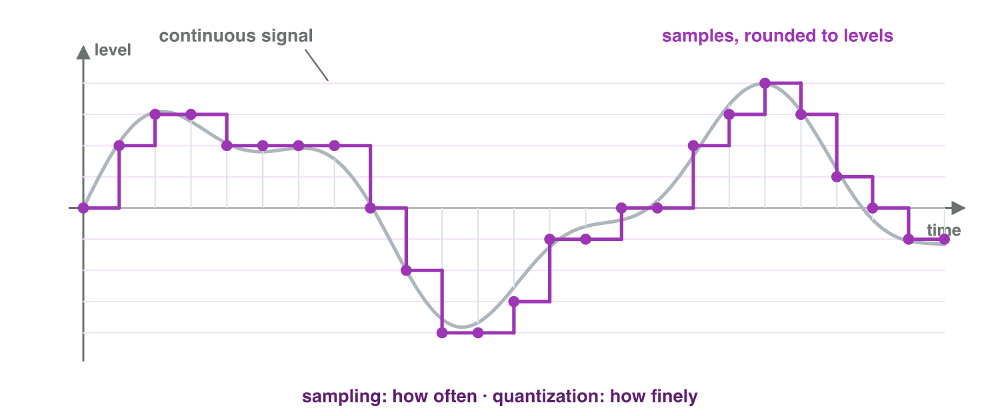

## Keywords



## Think · What does the player meet first?

You open a new game for the first time.
**Do you meet its code — or something else?**

::: {.answer}
Its **media**: images, music, sounds, text, video.
:::

## 1.1 Digital media

:::: {.columns}
::: {.column width="45%"}
- text · images · audio
- video · animation · interactive
- encoded as **numbers**
- several together: multimedia
:::
::: {.column width="55%"}

:::
::::

## Digitization

:::: {.columns}
::: {.column width="38%"}
- **sampling**: how often
- **quantization**: how finely
- CD: 44 100 /s, 16 bits
- 1 s stereo ≈ 176 KB → compress
:::
::: {.column width="62%"}

:::
::::

## Raster or vector?

:::: {.columns}
::: {.column width="38%"}
- raster: pixels — photos, art
- vector: shapes — logos, icons
:::
::: {.column width="62%"}

:::
::::

## Try it 1 · Media as numbers

a) measuring at regular intervals?
b) 1 s of CD stereo?
c) sharp at any size?

::: {.answer}
a) sampling
b) about 176 KB
c) vector graphics
:::

## 1.2 Properties of digital media (+ interactivity)

| Property | In games |
|---|---|
| numerical | colours, volumes changed by code |
| modular | levels from reusable assets |
| automation | procedural levels |
| variability | adaptive music, translations |
| transcoding | art for players, files for the engine |
| **interactivity** | a set of possibilities |

## Try it 2 · Which property?

a) 40 tiles used again and again?
b) drums added when an enemy is near?
c) a new dungeon every game?

::: {.answer}
a) modularity
b) variability
c) automation
:::

## 1.3 The elemental tetrad

:::: {.columns}
::: {.column width="38%"}
- mechanics · story
- aesthetics · technology
- all equal
- goal: **player experience**
:::
::: {.column width="62%"}

:::
::::

## Live demo · Juice It



## Try it 3 · The tetrad of Lantern Keeper

a) tap to float; fireflies grow the light
b) warm light, soft piano
c) cheap shader, 60 fps on old phones

::: {.answer}
a) mechanics
b) aesthetics
c) technology
:::

## 1.4 The production pipeline

:::: {.columns}
::: {.column width="38%"}
- pre-production: plan
- production: assets
- post-production: finish
- testing sends work back
:::
::: {.column width="62%"}

:::
::::

## Try it 4 · Which stage?

a) script and storyboard
b) recording voices
c) mixing, exporting

::: {.answer}
a) pre-production
b) production
c) post-production
:::

## Game challenge · Lantern Keeper's media plan

:::: {.columns}
::: {.column width="55%"}
- 2-minute looping music, 3 layers
- firefly chime × 3 variations
- vector logo · 30-second trailer
:::
::: {.column width="45%"}

:::
::::

## Try it 5 · Planning the media (harder)

a) 2 min uncompressed (176 KB/s)?
b) 3 music layers = which property?
c) logo for icon and banner?

::: {.answer}
a) about 21 MB
b) variability
c) vector
:::

## Summary

- digital media = numbers · sampling + quantization
- compress · raster vs vector
- modular, variable, automated, interactive
- tetrad → player experience
- pre → production → post → testing
