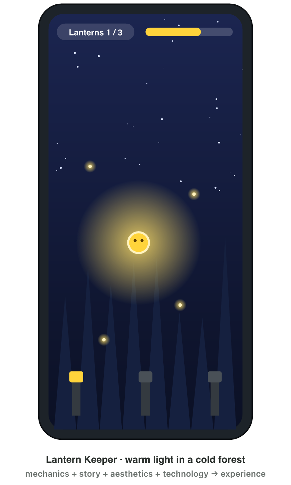
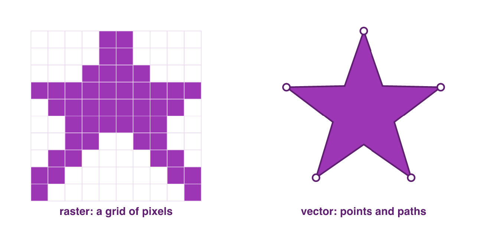
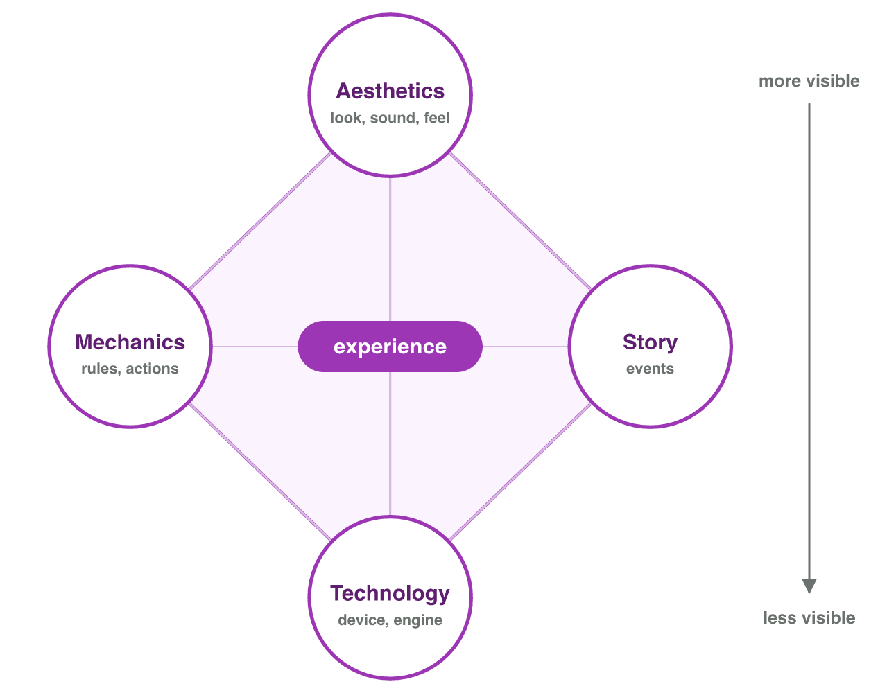
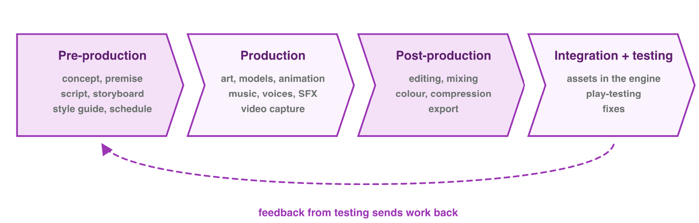

## Keywords



## 1.1 Digital media

:::: {.columns}
::: {.column width="50%"}
- Digital media are content stored as numbers.
- Games use six types: text, images, audio, video, animation and interactive media.
- Several media types in one work are called **multimedia**.
- Games keep their media in small, compressed files.
:::
::: {.column width="50%"}

:::
::::

## Raster or vector?

:::: {.columns}
::: {.column width="50%"}
- A **raster** image is a grid of pixels. It gets blocky when you enlarge it.
- **Vector** graphics are shapes. They stay sharp at any size.
- Photos and paintings are raster; logos and icons are often vector.
- **Do it:** Draw a circle in Paint and in PowerPoint, and zoom in. Which one stays sharp?
:::
::: {.column width="50%"}

:::
::::

## Try it 1 · Media as numbers

a) The game logo must look sharp on a tiny icon and on a big poster. Which image type should it be?
b) Which image type is a painted forest background with soft light?
c) What do we call several media types together in one work?

::: {.answer}
a) vector
b) raster
c) multimedia
:::

## 1.2 The elemental tetrad

:::: {.columns}
::: {.column width="50%"}
- A game has four elements: mechanics, story, aesthetics and technology.
- Mechanics are the rules; aesthetics are the look, sound and feel.
- Technology is the device, the engine and the screen.
- All four together create the **player experience**.
:::
::: {.column width="50%"}

:::
::::

## Live demo · Juice It



## Try it 2 · The tetrad of Lantern Keeper

a) In Lantern Keeper, you tap to float and collect fireflies to grow the light. Which element is this?
b) The game has warm light and soft piano music. Which element is this?
c) A simple light effect keeps old phones at 60 fps. Which element is this?

::: {.answer}
a) mechanics
b) aesthetics
c) technology
:::

## 1.3 The production pipeline

:::: {.columns}
::: {.column width="50%"}
- **Pre-production:** the team plans the idea, the script and the style.
- **Production:** the team makes the assets: it draws, records and models.
- **Post-production:** the team edits, mixes and exports the assets.
- Testing in the game can send an asset back to an earlier stage.
- **Do it:** Make a coin icon: write a plan, draw it in Paint, save it as a PNG file.
:::
::: {.column width="50%"}

:::
::::

## Example · One sound through the pipeline

Lantern Keeper needs a firefly chime.
**What happens to the chime in each stage of the pipeline?**

::: {.reveal}
1. Pre-production: the plan says "soft, bright, short".
2. Production: a bell is recorded three times.
3. Post-production: the sound is cut, mixed and saved.
4. Testing: it is too loud, so it goes back to mixing.
:::

## Try it 3 · Which stage?

a) A writer writes the script of a cut-scene. Which stage of the pipeline is this?
b) An actor records the voice of the hero. Which stage is this?
c) The editor exports the trailer as an MP4 file. Which stage is this?

::: {.answer}
a) pre-production
b) production
c) post-production
:::

## Game challenge · Lantern Keeper



## Try it 4 · Planning the media (harder)

The facts: Lantern Keeper needs a firefly chime in three versions and a logo for the store. The story: the spirit must light the lanterns before sunrise.

a) "Light the lanterns before sunrise": which element of the tetrad is this?
b) Why does the chime have three versions instead of one?
c) Which image type should the logo be, for a tiny icon and a big banner?

::: {.answer}
a) story
b) so it does not repeat exactly
c) vector
:::

## Summary

- Digital media are content stored as numbers, and games compress them.
- A raster image is made of pixels; vector graphics are shapes that stay sharp.
- Mechanics, story, aesthetics and technology create the player experience.
- Media go through pre-production, production, post-production and testing.
