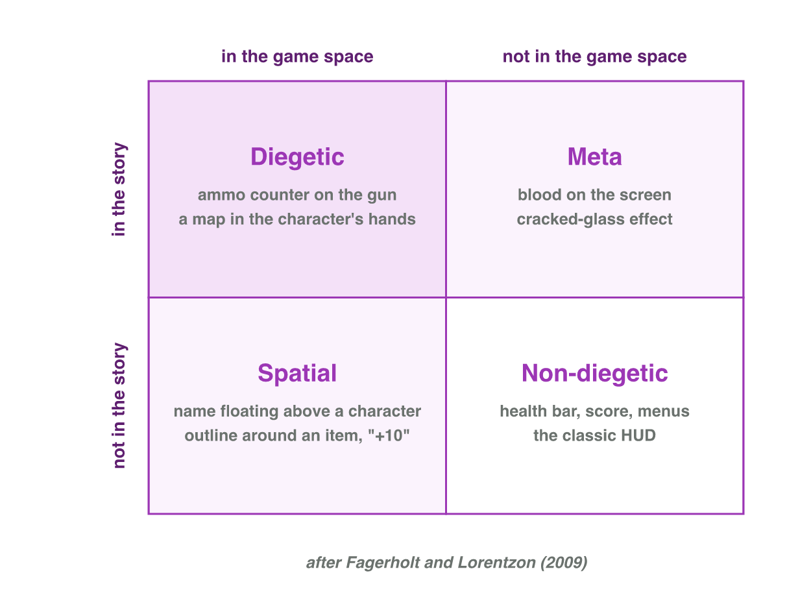

::: {.lead}
Players experience the media of a game all at once: a theme tune, a burst of
light, a line of dialogue, a health bar turning red. To design media, one
must first learn to take this experience apart. This chapter gives a method
for analysing the media of any game in four steps — make an inventory, find
the function of each element, locate it inside or outside the game world, and
evaluate it against clear criteria — and closes with the structure of a
written media analysis.
:::

## Key terms



## 2.1 The media inventory

The first step of an analysis is description, not judgement: an **inventory**
of the media that the game uses, organised by **media channel**. Five
channels cover almost every game (@fig-annotated):

- **visual** — the **art style** (the consistent visual language of shapes,
  colours and proportions), characters, environments, animation and visual
  effects;
- **audio** — music, **sound effects** (SFX), voices and **ambience** (the
  background sound of a place);
- **text and narrative** — dialogue, item descriptions, quest logs, the story
  told in words;
- **cinematic** — cut-scenes, intro videos and trailers: sequences in which
  the player watches rather than plays;
- **interface** — menus, buttons, icons and the head-up display (HUD) that
  shows health, score or time.

{#fig-annotated width=94%}

An inventory is easiest to use as a table: one row per element, with its
channel, a short description and the moment in the game where it appears.

::: {.callout-note title="Example 2.1 — Inventory of one screen"}
The screen of *Ember Trail* in @fig-annotated contains:

1. a fox character drawn in a soft, rounded art style (visual);
2. a campfire with animated flames and crackling sound (visual, audio);
3. a health bar and a coin counter at the top (interface);
4. a speech bubble, "The bridge is out!" (text and narrative);
5. a floating "+10" above a collected coin (interface, visual effect);
6. background music played on a flute, and wind ambience (audio).

The inventory is complete when every element that reaches the player's eyes
or ears has a row; *what* each element does is the next step.
:::

## 2.2 The functions of media

Every media element in a well-designed game has a job. Five functions occur
again and again:

| Function | Question it answers for the player | Example |
|---|---|---|
| **feedback** | What happened because of my action? | a chime and a flash when a coin is collected |
| **guidance** | Where should I go, what can I use? | a glowing door, an arrow, a lit path |
| **mood** | How should this moment feel? | slow strings in a sad scene, rain ambience |
| **narrative** | What is the story, who are these people? | dialogue, a cut-scene, a ruined statue |
| **identity** | Which game is this? | a theme tune, a logo, a recognisable art style |

: The functions of media in games. {#tbl-functions}

One element often performs several functions. A short trumpet phrase at the
end of a level is feedback (the level is complete), mood (triumph) and
identity (players recognise the game by it). A good analysis names all the
functions it can justify.

::: {.callout-note title="Example 2.2 — The functions of the “+10”"}
In *Ember Trail*, collecting a coin shows a floating "+10", plays a bright
"ting" and adds to the counter.

1. **Feedback**: the player learns at once that the action succeeded and how
   much it was worth.
2. **Guidance**: coins are placed along the safe path, so the sparkle of the
   next coin shows where to jump.
3. **Mood**: the bright, rising sound feels rewarding and keeps the tone light.
:::

::: {.callout-warning title="Common mistake"}
Describing instead of analysing. "There is music in the menu" is inventory;
"the slow flute theme in the menu sets a calm, nostalgic mood before play
begins" is analysis: it names the element, its function and its effect on
the player.
:::

## 2.3 Inside or outside the game world: diegetic and non-diegetic

Film theory uses the word *diegesis* for the world of the story. An element is
**diegetic** when it exists inside that world, so that the characters could
perceive it: the crackling of the campfire, a radio playing in a room, the
footsteps of the hero. It is **non-diegetic** when it exists only for the
audience: the background music, the narrator's voice, the score counter.

The distinction is especially useful for sound and for interfaces. Fagerholt
and Lorentzon proposed a model that classifies interface elements on two
questions (@fig-diegesis): does the element exist in the *story* of the game
world, and is it placed in the *space* of the game world?

{#fig-diegesis width=78%}

- **diegetic** — in the story and in the space: an ammunition counter printed
  on the gun itself, a map that the character holds;
- **non-diegetic** — neither: the classic HUD with health bar and score;
- **spatial** — in the space but not in the story: a floating name above a
  character, an outline drawn around an item, the "+10" above a coin;
- **meta** — in the story but not in the space: blood spatter on the screen
  when the character is hurt, a cracked-glass effect.

::: {.callout-important title="Definition 2.1 — Diegetic and non-diegetic elements"}
A media element is **diegetic** if it belongs to the game world and its
characters could perceive it, and **non-diegetic** if it is presented only to
the player.
:::

Designers choose deliberately. Diegetic elements strengthen *immersion* — the
feeling of being inside the world — but can be harder to read quickly.
Non-diegetic elements are clear and fast to read but remind the player that
they are looking at an interface. Horror games, for instance, often hide the
HUD and replace it with diegetic cues — a character's heavy breathing instead
of a health bar.

::: {.callout-note title="Example 2.3 — Classifying the sounds of a scene"}
In *Ember Trail* the fox walks past a campfire at night.

1. The crackling of the fire, louder as the fox comes closer: **diegetic** —
   the fox could hear it, and it comes from a place in the world.
2. The fox's footsteps: **diegetic**.
3. The flute music: **non-diegetic** — no flute exists in the world.
4. The "ting" of a collected coin: **non-diegetic** feedback, even though
   the coin itself is part of the world.
:::

The mini-game below presents such a scene. Walk the character past the fire
and switch each layer on and off: diegetic sounds change with the
character's position, non-diegetic music does not.



## 2.4 Evaluating media

The last step is evaluation: judging how well each element, and the media as a
whole, serve the intended player experience. Judgements must rest on
criteria, not on personal taste. Five criteria cover most cases:

| Criterion | Question | Signs of a problem |
|---|---|---|
| **coherence** | Do all elements share one style and tone? | a realistic photo next to cartoon characters |
| **clarity** | Can the player read the important information quickly? | a red warning on a red background |
| **fit** | Do the media suit the genre, the audience and the moment? | cheerful music during a sad scene |
| **technical quality** | Are resolution, compression and loudness right? | blurred text, clipping audio, visible compression |
| **accessibility** | Can players with different abilities perceive it? | no subtitles; colour as the only signal |

: Criteria for evaluating game media. {#tbl-criteria}

**Accessibility** deserves special attention, because a large share of
players is affected by it: about one man in twelve has some form of
colour-vision deficiency, and many people play with the sound off on public
transport. Good games never rely on a single channel for important
information — a danger signal is a colour *and* a shape *and* a sound — and
offer subtitles and adjustable text size.

### Writing the analysis

A written media analysis is organised around claims, each supported by
evidence and connected to the player:

1. **claim** — what the element does ("the music builds tension before the
   boss");
2. **evidence** — what exactly shows it ("the tempo doubles and low drums
   enter when the gate opens");
3. **effect** — what the player feels or does as a result ("the player slows
   down and prepares, before seeing the enemy").

A short scoring grid (for example 1–3 points per criterion) helps to compare
games or versions, but the written claims are the real content of the
analysis.

::: {.callout-note title="Example 2.4 — One claim, evidence and effect"}
*Ember Trail*, evaluated on clarity:

1. **Claim**: the health bar is hard to read during play.
2. **Evidence**: it is a thin orange bar on a sunset sky of nearly the same
   colour, in the corner of the screen.
3. **Effect**: players notice low health too late and fail without
   understanding why. Recommendation: add a dark outline and a heartbeat sound
   when health is low — clarity through two channels.
:::

## Case study: analysing Ember Trail

*Ember Trail* is a 2D adventure game for phones: a young fox crosses a
forest at night to return home. Its art style is soft and rounded, its
palette warm against deep blue, its music a solo flute with wind ambience;
the interface shows health, coins and a pause button; short animated scenes
tell the story between chapters. The exercises below and the Game challenge of
the interactive lesson analyse it with the method of this chapter.

## Further reading

Schell, *The Art of Game Design*, 3rd ed., chapters on aesthetics and on
interface; Collins, *Game Sound*, MIT Press, 2008, on diegetic and
non-diegetic game audio; Fagerholt and Lorentzon, *Beyond the HUD* (2009), on
the four kinds of interface elements.

## Exercises

1. Name the five media channels and give one example of each from a game you
   know.
2. Write a four-row inventory for the title screen of a game you know.
3. Name the five functions of media. Give one element that performs at least
   two functions and explain both.
4. Rewrite the description "The game has sound effects" as an analytical
   sentence.
5. Classify as diegetic or non-diegetic: (a) a radio playing in a car the
   player drives; (b) the menu music; (c) a narrator; (d) a dog barking off
   screen.
6. Classify each interface element as diegetic, non-diegetic, spatial or meta:
   (a) a health bar in the corner; (b) a glowing outline around a door;
   (c) the screen turning red when the character is hurt; (d) a watch on the
   character's wrist that shows the time.
7. Give one advantage and one disadvantage of replacing a HUD with diegetic
   elements.
8. A game shows enemies in red and friends in green only. Which criterion does
   it violate, and how would you fix it?
9. Write one claim, its evidence and its effect about the music of a game you
   know.
10. *Ember Trail*: the coin "ting" is louder than the dialogue voices. Which
    criterion is affected, and what would you recommend?

## Answers to the exercises

::: {.answers}
1. Visual (art style), audio (music), text and narrative (dialogue), cinematic (cut-scene), interface (HUD).
2. For example: logo (visual), theme music (audio), "Tap to start" (interface), animated background (visual).
3. Feedback, guidance, mood, narrative, identity. A victory fanfare: feedback (level complete) and identity (recognisable theme).
4. For example: "A sharp metallic clang confirms every successful block, so the player knows at once that the attack failed."
5. (a) diegetic; (b) non-diegetic; (c) non-diegetic; (d) diegetic.
6. (a) non-diegetic; (b) spatial; (c) meta; (d) diegetic.
7. Advantage: stronger immersion. Disadvantage: information is slower or harder to read.
8. Accessibility (and clarity): colour is the only signal; add shapes or icons and a colour-blind mode.
9. For example: claim — the music raises tension; evidence — the tempo rises as the timer runs out; effect — the player hurries.
10. Technical quality (mixing/loudness) and clarity: lower the SFX or duck them under dialogue.
:::
