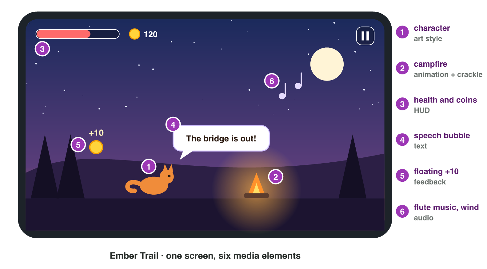
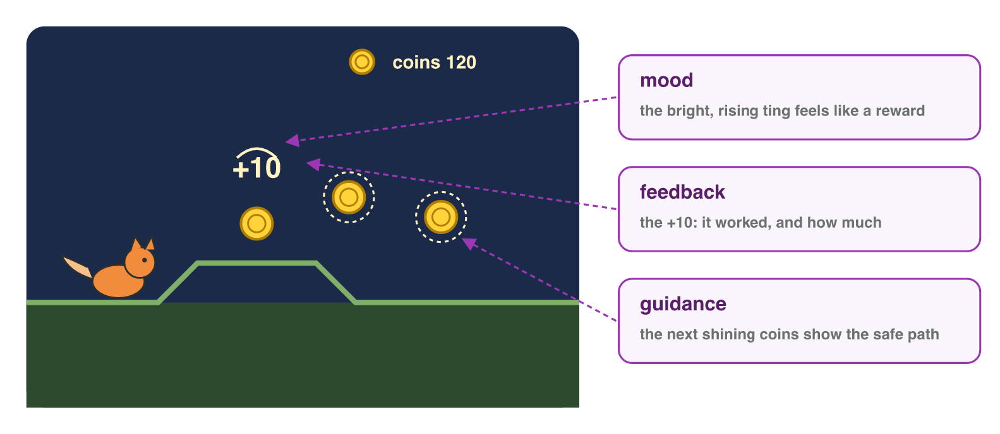

## Recall · Lecture 1

a) A chime and a flash play when the player collects a coin. Which job do they do?
b) Which element of the tetrad are the phone, the engine and the screen?
c) In which stage of the pipeline does the team record the voice of the hero?

::: {.answer}
a) feedback
b) technology
c) production
:::

## Activity 1 · Media and tetrad · 15 min

:::: {.columns}
::: {.column width="50%"}
- An analysis starts with a list of the media of a game.
- **Do it:** Take a screenshot of a game on your phone. Write five media elements with their types, and one line for each element of the tetrad.
- Your product is a table of five elements and four lines.
:::
::: {.column width="50%"}

:::
::::

## Check 1 · Media and tetrad

What does a good answer look like?

::: {.reveal}
1. It has five types: the hero (image), the music (audio), the coin counter (text), the intro film (video), the running hero (animation).
2. Mechanics are the rules, for example "tap to jump".
3. Story is the events, for example "the hero looks for his sister".
4. Aesthetics are the look and sound, and technology is the phone that runs the game.
:::

## Activity 2 · Jobs and pipeline · 15 min

:::: {.columns}
::: {.column width="50%"}
- An analysis names the element, its job and its effect on the player.
- **Do it:** Write the job and the effect of three elements of your game. Then write the three pipeline stages of one of them.
- Your product is three sentences and three pipeline lines.
:::
::: {.column width="50%"}

:::
::::

## Check 2 · Jobs and pipeline

What do a good sentence and good pipeline lines look like?

::: {.reveal}
1. "The red flash when the hero is hit is feedback: it tells me that I lost health, so I play more carefully."
2. In pre-production, the team plans the battle music.
3. In production, a composer records it.
4. In post-production, the team mixes it with the sound effects and exports it.
:::

## Wrap-up

- You can list the media of a game by type and describe its tetrad.
- You can explain the job of an element, its effect and how the team made it.
