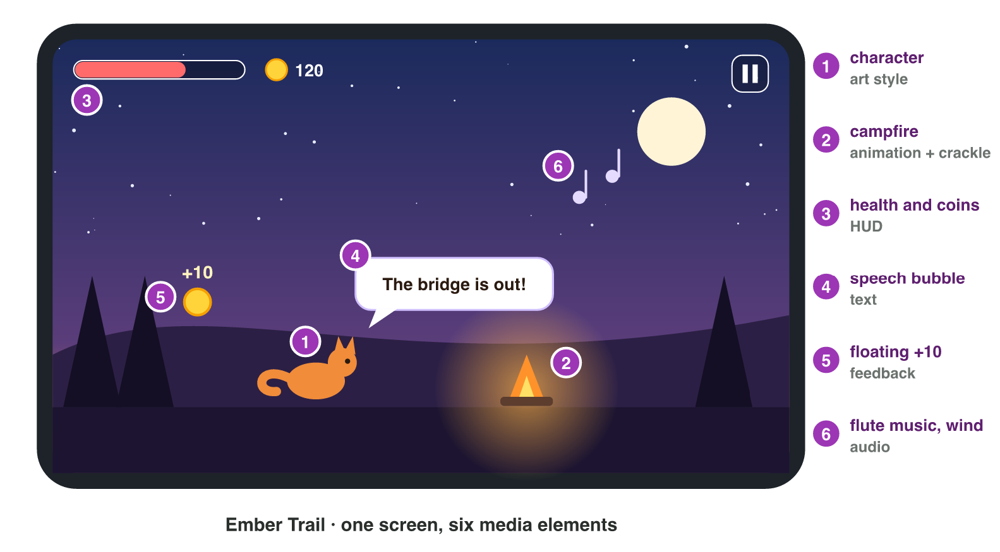
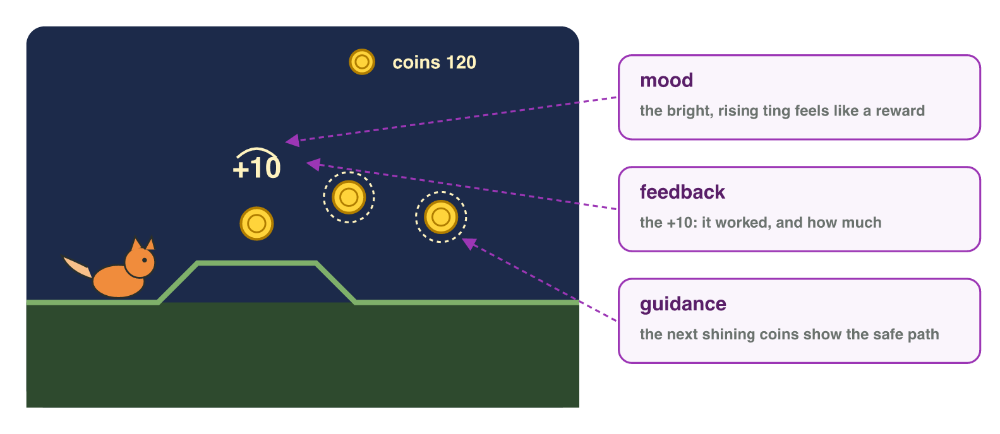

No new ideas today: two short problems on Lecture 1, about a game you play.
Do each one alone. Tap, sort or type your answer at every step: the page
checks it at once and tells you why.

## Recall

- **Digital media:** text, images, audio, video, animation and interactive
  content.
- The **tetrad**: mechanics, story, aesthetics and technology make the
  player experience together.
- Media do five jobs: **feedback**, **guidance**, **mood**, **story**,
  **identity**. The team makes them in a **pipeline**: pre-production,
  production, post-production.

::: {.callout-tip title="Try it 1 · Recall"}
Choose the right answer.

::: {.match extra="story|pre-production"}
A chime and a flash when the player collects a coin. Which job?
:   feedback

    Why: It tells the player what the action did.

The phone, the engine and the screen. Which element of the tetrad?
:   technology

    Why: Technology is what the game runs on.

Recording the voice of the hero. Which stage of the pipeline?
:   production

    Why: Recording makes an asset.
:::
:::

## Activity 1 · Take your game apart

A studio wants to know why your favourite game works. The first step of an
analysis is a list: which media are there?

{width=90%}

::: {.callout-note title="Activity 1 · Media and tetrad · 15 min"}
Choose a game on your phone. Take a screenshot of one busy moment.

1. Write five media elements of the game, and the type of each one.
2. Write one line for each element of the tetrad: mechanics, story,
   aesthetics, technology.

*Your product:* a table of five elements and four short lines.

Here is one busy moment of *Hero Dash*.

::: {.sort}
Step 1: which type of media is each element of Hero Dash? Sort them.

Image
:   the hero

    Why: A drawn picture.

Audio
:   the battle music

    Why: Sound.

Text
:   the coin counter

    Why: Numbers and words on the screen.

Video or animation
:   the intro film

    Why: A recorded scene: video.

:   the hero running

    Why: A picture that moves: animation.
:::

::: {.sort}
Step 2: which element of the tetrad is each line? Sort them.

Mechanics
:   tap to jump

    Why: A rule: an action of the player.

Story
:   the hero looks for his sister

    Why: The goal and the events.

Aesthetics
:   bright cartoon colours and drums

    Why: What the player sees and hears.

Technology
:   a phone, held upright

    Why: The device and how it is used.
:::
:::

::: {.callout-tip title="Try it 2 · Types and the tetrad"}
Choose the right answer.

::: {.match extra="technology|text"}
A short film between two levels. Which type of media?
:   video

    Why: The player watches moving pictures.

"Swipe up to jump over a wave." Which element of the tetrad?
:   mechanics

    Why: It is a rule: what the player can do.

Bright sea colours and steel-drum music. Which element of the tetrad?
:   aesthetics

    Why: Aesthetics are how the game looks, sounds and feels.
:::
:::

## Activity 2 · What each element does, and how it was made

An analysis says what an element does for the player. "There is music in
the menu" only describes. "The slow flute music in the menu makes the
player calm before play begins" names the element, its job and its effect.

{width=90%}

::: {.callout-note title="Activity 2 · Jobs and pipeline · 15 min"}
Use your table from Activity 1.

1. Choose three elements. For each one, write its job and its effect on
   the player in one sentence.
2. Choose one of the three. Write what the team did for it in
   pre-production, production and post-production.

*Your product:* three sentences and three short pipeline lines.

::: {.choice}
Step 1: which sentence explains an element (the element, its job and its
effect)?

- [x] "The red flash when the hero is hit is feedback: it tells me at once that I lost health, so I play more carefully."

  Why: It names the element, its job and its effect on the player.

- [ ] "There is a red flash in the game."

  Why: It only describes; it says no job and no effect.

- [ ] "The red flash is nice."

  Why: An opinion: no job and no effect.
:::

::: {.order}
Step 2: put the pipeline of the battle music in order.

1. Pre-production: the team plans a fast tune.
2. Production: a composer records it.
3. Post-production: the team mixes it so that the effects stay clear, and exports it.

Why: Plan, make, then edit, mix and export.
:::
:::

::: {.callout-tip title="Try it 3 · Jobs and stages"}
Choose the right answer.

::: {.match extra="mood|production"}
A glowing door at the end of a dark room. Which job?
:   guidance

    Why: It shows the player where to go.

A theme tune that players know at once. Which job?
:   identity

    Why: It tells which game this is.

Mixing the music so that the voices stay clear. Which stage?
:   post-production

    Why: Mixing finishes the assets.
:::
:::

## Wrap-up {.summary}

- You can list the media of a game by type and describe its tetrad.
- You can explain the job of a media element, its effect on the player and
  how the team made it.
