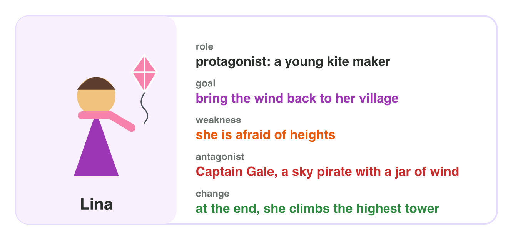
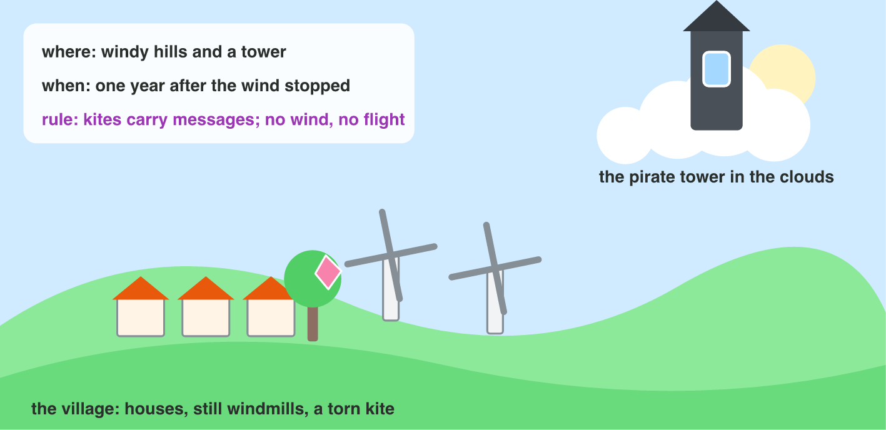
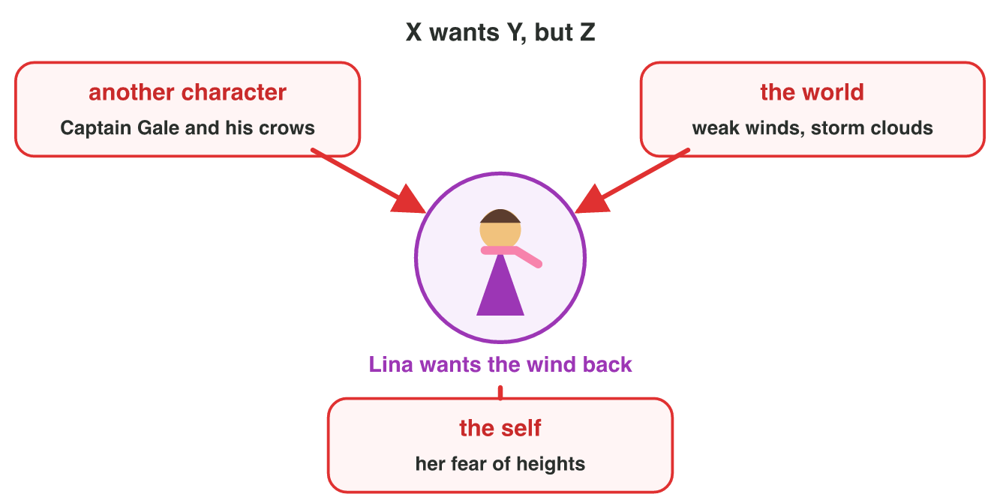
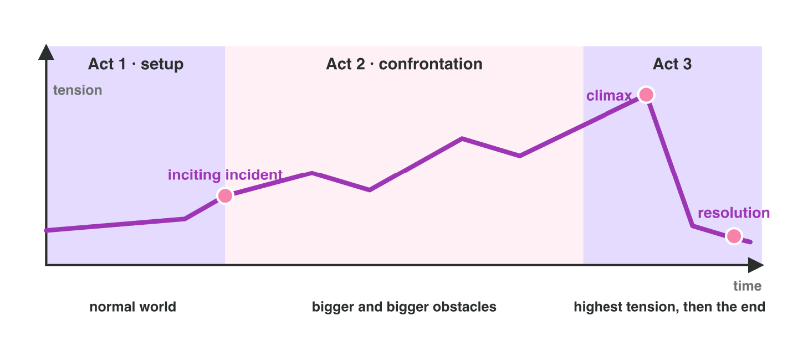

This page is the interactive version of the lesson notes (PDF). Each section
starts with a problem in a game. Then it explains one building block of a
story and what it does for the player. It ends with a **Do it** task on a
game you play and one set of questions. The full explanations, examples and
exercises are in the notes.

## Key terms



## 3.1 Who do we follow? Character and goal

- A **story** follows a character who **wants** something.
- The **protagonist** is the main character. The **antagonist** works
  against the protagonist's goal.
- A good protagonist has a **goal**, a **weakness** and a **change** at the
  end.
- In a game, the player often controls the protagonist. So the player takes
  the goal as their own.
- *Skyward Kite:* Lina, a young kite maker, wants to bring the wind back. She
  is afraid of heights. The sky pirate Captain Gale keeps the wind in a jar.

{width=86%}

::: {.callout-warning title="Watch out!"}
"A girl with a red scarf" is only a look. Start with the goal: "a kite maker
who wants to bring the wind back."
:::

::: {.callout-note title="Do it · The protagonist of your game"}
Choose a game you play (or a film you know). Make a character card with four
lines: name, goal (one sentence), one weakness, the antagonist (or "none").
:::

::: {.callout-tip title="Try it 1 · Characters"}
Choose the right answer.

::: {.match extra="the setting|a look"}
In Skyward Kite, Captain Gale keeps the wind in a jar. What is he?
:   the antagonist

Lina wants to bring the wind back to her village. What is this?
:   her goal

Lina is afraid of heights. What is this?
:   her weakness

At the end, Lina climbs the highest tower without fear. What is this?
:   her change

Why does the player care about the hero's goal?
:   the player controls the hero
:::
:::

## 3.2 Where and when? The setting

- The **setting** is the place, the time and the **rules** of the world.
- **Where?** A village on windy hills, and a pirate tower in the clouds.
- **When?** One year after the wind stopped.
- **Rules:** kites carry messages; without wind, nothing flies.
- In a game, the setting becomes the **levels**, its rules become the
  **mechanics**, and its colours and sounds set the **mood**.

{width=90%}

::: {.callout-warning title="Watch out!"}
A setting is not only a background picture. A "frozen kingdom" where the ice
is not slippery is only a picture.
:::

::: {.callout-note title="Do it · The setting of your game"}
Write three lines about your game: **where**, **when**, and **one rule** of
its world. Add one sentence: how does the setting change what the player can
do?
:::

::: {.callout-tip title="Try it 2 · Setting"}
Choose the part of the setting. You can use an answer more than once.

::: {.match extra="the conflict"}
A village on windy hills.
:   where

One year after the wind stopped.
:   when

Kites carry messages between villages.
:   a rule of the world

Broken windmills stand still on the hills.
:   where

:::
:::

## 3.3 What stands in the way? Conflict and stakes

- **Conflict** is the struggle between what a character wants and what
  stands in the way.
- One sentence holds it: **"X wants Y, but Z."**
- Conflict comes from **another character**, **the world** or **the self**.
- The **stakes** are what the character loses if the goal is not reached.
- In games, the obstacles become the **challenges** of the levels, and the
  stakes make the player care about winning.

{width=86%}

::: {.callout-warning title="Watch out!"}
"Lina must reach the tower" is only a task. "…before winter, or the village
will starve" adds the stakes.
:::

::: {.callout-note title="Do it · The conflict of your game"}
Write the conflict of your game in one sentence: "X wants Y, but Z." Then
name its source (another character, the world or the self) and the stakes.
:::

::: {.callout-tip title="Try it 3 · Conflict"}
Choose the source of the conflict, or the stakes. You can use an answer more
than once.

::: {.match extra="the setting"}
Gale's crows attack Lina's kite.
:   another character

The last winds are weak, so Lina must find warm air to rise.
:   the world

Lina is afraid of heights.
:   the self

Without wind, the village will have no bread by winter.
:   the stakes

A storm breaks the bridge in front of the hero.
:   the world
:::
:::

## 3.4 Beginning, middle, end: the three-act structure

- **Act 1 (setup):** the normal world. It ends with the **inciting
  incident**, the event that starts the conflict.
- **Act 2 (confrontation):** bigger and bigger obstacles. It is the longest
  act, with most of the levels.
- **Act 3:** the **climax** (the highest tension) and the **resolution** (the
  new situation).
- In a game, act 1 is often the tutorial.

{width=92%}

::: {.callout-warning title="Watch out!"}
The climax belongs near the end. If the biggest fight is in level 5 of 10,
the last levels feel empty.
:::

::: {.callout-note title="Do it · Five events of a story"}
Write five events of your game (or a film) in order: the normal world, the
inciting incident, a big obstacle, the climax, the resolution. Mark the act
of each one.
:::

::: {.callout-tip title="Try it 4 · Three acts"}
Choose the part of the structure.

::: {.match extra="the hook|the setting"}
A last kite falls from the sky with a map to the tower.
:   the inciting incident

Lina mends kites in the silent village.
:   the normal world (act 1)

Lina crosses the forest of crows and the storm clouds.
:   the confrontation (act 2)

On top of the tower, Lina breaks the jar while Gale tries to stop her.
:   the climax

The wind returns, and the village holds its kite festival.
:   the resolution
:::
:::

## Game challenge: Skyward Kite {.challenge}

Work alone. Use every section of today.

**Skyward Kite** is a mobile game. **Lina**, a young kite maker who is afraid
of heights, lives in a village on windy hills. One year ago, the sky pirate
**Captain Gale** locked the wind in a glass jar in his tower in the clouds.
Without wind, kites cannot carry messages, and the village will have no bread
by winter. A last kite falls with a map to the tower. Lina flies across the
hills, the forest of crows and the storm clouds, breaks the jar and brings
the wind home.



::: {.callout-tip title="Try it 5 · The building blocks"}
Skyward Kite: Lina (kite maker, afraid of heights), Captain Gale (keeps the
wind in a jar), a village on windy hills, no bread by winter. Choose the
building block. You can use an answer more than once.

::: {.match extra="structure"}
Lina, a young kite maker.
:   character

The tower in the clouds.
:   setting

Lina wants the wind back, but Gale keeps it in a jar.
:   conflict

Captain Gale, the sky pirate.
:   character
:::
:::

::: {.callout-tip title="Try it 6 · What does it do for the player? (harder)"}
Skyward Kite: Lina wants the wind back, but Gale keeps it in a jar; without
wind, the village will have no bread by winter; the game has ten levels.
Choose the right answer.

::: {.match extra="it is the setting|it ends the story"}
Why does the player hurry through the levels?
:   the stakes: no bread by winter

Which act holds most of the ten levels?
:   act 2

Why does the screen shake when Lina looks down?
:   it shows her conflict with herself

Where should the fight with Gale be: level 5 or level 10?
:   level 10, the climax

What does the inciting incident give the player?
:   a reason to start the journey
:::
:::

## Summary {.summary}

- A story follows a protagonist with a goal, a weakness and a change.
- The setting is the place, the time and the rules of the world.
- Conflict: "X wants Y, but Z"; the stakes are what is lost.
- Three acts: setup and inciting incident, confrontation, climax and resolution.
- Each block gives the player a reason to play and to care.
