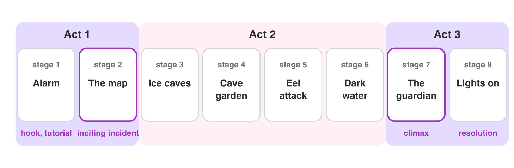
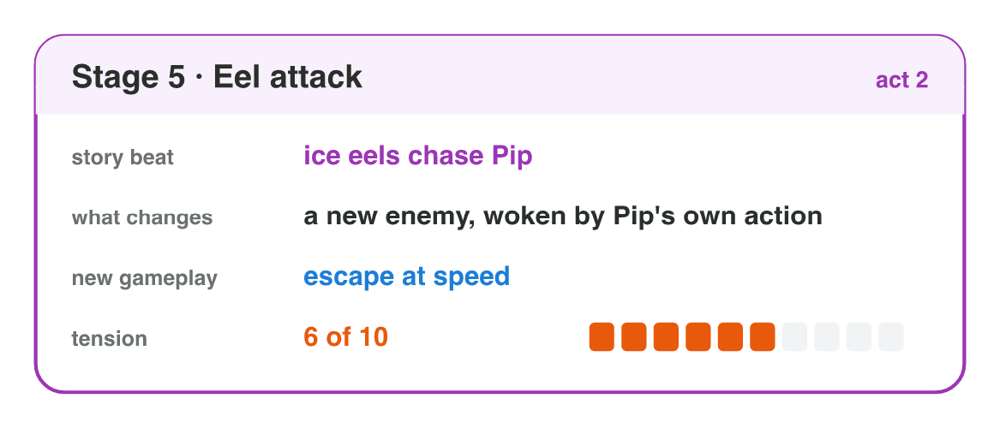

This page is the interactive version of the lesson notes (PDF). Each section
starts with a problem in a game studio. Then it gives you one tool to
analyse the story of a game. It ends with a **Do it** task on a game you play
and one set of questions. The full explanations, examples and exercises are
in the notes.

## Key terms



## 4.1 From three acts to the stages of a game

- A mobile game tells its story in **stages** (levels, chapters, worlds).
- The order of the story's events across the stages is its **narrative
  structure**.
- Eight stages: **act 1** = stages 1–2 (normal world, tutorial, inciting
  incident), **act 2** = stages 3–6 (the journey), **act 3** = stages 7–8
  (climax, resolution).
- *Moon Diver:* stage 1 Alarm (power at 20 %), stage 2 The map (inciting
  incident), stages 3–6 ice caves, cave garden, eel attack, dark water,
  stage 7 The guardian (climax), stage 8 Lights on (resolution).

{width=92%}

::: {.callout-warning title="Watch out!"}
A tutorial with no story gives no reason to come back. The alarm and the low
power give the player a reason to learn to dive.
:::

::: {.callout-note title="Do it · The acts of your game"}
Choose a mobile game with stages or chapters that you have played. Write its
first four or five stages and mark the act of each one. Which stage starts
the conflict?
:::

::: {.callout-tip title="Try it 1 · Acts and stages"}
Moon Diver has eight stages (see the list above). Choose the right answer.

::: {.match extra="stage 1|stage 4"}
In which stage is the inciting incident?
:   stage 2

In which stage is the climax?
:   stage 7

Which act holds stages 3 to 6?
:   act 2

Which stage is the resolution?
:   stage 8

Stage 1 is the tutorial. What gives it a story?
:   the alarm: power at 20 %
:::
:::

## 4.2 The beat table: what happens in each stage

- A **story beat** is an important event that **changes** the situation.
- A **beat table** has one row per stage: stage, story beat, what changes,
  new gameplay.
- Moon Diver, stage 5: *ice eels chase Pip* — a new enemy — escape at speed.
- Moon Diver, stage 4: *Pip repairs its lamp in the cave garden* — a calm
  rest — collect light seeds.
- Moon Diver, stage 6: *the lamp fails* — Pip is alone in the dark — move by
  sound.
- "More enemies" is gameplay, not a story beat: nothing changes in the story.

{width=76%}

::: {.callout-warning title="Watch out!"}
"Harder jumps" or "more coins" in the story column is gameplay. Ask: *what
changes for the hero?*
:::

::: {.callout-note title="Do it · A beat table"}
Make a beat table for four stages of your game: stage, story beat, what
changes, new gameplay. Write "none" where a stage has no beat. Which stage has
the weakest beat?
:::

::: {.callout-tip title="Try it 2 · Beats"}
Choose the right answer. You can use an answer more than once.

::: {.match extra="the climax"}
"Stage 5 — more enemies." Is this a story beat?
:   no, it is only gameplay

"Ice eels wake up because Pip took the first crystal." Is this a story beat?
:   yes, it changes the situation

"Stage 3 — harder jumps." Is this a story beat?
:   no, it is only gameplay

In the beat table, the lamp fails in stage 6. What changes for Pip?
:   Pip is alone in the dark

In the beat table, stage 4 is the cave garden. What is its job?
:   a calm rest
:::
:::

## 4.3 The tension curve: is the game boring in the middle?

- Give each stage a **tension** value from 1 (calm) to 10 (very tense).
  Draw them: this is an **interest curve**.
- A good curve has a **hook** (a strong start), a **rise with rests**, the
  **peak at the climax** near the end, and a quick **resolution**.
- Moon Diver, first draft: 3, 4, 9, 5, 5, 5, 6, 2. The peak comes too early,
  and the middle is flat.
- Moon Diver, final: 6, 5, 4, 2, 6, 7, 9, 2. A hook, a rest in stage 4, the
  peak in stage 7.

{width=92%}

::: {.callout-warning title="Watch out!"}
More tension is not always better. A curve that stays at 9 or 10 tires the
player; the rests make the peaks feel high.
:::



::: {.callout-note title="Do it · Curve Builder"}
In **Curve Builder**, load the first draft of Moon Diver and read the
feedback. Then set the tension of the stages of your own game and read the
feedback again. Write one change that would improve your game's curve.
:::

::: {.callout-tip title="Try it 3 · Read the curve"}
Choose the problem of each curve (tension of stages 1 to 8).

::: {.match extra="a good curve|no hook"}
3, 4, 9, 5, 5, 5, 6, 2
:   the peak comes too early

8, 8, 9, 9, 9, 10, 10, 9
:   no rests: always tense

5, 5, 5, 5, 5, 5, 5, 5
:   flat: no rise and no peak

4, 5, 6, 7, 8, 9, 9, 10
:   no resolution at the end

What makes the climax feel high?
:   the rests before it
:::
:::

## Game challenge: building the stages of Moon Diver {.challenge}

Work alone. Use every section of today.

**Moon Diver** is a mobile game. Pip, a small robot, dives into the Deep Lake
on the Moon to bring back the lost crystals before the base loses power. The
eight stages, with their tension (1–10): **Alarm** (power at 20 %; 6), **The
map** (5), **Ice caves** (the first crystal; 4), **Cave garden** (a calm rest;
2), **Eel attack** (6), **Dark water** (the lamp fails; 7), **The guardian**
(9) and **Lights on** (2). In the mini-game the cards are shuffled.



::: {.callout-tip title="Try it 4 · Place the stages"}
Moon Diver: Alarm 6, The map 5, Ice caves 4, Cave garden 2, Eel attack 6,
Dark water 7, The guardian 9, Lights on 2. Choose the stage.

::: {.match extra="Ice caves|Eel attack"}
Which stage must come last?
:   Lights on

Which stage must come just before the last one?
:   The guardian

Which stage is the hook at the very start?
:   Alarm

Which stage gives the player a rest in act 2?
:   Cave garden
:::
:::

::: {.callout-tip title="Try it 5 · Analyse the order (harder)"}
Moon Diver: Alarm 6, The map 5, Ice caves 4, Cave garden 2, Eel attack 6,
Dark water 7, The guardian 9, Lights on 2. Choose the right answer.

::: {.match extra="nothing, it is a good order|put Lights on first"}
A writer puts The guardian in stage 3. What goes wrong?
:   the peak comes too early

A writer removes the Cave garden. What does act 2 lose?
:   its rest

Why must Ice caves come before Eel attack?
:   the eels wake up because Pip took the first crystal

The map is in stage 6. What is wrong?
:   the inciting incident comes too late

A writer starts the game with the Cave garden (tension 2). What does the game lose?
:   its hook
:::
:::

## Summary {.summary}

- The narrative structure is the order of the story's events across the stages.
- Eight stages: act 1 = 1–2, act 2 = 3–6, act 3 = 7–8.
- A beat table lists one beat per stage; a beat changes the situation.
- A good tension curve: hook, rise with rests, peak at the climax, resolution.
- Analyse first, then move stages to fix the structure.
