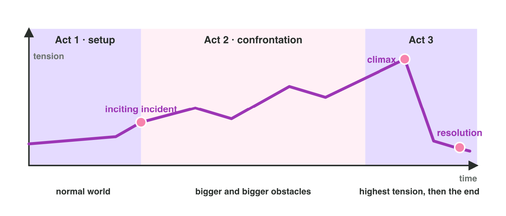

::: {.lead}
In Lecture 2 you learned the building blocks of a story and the three-act
structure, with story beats and the tension curve. Today you use them on
one mobile game, *Moon Diver*. There are no new ideas: two short problems.
Do each one alone. The results of the activities are at the end of this
worksheet.
:::

## Recall

- A story follows a **protagonist** with a **goal** in a **setting**. The
  **conflict** stands in the way; the **stakes** are what is lost.
- **Act 1** ends with the **inciting incident**. **Act 2** has bigger
  obstacles. **Act 3** has the **climax** and the **resolution**.
- A **story beat** changes the situation. The **tension curve** rises,
  with rests, to the climax near the end.

::: {.callout-tip title="Try it · Recall"}
Choose the right answer.

::: {.match extra="the resolution|act 1"}
Which event starts the conflict?
:   the inciting incident

Which act is usually the longest?
:   act 2

Where does the climax belong?
:   near the end
:::
:::

## Activity 1 · The building blocks and the acts of Moon Diver

*Moon Diver* is a mobile game in eight stages. The base on the Moon is
losing power. **Pip**, a small diving robot, must find the lost crystals in
the Deep Lake before the lights go out for good. Ice eels and dark water
stand in the way. The stages are: 1 Alarm (power at 20 %; the tutorial),
2 The map (Pip learns where the crystals are and dives in), 3 Ice caves,
4 Cave garden, 5 Eel attack, 6 Dark water, 7 The guardian, 8 Lights on.
@fig-acts shows the three acts in general.

{#fig-acts width=92%}

Six phrases from the story of Moon Diver:

a) the Deep Lake on the Moon · b) find the lost crystals · c) Pip, a small
diving robot · d) the tutorial · e) ice eels and dark water · f) the lights
of the base go out for good

::: {.callout-note title="Activity 1 · Blocks and acts · 15 min"}
1. Match each building block to its phrase: write the letter. One phrase
   is not a building block.

   | protagonist | goal | setting | conflict | stakes |
   |:---:|:---:|:---:|:---:|:---:|
   | | | | | |

2. Write the act (1, 2 or 3) under each of the eight stages. Circle the
   stage of the inciting incident and the stage of the climax.

   | Alarm | Map | Caves | Garden | Eels | Dark | Guardian | Lights |
   |:---:|:---:|:---:|:---:|:---:|:---:|:---:|:---:|
   | | | | | | | | |

*Your product:* five letters, and eight acts with two circles.

::: {.check}
Protagonist **c**, goal **b**, setting **a**, conflict **e**, stakes **f**.
Phrase d (the tutorial) is a stage, not a building block. The acts: 1, 1,
2, 2, 2, 2, 3, 3. Circle The map (stage 2, the inciting incident) and The
guardian (stage 7, the climax).
:::
:::

## Activity 2 · Put the stages in order and read the curve

Each stage of Moon Diver has a tension from 1 (calm) to 10 (very tense):
Alarm 6, The map 5, Ice caves 4, Cave garden 2, Eel attack 6, Dark water 7,
The guardian 9, Lights on 2. In the mini-game *Stage Order* the cards are
shuffled; the game draws the tension curve of your order.



::: {.callout-note title="Activity 2 · Order and curve · 15 min"}
1. In **Stage Order**, put the eight cards in a good order. Write the
   eight tension values of your order.
2. What is the story beat of the Eel attack? Choose A, B or C.

   - **A.** Pip swims faster than in stage 4.
   - **B.** The ice eels wake up because Pip took the first crystal, so
     Pip must escape.
   - **C.** Stage 5 has more enemies than stage 4.

3. A writer puts The guardian in stage 3. What goes wrong? Choose A, B
   or C.

   - **A.** The tutorial gets too long.
   - **B.** The curve has no rests.
   - **C.** The peak comes too early, and the last stages feel empty.

*Your product:* eight numbers and two letters.

::: {.check}
The story order: Alarm, The map, Ice caves, Cave garden, Eel attack, Dark
water, The guardian, Lights on, with the tension 6, 5, 4, 2, 6, 7, 9, 2: a
strong start, a rest in stage 4, the peak in stage 7. Step 2: **B**, a new
danger changes the situation for Pip (A and C are only gameplay). Step 3:
**C**, the peak comes in stage 3, so the end cannot rise higher.
:::
:::

## Exercises

1. In a game with twelve stages, about how many stages are act 2? Choose:
   two, six or eleven.
2. "Stage 6: the cave walls are blue." "Stage 6: Pip learns that the guardian
   is awake." Which one is a story beat, and why?
3. A curve is 5, 5, 5, 5, 5, 5, 5, 5. What is wrong?
4. Why does a good curve have rests?

## Answers to the exercises

::: {.answers}
1. Six (about a half).
2. The second one: Pip gets news, so the situation changes. The first is
   only how the stage looks.
3. It is flat: no rise and no peak, so the player gets bored.
4. The rests let the player breathe, so the peaks feel high.
:::
