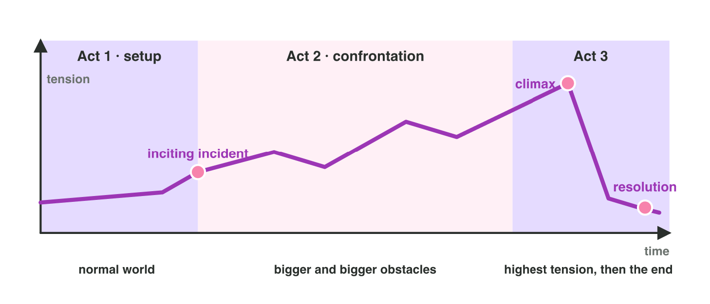
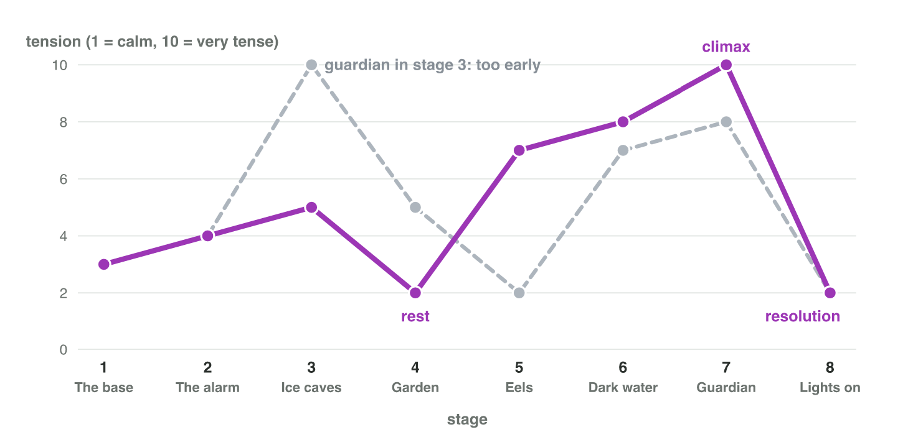

## Recall · Lecture 2

a) What do we call the event that starts the problem of a story?
b) Which act of a story is usually the longest?
c) Where does the climax of a story belong?

::: {.answer}
a) the inciting incident
b) act 2
c) near the end
:::

## The facts · eight stages of Moon Diver

| Stage | Name | What happens | Tension (1–10) |
|:-----:|----------------|--------------------------------------------|:---------:|
| 1 | The base | Pip learns to swim (the tutorial). | 3 |
| 2 | The alarm | The base loses power. Pip dives in. | 4 |
| 3 | Ice caves | Pip takes the first crystal. | 5 |
| 4 | Cave garden | Pip rests in a quiet garden. | 2 |
| 5 | Eel attack | Ice eels chase Pip. | 7 |
| 6 | Dark water | Pip's lamp breaks. | 8 |
| 7 | The guardian | A giant fish guards the last crystal. | 10 |
| 8 | Lights on | The lights of the base come back. | 2 |

## Activity 1 · Parts and acts · 15 min

:::: {.columns}
::: {.column width="50%"}
- The story: Pip, a small robot, must find the lost crystals in a deep lake on the Moon.
- The worksheet gives six groups of words, a to f, and the table of the eight stages.
- **Do it:** Match the five parts of the story to their letters. Then write the act of each stage.
- Your product is four letters, eight acts and two stages.
:::
::: {.column width="50%"}

:::
::::

## Check 1 · Parts and acts

What are the parts and the acts of Moon Diver?

::: {.reveal}
1. The protagonist is c (Pip), the goal is b (the crystals), and the setting is a (the lake).
2. The conflict is e (eels and dark water), and the stakes are f (the lights go out); d is not used.
3. Stages 1–2 are act 1, and stage 2 (The alarm) is the inciting incident.
4. Stages 3–6 are act 2; stages 7–8 are act 3, and stage 7 (The guardian) is the climax.
:::

## Activity 2 · Order and curve · 15 min

:::: {.columns}
::: {.column width="50%"}
- The game Stage Order mixes up the eight stage cards and draws the tension curve.
- **Do it:** Put the cards in story order in Stage Order. Find the rest and the climax on the curve. Then choose A, B or C twice.
- Your product is two stages and two letters.
:::
::: {.column width="50%"}

:::
::::

## Live demo · Stage Order



## Check 2 · Order and curve

Where are the rest and the climax, and what are the two letters?

::: {.reveal}
1. In story order, the tension of the stages is 3, 4, 5, 2, 7, 8, 10, 2.
2. The rest is stage 4 (Cave garden, 2), and the climax is stage 7 (The guardian, 10).
3. The story beat of stage 5 is B: the eels wake up because Pip took a crystal.
4. The guardian in stage 3 is C: the most tense stage comes too early.
:::

## Wrap-up

- You can find the five parts of a game story and its three acts.
- You can order the stages of a game and read its tension curve.
