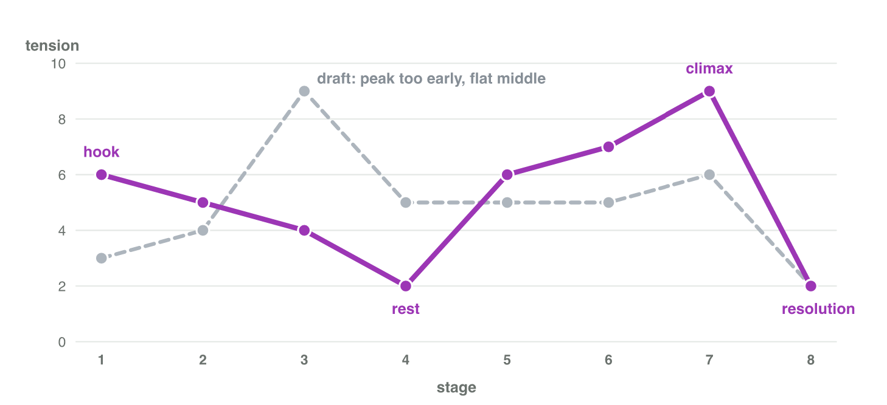

## Recall · Lecture 2

a) Which event of a story starts the conflict?
b) Which act of a story is usually the longest?
c) Where does the climax of a story belong?

::: {.answer}
a) the inciting incident
b) act 2
c) near the end
:::

## Activity 1 · Blocks and acts · 15 min

:::: {.columns}
::: {.column width="50%"}
- In Moon Diver, the robot Pip must find lost crystals before the base on the Moon loses power.
- **Do it:** Write the protagonist, goal, setting, conflict and stakes. Then write the act of each of the eight stages.
- Your product is five lines and the stages with their acts.
:::
::: {.column width="50%"}

:::
::::

## Check 1 · Blocks and acts

What are the building blocks and the acts of Moon Diver?

::: {.reveal}
1. Pip, a diving robot, wants the lost crystals in the Deep Lake on the Moon.
2. Ice eels and dark water stand in the way, and the base loses its lights if Pip fails.
3. Stages 1–2 are act 1, and stage 2 (the map) is the inciting incident.
4. Stages 3–6 are act 2; stages 7–8 are act 3, with the climax in stage 7.
:::

## Activity 2 · Order and curve · 15 min

:::: {.columns}
::: {.column width="50%"}
- The tension of the stages is Alarm 6, Map 5, Caves 4, Garden 2, Eels 6, Dark 7, Guardian 9, Lights 2.
- **Do it:** Put the cards in a good order in Stage Order. Write the beat of the Eel attack. What goes wrong with the guardian in stage 3?
- Your product is an order, a beat and a sentence.
:::
::: {.column width="50%"}

:::
::::

## Live demo · Stage Order



## Check 2 · Order and curve

What is a good order, and what does the curve show?

::: {.reveal}
1. A good order keeps the story order: Alarm, Map, Caves, Garden, Eels, Dark water, Guardian, Lights on.
2. The curve has a strong start, a rest in stage 4 and its peak in stage 7.
3. The beat of stage 5: the eels wake up because Pip took a crystal, so Pip must escape.
4. With the guardian in stage 3, the peak comes too early and the end feels empty.
:::

## Wrap-up

- You can find the building blocks and the three acts of a game story.
- You can order the stages of a game and read its tension curve.
