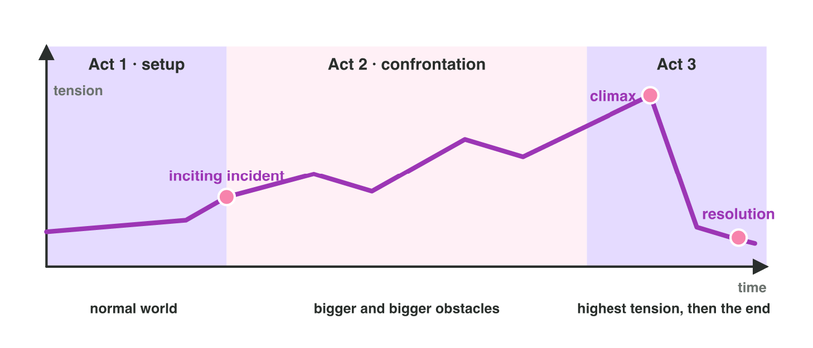

No new ideas today. You practise Lecture 2 with one game, *Moon Diver*.
There are two short activities. Do each one alone. Then open "Check your
result". Every question on this page has its answer.

## Recall

The five parts of a story:

| Part | What it means |
|--------------|---------------------------------------------------|
| protagonist | the hero: the character we follow |
| goal | what the hero wants |
| setting | where and when the story happens |
| conflict | what stops the hero |
| stakes | what is lost if the hero fails |

- **Act 1** is the start. It ends with the **inciting incident**: the event
  that starts the problem.
- **Act 2** has bigger and bigger problems. It is the longest act.
- **Act 3** has the **climax** (the most tense moment) and the
  **resolution** (the end).
- **Tension** means how tense a stage feels: 1 is very calm, 10 is very
  tense. The tension rises to the climax, with short rests.

::: {.callout-tip title="Try it 1 · Recall"}
Choose the right answer.

::: {.match extra="the resolution|act 1|at the start"}
What do we call the event that starts the problem?
:   the inciting incident

    Why: It ends act 1 and starts the journey.

Which act is usually the longest?
:   act 2

    Why: Act 2 has the most stages, with bigger and bigger problems.

Where does the climax belong?
:   near the end

    Why: The tension rises until near the end of the story.
:::
:::

## Activity 1 · The parts and the acts of Moon Diver

*Moon Diver* is a mobile game with eight stages. A **stage** is one part
of the game, like a level. The story:

- Pip, a small robot, lives in a base on the Moon.
- One day, the base starts to lose power.
- Pip must find the lost crystals in a deep lake.
- Ice eels and dark water try to stop Pip.
- If Pip fails, the lights of the base go out forever.

| Stage | Name | What happens | Tension |
|:---:|----------------|----------------------------------------------|:-------:|
| 1 | The base | Pip lives at the base and learns to swim (the tutorial). | 3 |
| 2 | The alarm | The base loses power. Pip takes a map and dives in. | 4 |
| 3 | Ice caves | Pip takes the first crystal. | 5 |
| 4 | Cave garden | Pip rests in a quiet garden. | 2 |
| 5 | Eel attack | Ice eels wake up and chase Pip. | 7 |
| 6 | Dark water | Pip's lamp breaks. The water is very dark. | 8 |
| 7 | The guardian | A giant fish guards the last crystal. | 10 |
| 8 | Lights on | Pip brings the crystals home. The lights come back. | 2 |

: The eight stages of Moon Diver. Tension: 1 is very calm, 10 is very tense.

{width=92%}

Six groups of words from the story:

- **a)** a deep lake on the Moon
- **b)** find the lost crystals
- **c)** Pip, a small robot
- **d)** the tutorial
- **e)** ice eels and dark water
- **f)** the lights of the base go out forever

::: {.callout-note title="Activity 1 · Parts and acts · 15 min"}
1. Match each part of the story to its words. Write the letter. The first
   one is done for you. One letter is not used.

   | protagonist | goal | setting | conflict | stakes |
   |:---:|:---:|:---:|:---:|:---:|
   | c | \_\_\_ | \_\_\_ | \_\_\_ | \_\_\_ |

2. Write the act of each stage: 1, 2 or 3. Help: act 1 ends with the
   inciting incident. Act 3 starts with the climax, the most tense stage.

   | Stage | 1 | 2 | 3 | 4 | 5 | 6 | 7 | 8 |
   |:---:|:---:|:---:|:---:|:---:|:---:|:---:|:---:|:---:|
   | Act | \_\_\_ | \_\_\_ | \_\_\_ | \_\_\_ | \_\_\_ | \_\_\_ | \_\_\_ | \_\_\_ |

3. Which stage is the inciting incident? Which stage is the climax? Write
   the number and the name of each stage.

*Your product:* four letters, eight acts and two stages.

::: {.check}
- Protagonist **c** (Pip), goal **b**, setting **a**, conflict **e**,
  stakes **f**. Letter **d** is not used: the tutorial is stage 1, not a
  part of the story.
- Stages 1–2 are act 1. Stages 3–6 are act 2. Stages 7–8 are act 3.
- The inciting incident is **stage 2 (The alarm)**: the base loses power,
  and Pip's journey starts.
- The climax is **stage 7 (The guardian)**: it has the highest tension, 10.
:::
:::

::: {.callout-tip title="Try it 2 · Moon Diver"}
Use the table of the eight stages. Choose the right answer.

::: {.match extra="stage 1 (The base)|stage 8 (Lights on)|the setting"}
"The lights of the base go out forever." Which part of the story is it?
:   the stakes

    Why: The stakes are what is lost if Pip fails.

In which stage is the inciting incident?
:   stage 2 (The alarm)

    Why: The base loses power, and Pip's journey starts.

In which stage is the climax?
:   stage 7 (The guardian)

    Why: It is the most tense stage (10), near the end.
:::
:::

## Activity 2 · Put the stages in order and read the curve

In the mini-game **Stage Order**, the eight stage cards are mixed up. You
put them in story order. Then the game draws the **tension curve**: a
line that shows the tension of each stage.



::: {.callout-note title="Activity 2 · Order and curve · 15 min"}
1. In **Stage Order**, tap the cards in the order of the table: stage 1
   first, stage 8 last. Then press **Check the structure**.
2. Look at the curve. Which stage in act 2 has the lowest tension? Which
   stage has the highest tension? Write the number and the name of each
   stage.
3. A **story beat** is an event that changes the situation. What is the
   story beat of stage 5 (Eel attack)? Choose A, B or C.

   - **A.** Pip swims faster than in stage 4.
   - **B.** The eels wake up because Pip took the first crystal. Now Pip
     must run away.
   - **C.** Stage 5 has more enemies than stage 4.

4. A writer moves The guardian to stage 3. What goes wrong? Choose A, B
   or C.

   - **A.** The tutorial gets too long.
   - **B.** The game has no rest.
   - **C.** The most tense stage comes too early. The last stages feel
     empty.

*Your product:* two stages and two letters.

::: {.check}
- In Stage Order, every line is green. The tension of the stages is 3, 4,
  5, 2, 7, 8, 10, 2.
- The lowest tension in act 2 is **stage 4 (Cave garden)**: a rest. The
  highest is **stage 7 (The guardian)**: the climax.
- Step 3: **B**. Something changes for Pip: a new danger. A and C change
  only the gameplay.
- Step 4: **C**. With the guardian (10) in stage 3, no later stage can be
  more tense.
:::
:::

::: {.callout-tip title="Try it 3 · Beats and curves"}
Choose the right answer.

::: {.match extra="a good curve"}
"Stage 5: more enemies." Is it a story beat?
:   no, it is only gameplay

    Why: Nothing changes in the story.

The tension of eight stages is 3, 4, 9, 5, 5, 5, 6, 2. What is the problem?
:   the most tense stage comes too early

    Why: The highest number (9) is in stage 3, not near the end.

Cave garden (2) comes between stage 3 (5) and stage 5 (7). What is its job?
:   a rest

    Why: The player can relax before the tension rises again.

The tension is 8, 8, 9, 9, 9, 10, 10, 9. What is the problem?
:   there is no rest

    Why: Without a calm stage, the player gets tired.
:::
:::

## Wrap-up {.summary}

- You can find the five parts of a game story and its three acts.
- You can put the stages of a game in order and read its tension curve.
