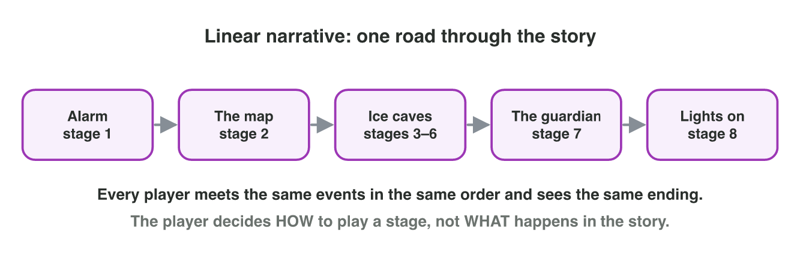
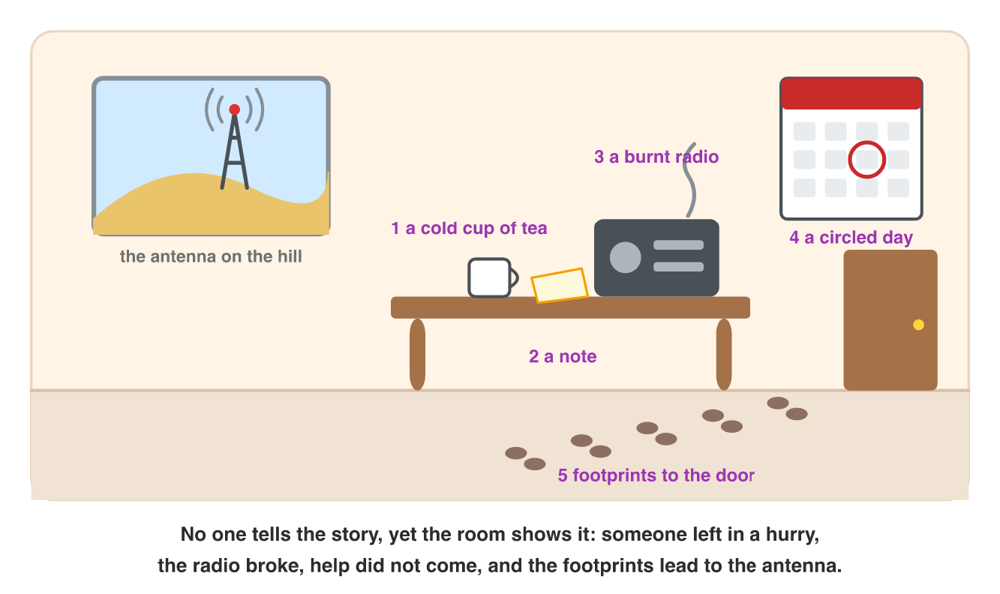

## Keywords



## 3.1 Linear narrative

:::: {.columns}
::: {.column width="50%"}
- In a linear narrative, every player meets the same events and the same ending.
- The player decides how to play a stage, but not what happens in the story.
- The writer controls the tension, and each scene is written only once.
- **Do it:** Write two choices you made in a game. Did they change the story or only the gameplay?
:::
::: {.column width="50%"}

:::
::::

## Try it 1 · Linear

a) Every player sees the same stages in the same order. What kind of narrative is it?
b) A player chooses a weapon, but the story stays the same. What does the choice change?
c) What is one weakness of a linear story?

::: {.answer}
a) linear
b) only the gameplay
c) The player cannot change the story.
:::

## 3.2 Branching narrative

:::: {.columns}
::: {.column width="50%"}
- In a branching narrative, the player's choices lead to different scenes and endings.
- Real choices give the player agency, but every choice opens new scenes to write.
- In branch and bottleneck, the paths join again at key scenes.
- **Do it:** In Branch Builder, set 2 choices and 3 decisions. Which structure needs fewer scenes?
:::
::: {.column width="50%"}

:::
::::

## Example · Two maps for three choices

A story has 3 decisions in a row, each with 2 options.
**Why do writers let the paths join again?**

::: {.reveal}
1. In a full tree the scenes **double at every decision**, and one player sees only one road.
2. With branch and bottleneck, the paths **join after each choice**, so the team writes far fewer scenes.
3. In both maps every player still makes **3 real choices**.
:::

## Live demo · Branch Builder



## Try it 2 · Branches

a) The player's choices lead to different scenes and endings. What kind of narrative is it?
b) What do we call the player's feeling that choices really matter?
c) Why do writers let paths join again?

::: {.answer}
a) a branching narrative
b) player agency
c) to write far fewer scenes
:::

## 3.3 Environmental storytelling

:::: {.columns}
::: {.column width="50%"}
- In environmental storytelling, places and objects tell the story.
- The player discovers the story by exploring, without a cutscene.
- A clue must point to an event, so a plant or a chair is only decoration.
- **Do it:** List three objects in a game place. What does each object tell?
:::
::: {.column width="50%"}

:::
::::

## Example · Reading the room

Mira enters the empty station and sees a cup of cold tea, a burnt radio and a circled day with the words "supply truck".
**What do these objects tell her?**

::: {.reveal}
1. The cold tea shows that **someone left in a hurry**.
2. The burnt radio shows that **nobody could call for help**.
3. The circled day shows that **the supply truck did not come**.
:::

## Try it 3 · Read the room

a) Footprints lead out of the door towards the hill. What do they tell?
b) How does the player get this story?
c) Why is a plant in the room not a clue?

::: {.answer}
a) Someone walked to the antenna.
b) by exploring the room
c) It does not point to an event of the story.
:::

## Game challenge · Silent Station



## Try it 4 · The structure (harder)

The facts: Mira explores the room first. Then she follows the footprints or repairs the radio. Both paths reach the antenna on the hill, and there she chooses ending A or ending B.

a) Which scene is the bottleneck?
b) How many scenes are there in all?
c) The two first paths stop joining, and each one gets its own antenna scene with two endings. How many endings are there now?

::: {.answer}
a) the antenna on the hill
b) 6
c) 4
:::

## Summary

- In a linear narrative, every player follows the same road to the same ending.
- In a branching narrative, choices lead to different scenes and endings.
- Branch and bottleneck lets the paths join again, so the writers need fewer scenes.
- In environmental storytelling, the places and objects of the world tell the story.
- Many games mix linear, branching and environmental storytelling.
