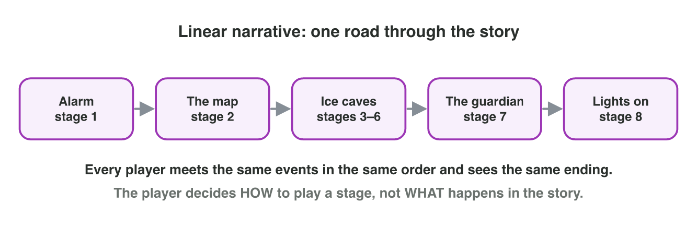
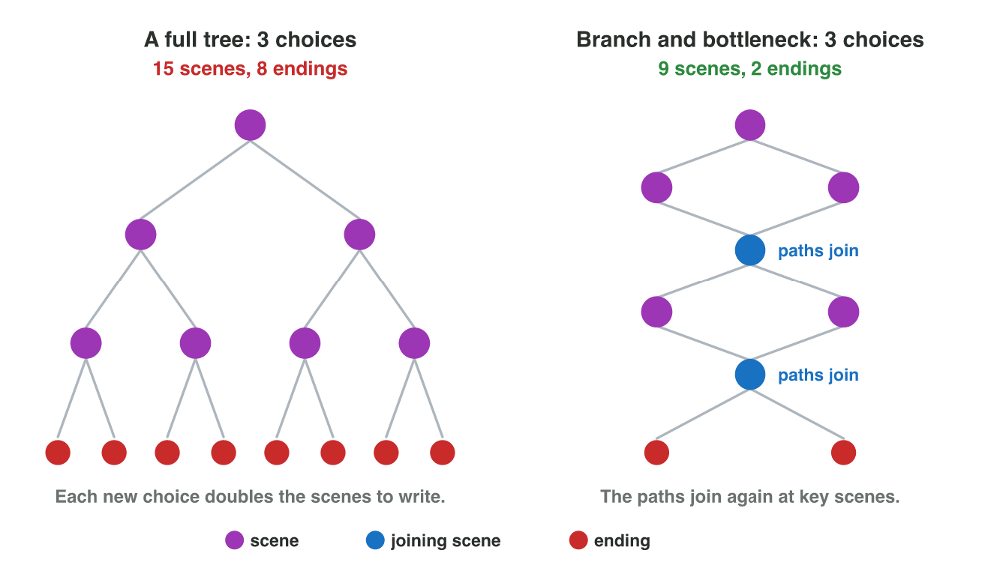
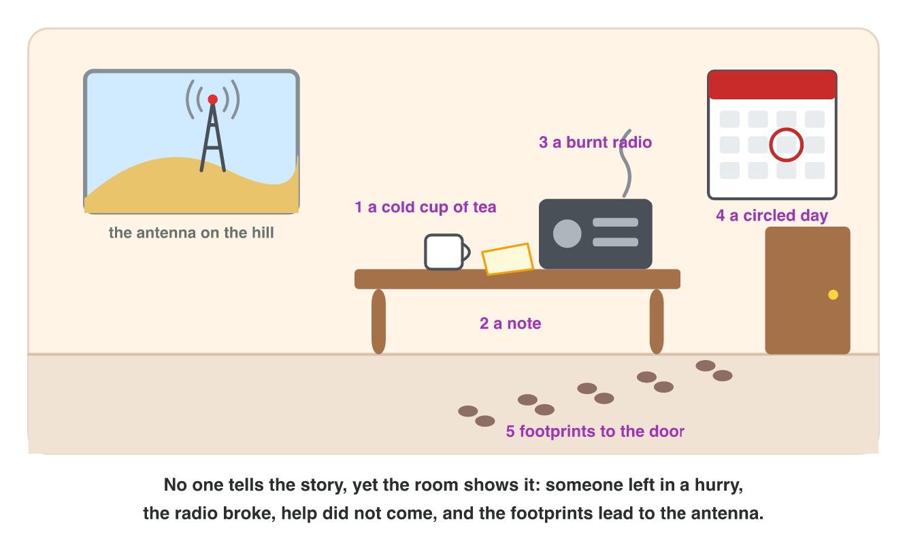

This page is the interactive version of the lesson notes (PDF). Each section
starts with a game situation. Then it explains one idea. It ends with a **Do
it** task and one set of questions. Tap, sort or type your answer: the page
checks it at once and tells you why.

## Key terms



## 3.1 One road through the story: linear narrative

- In a **linear narrative**, every player meets the same events in the same
  order and sees the same ending.
- The player decides **how** to play a stage, not **what** happens in the
  story.
- Strength 1: the writer controls the tension curve and the climax.
- Strength 2: each scene is written only once, so it costs less.
- Weakness: the player cannot change the story.
- *Moon Diver* (Seminar 2) is linear. Every player plays its eight stages
  in the same order and sees one ending.

{width=90%}

::: {.callout-warning title="Watch out!"}
Linear is not the same as boring. It describes the structure, not the
quality.
:::

::: {.callout-note title="Do it · Linear or not?"}
In *Harbor Run*, a mobile game with a story, Lina made four choices. For
each choice, write "story" (it changes what happens) or "gameplay" (it
changes only how she plays). Is the narrative linear?

| Choice | What Lina did | Story or gameplay? |
|:---:|------------------------------------------------------|:------------------:|
| a | She picked a blue boat. | \_\_\_ |
| b | She played on the hard level. | \_\_\_ |
| c | She saved the fisherman. The next scene is at his house. | \_\_\_ |
| d | She bought a faster engine. | \_\_\_ |

::: {.check}
a gameplay · b gameplay · c **story** · d gameplay. **No**, Harbor Run is
not linear. Choice c takes Lina to a scene that another player may never
see.
:::
:::

::: {.callout-tip title="Try it 1 · Linear"}
Choose the right answer.

::: {.match extra="it has many endings"}
Every player sees the same stages in the same order and the same ending. What kind of narrative is it?
:   linear

    Why: One road through the story, for every player.

In a linear game, what does the player decide?
:   how to play a stage

    Why: The player chooses how to play, not what happens.

A player chooses a weapon, but the story is always the same. What does the choice change?
:   only the gameplay

    Why: The story and the ending do not change.

Name one strength of a linear story.
:   the writer controls the tension

    Why: The writer places the beats exactly as planned.

Name one weakness of a linear story.
:   the player cannot change the story

    Why: Every player meets the same events.
:::
:::

## 3.2 Choices that change the story: branching narrative

- In a **branching narrative**, the player's choices lead to different
  scenes and endings.
- When choices really matter, the player feels **agency**.
- The cost: every choice opens new scenes. In a **full tree**, the paths
  never join, so the scenes double at every decision. One player sees only
  a few of them.
- **Branch and bottleneck:** the paths join again at key scenes (the
  **bottlenecks**). The player still makes real choices, but the writers
  make far fewer scenes.
- *Silent Station* (Game challenge): Mira chooses the footprints or the
  radio. Both paths meet at the antenna: the bottleneck. Then the game has
  two endings.

{width=90%}

::: {.callout-warning title="Watch out!"}
A fake choice changes nothing. At a bottleneck, the earlier choice should
still leave a mark: a line, an object, a character who remembers.
:::



::: {.callout-note title="Do it · Branch Builder"}
A **decision** is a moment when the player must choose. A **choice** is one
option at that moment. In **Branch Builder**, set 2 choices and 3
decisions. Read the numbers of a full tree. Then set "Paths join again" to
yes. Fill in the table. Then try 3 choices.

| 2 choices, 3 decisions | Full tree | Branch and bottleneck |
|------------------------|:-------------:|:-------------------------:|
| Scenes to write | \_\_\_ | \_\_\_ |
| Endings | \_\_\_ | \_\_\_ |

Why do writers let the paths join? Choose A, B or C.

- **A.** To write fewer scenes, while every player still makes real
  choices.
- **B.** To make the game longer.
- **C.** To give every player the same ending.

::: {.check}
Full tree: **15** scenes and **8** endings. Branch and bottleneck: **9**
scenes and **2** endings. With 3 choices, the full tree has 40 scenes. The
answer is **A**: the paths join, so the writers make far fewer scenes, and
every player still makes 3 real choices.
:::
:::

::: {.callout-tip title="Try it 2 · Branches"}
Choose the right answer.

::: {.match extra="linear|a fake choice"}
A story gives every player different scenes and endings because of their choices. What kind of narrative is it?
:   branching

    Why: Choices lead to different scenes and endings.

The paths join again at key scenes. What is this structure called?
:   branch and bottleneck

    Why: Paths join at key scenes: the bottlenecks.

The player feels that choices really matter. What is it called?
:   player agency

    Why: Agency is the feeling that "what I do matters".

Why do writers let paths join again?
:   to write far fewer scenes

    Why: A full tree doubles the scenes at every decision.
:::
:::

## 3.3 The world tells the story: environmental storytelling

- **Environmental storytelling:** places and objects tell the story. The
  player discovers it by exploring.
- Tools: objects, notes, damage, light, sound, the place of things.
- Strength 1: the player finds the story like a detective.
- Strength 2: it does not stop the gameplay (no long cutscene).
- Strength 3: it works with linear and with branching stories.
- The station room of *Silent Station* shows: a cup of cold tea (someone
  left in a hurry), a burnt radio (nobody could call for help), "supply
  truck" circled on the calendar (the truck did not come), and a note and
  footprints (Aziz went to the antenna).

{width=90%}

::: {.callout-warning title="Watch out!"}
A plant or a chair is decoration, not a clue. A clue must point to an event
of the story.
:::

::: {.callout-note title="Do it · Find the clues"}
A kitchen in a game shows five things. Which thing is only decoration?
Match the other four to what they tell.

| Thing | What the player sees |
|:---:|-------------------------------------------------|
| a | a birthday cake with candles that were never lit |
| b | a chair that lies on the floor |
| c | wet footprints from the open window |
| d | a white fridge |
| e | a phone with 9 missed calls |

What the clues can tell: (1) someone came in from outside; (2) someone
left in a hurry; (3) the party never started; (4) someone tried to call
the owner.

::: {.check}
**d**, the white fridge, is decoration: every kitchen has one. a → (3),
b → (2), c → (1), e → (4). Each clue points to an event of the story.
:::
:::

::: {.callout-tip title="Try it 3 · Read the room"}
The room of Silent Station. Choose what each object tells.

::: {.match extra="Mira is hungry"}
A full cup of cold tea.
:   someone left in a hurry

    Why: Nobody drank it: the person left suddenly.

A burnt radio.
:   nobody could call for help

    Why: The station had no way to call.

"Supply truck" is circled on yesterday's date.
:   the truck did not come

    Why: The date is circled, but the station is empty and waiting.

Footprints lead out of the door towards the hill.
:   someone walked to the antenna

    Why: The antenna is on the hill.

How does the player get this story?
:   by exploring the room

    Why: Environmental storytelling is found by exploring.
:::
:::

## Game challenge: Silent Station {.challenge}

Work alone. Use every section of today.

*Silent Station* is a mobile game. The story:

- Mira, a radio operator, arrives at a research station in the desert.
- Nobody is there. Five things in the room tell what happened: a cup of
  cold tea, a note from Aziz ("Gone to fix the antenna. Back by 6."), a
  burnt radio, a circled day ("supply truck") and footprints to the door.
- Then Mira makes two decisions.

| Scene | What happens |
|:---:|--------------------------------------------------------------|
| 1 | Arrival: Mira explores the empty room. |
| 2a | Mira follows the footprints. |
| 2b | Mira repairs the radio first. |
| 3 | The antenna on the hill: both paths meet here. Aziz sits there with a hurt foot. |
| 4a | Ending A: Mira helps Aziz fix the antenna. Help is coming. |
| 4b | Ending B: Mira takes Aziz back to the station first. A safe, silent night. |

: The six scenes of Silent Station.



::: {.callout-tip title="Try it 4 · The structure of Silent Station"}
Silent Station has six scenes: 1 the room, 2a the footprints or 2b the
radio, 3 the antenna, 4a ending A or 4b ending B. Choose the right answer.

::: {.match extra="4|ending A"}
Which part is environmental storytelling?
:   the room with its objects

    Why: The objects tell what happened.

Which scene is the bottleneck?
:   the antenna on the hill

    Why: Both first paths join there.

How many endings does the game have?
:   2

    Why: Help is coming (A), or a safe, silent night (B).

How many scenes are there in all?
:   6

    Why: Scenes 1, 2a, 2b, 3, 4a and 4b.
:::
:::

::: {.callout-tip title="Try it 5 · Change the design (harder)"}
Silent Station as above. Choose the right answer.

::: {.match extra="12|a full tree"}
The two first paths do not join; each one has its own antenna scene with two endings. How many endings now?
:   4

    Why: Two paths, each with two endings: 2 + 2 = 4.

Which structure needs fewer scenes for the same choices?
:   branch and bottleneck

    Why: Joining paths saves scenes.

The designer removes both choices. What kind of narrative is left?
:   linear, with environmental storytelling

    Why: One road, and the room still tells the story.

Both first paths reach the antenna, and nothing there is different. What is the risk?
:   a fake choice

    Why: The first choice changed nothing.

What could show that Mira repaired the radio first?
:   the radio hums in the background

    Why: A small mark of the earlier choice at the bottleneck.
:::
:::

## Summary {.summary}

- Linear: one road, the same events and ending for every player.
- Branching: choices lead to different scenes and endings and give agency.
- A full tree grows fast; branch and bottleneck joins paths at key scenes.
- Environmental storytelling: places and objects tell the story.
- Many games mix the three ways.
