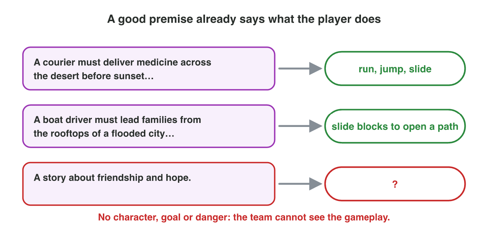
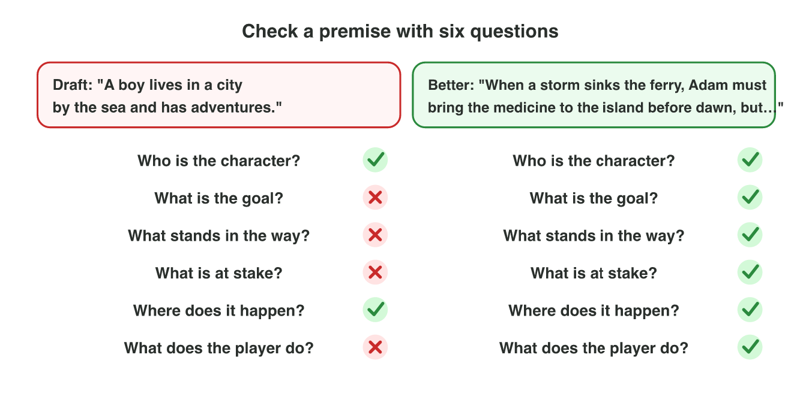

::: {.lead}
At *Night Owl Games*, the producer meets the writers every Monday. Each
writer has two minutes to present a new game idea. There is no time for a
long story. The writer must say the idea in one or two sentences, so that
the producer sees the character, the goal, the danger and the gameplay at
once. These sentences are the **premise** of the story. In lectures 3 to 5
you learned the parts of a story, its structure, and the ways in which games
tell it. In this seminar you put them together and draft a premise: you
write it, connect it to what the player does, test it and improve it. Every
section ends with a short task.
:::

## Key terms



## 6.1 The story in two sentences: the premise

A writer says: "My game is about a robot on the Moon." The producer asks:
"What does the robot want? What stands in the way? Why should I care?" A
**premise** answers these questions before they are asked.

::: {.callout-important title="Definition 6.1 — Premise"}
A **premise** (also called a logline) is one or two sentences that state who
the main character is, what the character wants, what stands in the way and
what is at stake.
:::

The parts are the building blocks of lecture 3. A simple template puts them
in order (@fig-parts):

> *When* [inciting incident], [character] *must* [goal] *before* / *or*
> [stakes], *but* [obstacle].

{#fig-parts width=94%}

::: {.callout-note title="Example 6.1 — The premise of Moon Diver"}
1. Inciting incident: the base on the Moon starts to lose power.
2. Character: Pip, a small diving robot. Goal: find the lost crystals in the
   Deep Lake.
3. Stakes: the lights go out for good. Obstacle: ice eels and dark water.
4. Premise: "When the base on the Moon starts to lose power, Pip, a small
   diving robot, must find the lost crystals in the Deep Lake before the
   lights go out for good, but ice eels and dark water stand in the way."
:::

::: {.callout-note title="Example 6.2 — The premise of Silent Station"}
Lecture 5's game, in two sentences: "When the supply station in the desert
goes silent, Mira, a radio operator, must find out what happened and call
for help before night falls, but the radio is burnt and her colleague is
missing. The player explores the station and follows the clues."
:::

::: {.callout-warning title="Common mistake"}
Telling the whole plot. A premise is not a summary of every stage. It stops
at the conflict: the player must want to know *how* it ends.
:::

::: {.callout-note title="Do it · The premise of a game you know"}
Choose a mobile game with a story that you have played.

1. Find its inciting incident, character, goal, stakes and obstacle.
2. Write its premise with the template.

*Your result:* the five parts and the premise in one or two sentences.
:::

## 6.2 From premise to play

A premise for a game is not a premise for a film. In a game, the player
*acts*. The producer asks: "What will the player do, again and again?" This
repeated action is the **core mechanic** of the game: dive, run, slide,
sort, build. A good premise already shows it (@fig-play).

::: {.callout-important title="Definition 6.2 — Core mechanic"}
The **core mechanic** is the main action that the player repeats again and
again in a game, such as jump, slide, sort or dive.
:::

{#fig-play width=94%}

The goal and the obstacle of the premise should *need* the core mechanic. A
courier who must cross a desert before sunset needs to run, jump and slide.
A boat driver whose streets are blocked needs to move the blocks. The
premise should also fit the length of a session: a mobile player often
plays for one to five minutes.

::: {.callout-note title="Example 6.3 — Does the premise show the play?"}
1. "A courier must carry medicine across the desert before sunset, but a
   sandstorm buries the road." The play: run, jump and slide. One run fits
   one minute.
2. "A boat driver must lead the families on the rooftops of a flooded city
   to the hill, but floating cars block the streets." The play: slide the
   blocks to open a path. One level fits three minutes.
3. "A story about friendship and hope." No character, goal or danger: the
   team cannot see any gameplay.
:::

::: {.callout-warning title="Common mistake"}
A premise that fits a film but not a game: "A detective remembers her
childhood." It is a good story, but what does the player *do*? Add the
action, or choose a goal that needs one.
:::

::: {.callout-note title="Do it · Find the core mechanic"}
Use your premise from section 6.1.

1. Write the core mechanic of the game in two or three verbs.
2. Check: does the goal of your premise need this action? Does one round
   fit a few minutes?

*Your result:* the verbs and your two checks (yes or no, with a reason).
:::

## 6.3 Test and improve a premise

A first draft is rarely good. Writers test their premise with six questions
(@fig-check). Each "no" shows what to add.

1. **Who** is the character? (one, specific)
2. **What** is the goal? (clear and concrete)
3. **What stands in the way?** (the obstacle, the conflict)
4. **What is at stake?** (what happens if the character fails)
5. **Where** does it happen? (the setting)
6. **What does the player do?** (the core mechanic)

A good premise is also short: about 25 to 40 words. Specific words help:
"Adam, a young fisherman" is better than "a boy"; "before dawn" is better
than "soon".

{#fig-check width=94%}

::: {.callout-note title="Example 6.4 — Improving a draft"}
Draft: "A boy lives in a city by the sea and has adventures."

1. The test: a character (a boy) and a place (a city by the sea), but no
   goal, no obstacle, no stakes, no player action.
2. Add an inciting incident and a goal: a storm sinks the ferry; Adam must
   bring the medicine to the island.
3. Add stakes and an obstacle: before dawn; the sea is full of wreckage.
4. Better: "When a storm sinks the ferry, Adam, a young fisherman, must
   bring the medicine to the island before dawn, but the sea is full of
   wreckage. The player steers the boat between the wrecks."
:::

::: {.callout-warning title="Common mistake"}
Vague stakes: "or something bad happens." The stakes must be concrete, so
that the player cares: "or the families stay on the rooftops all night."
:::



::: {.callout-note title="Do it · Premise Doctor"}
Open the **Premise Doctor** simulator above (or scan its QR code).

1. For each of the five drafts, tap the missing parts and check.
2. Then test your own premise from section 6.1 with the six questions and
   improve it.

*Your result:* your score, and your premise before and after.
:::

## Case study: the Night Owl pitch

*Night Owl Games* is a made-up studio. The producer gives the writers a
brief: *a mobile puzzle game; levels of 3 minutes; the setting is a flooded
city; the player slides blocks to open a path.* A writer must build a
premise that fits the brief: when the river floods the old city, Nour, a
young boat driver, must lead the families on the rooftops to the hill
before night falls, but floating cars and boxes block the streets. The Game
challenge of the interactive lesson uses this brief. In the mini-game below
you build premises for three briefs from cards, and the producer tells you
which cards do not fit.



## Further reading

McKee, *Story*, HarperCollins, 1997, on the controlling idea and the
desire of the protagonist; Schell, *The Art of Game Design*, 3rd ed., the
chapters on the story and on the game mechanics.

## Exercises

1. What is a premise? Which four questions does it answer?
2. Write the template of a premise.
3. Find the parts of this premise: "When the dragon steals the village bell,
   Tala, a young shepherd, must bring it back before the winter festival,
   but the mountain path is full of traps."
4. Why should a premise not tell the whole plot?
5. What is a core mechanic? Give two examples.
6. "A girl dreams about the stars." What is missing for a game premise?
7. A premise says "or something bad happens". What is wrong? Rewrite it for
   the boat driver of the flooded city.
8. Which premise fits a one-minute runner better? (a) "A chef must cook a
   five-course dinner." (b) "A courier must reach the village before
   sunset, but a sandstorm buries the road."
9. Write the six questions that test a premise.
10. *Night Owl*: which card does not fit the brief "puzzle game, flooded
    city, slide blocks": "The player shoots enemies" or "The player slides
    the blocks"? Why?

## Answers to the exercises

::: {.answers}
1. One or two sentences about the main character, the goal, the obstacle and the stakes. Who is it? What does the character want? What stands in the way? What is at stake?
2. When [inciting incident], [character] must [goal] before / or [stakes], but [obstacle].
3. Inciting incident: the dragon steals the bell. Character: Tala, a young shepherd. Goal: bring the bell back. Stakes: before the winter festival. Obstacle: the traps on the mountain path.
4. It must stop at the conflict, so that the listener wants to know how it ends.
5. The main action the player repeats; for example jump, slide, sort, dive, plant.
6. The goal, the obstacle, the stakes and the player's action (only a character and a wish are there).
7. The stakes are vague. For example: "…before night falls, or the families stay on the rooftops all night."
8. (b): it has a clear goal, a danger and an action (run) that fits one minute.
9. Who? What goal? What stands in the way? What is at stake? Where? What does the player do?
10. "The player shoots enemies": the brief is a puzzle game where the player slides blocks.
:::
