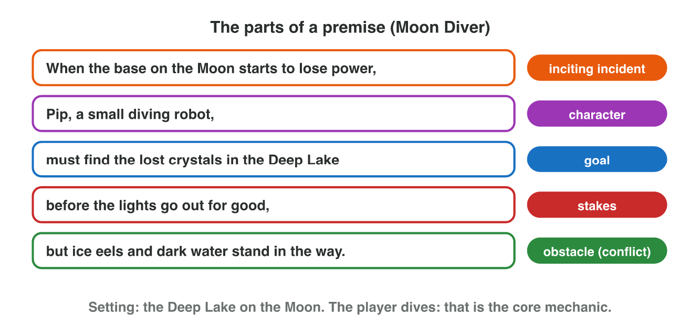
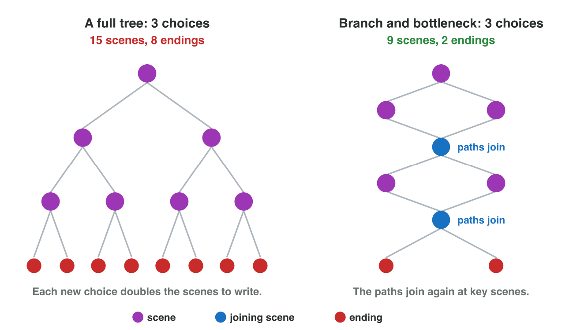

::: {.lead}
In Lecture 2 you learned the building blocks of a story; in Lecture 3, the
ways a game can tell it. Today you put them together: you build the
premise of a game from its parts and put its scenes on a map. There are no new ideas: two
short problems. Do each one alone. The results of the activities are at
the end of this worksheet.
:::

## Recall

- A story has a **character** with a **goal**, an **obstacle** and
  **stakes**. The **inciting incident** starts the conflict.
- A game can tell its story in a **linear** way, a **branching** way (often
  **branch and bottleneck**), or through the **environment**.
- A **fake choice** changes nothing for the player.

::: {.callout-tip title="Try it · Recall"}
Choose the right answer.

::: {.match extra="the setting|a linear story"}
What is lost if the hero fails?
:   the stakes

Which event starts the conflict?
:   the inciting incident

The paths join again at key scenes. What is this structure?
:   branch and bottleneck
:::
:::

## Activity 1 · The story in two sentences

At *Night Owl Games*, a writer has two minutes to present a game idea. So
the idea must fit in one or two sentences: the **premise**. It puts the
building blocks in order (@fig-premise):

> *When* [inciting incident], [character] *must* [goal] *before*
> [stakes], *but* [obstacle].

A premise stops at the conflict: the player must want to know how it ends.
In the mini-game *Pitch Room* you build premises from cards, and the
producer tells you which cards do not fit the brief.

{#fig-premise width=90%}



Five cards of the premise of *Night Bus*, a mobile driving game, are
shuffled: a) Sami, a young bus driver · b) must bring the last passengers home ·
c) When the city lights go out in a storm, · d) but fallen trees block the
streets · e) before the bridge closes at midnight

::: {.callout-note title="Activity 1 · Build a premise · 15 min"}
1. In **Pitch Room**, build the premise of the first brief (a puzzle game
   in a flooded city) from the cards.
2. Put the five cards of Night Bus in the order of the template: write the
   five letters.
3. A writer gives a shorter premise: "When the city lights go out in a
   storm, Sami, a young bus driver, must bring the last passengers home,
   but fallen trees block the streets." Which part is missing? Choose the
   inciting incident, the goal, the stakes or the obstacle.

*Your product:* five letters and the name of one part.

::: {.check}
Pitch Room, brief 1: "When the river floods the old city, Nour, a young
boat driver, must lead the families on the rooftops to the hill before
night falls, but floating cars block the streets." Night Bus: **c, a, b,
e, d**. "When the city lights go out in a storm, Sami, a young bus driver,
must bring the last passengers home before the bridge closes at midnight,
but fallen trees block the streets." The shorter premise has no **stakes**:
nothing tells what is lost if Sami is late.
:::
:::

## Activity 2 · How will the story be told?

The same premise can be told in different ways. **Linear:** one road;
every player sees the same scenes. **Branching:** the player chooses, and
the paths often join again at a **bottleneck** (@fig-branch).
**Environmental:** things in the world tell part of the story without
words.

{#fig-branch width=90%}

::: {.callout-note title="Activity 2 · Map and clues · 15 min"}
Nour's story has five scenes: **A** the flood, **B** the market, **C** the
bridge, **D** the old school, **E** the hill. Nour starts at the flood and
ends at the hill. She chooses: through the market or over the bridge. Both
ways lead to the old school.

1. The map has five boxes: box 1 → box 2 or box 3 → box 4 → box 5. Write
   the letter of each box. Which structure is it: linear, a full tree, or
   branch and bottleneck?
2. Six things in the old school: a) a calendar on the wall that stops on
   the day of the flood · b) a white wall · c) a line of mud high on the
   wall, where the water was · d) a desk · e) a window · f) a lamp. Which
   two tell part of the story without words? Write the two letters.

*Your product:* five letters, one structure and two letters.

::: {.check}
Box 1 **A**, boxes 2 and 3 **B** and **C** (in any order), box 4 **D**, box
5 **E**. It is **branch and bottleneck**: the two paths join again at the
old school. The clues are **a** and **c**: they tell when the flood came
and how high the water was. A white wall, a desk, a window and a lamp are
in every school: they tell nothing about the story.
:::
:::

## Exercises

1. Name the five parts of a premise.
2. Why does a premise stop at the conflict?
3. Which stakes are better, and why: "before something bad happens" or
   "before the families spend the night on the rooftops"?
4. Why does a team often choose branch and bottleneck instead of a full
   tree?

## Answers to the exercises

::: {.answers}
1. The inciting incident, the character, the goal, the stakes, the obstacle.
2. The player must want to know how it ends.
3. "Before the families spend the night on the rooftops": the stakes are
   concrete, so the player knows what is lost.
4. The team writes fewer scenes, and the choices still matter.
:::
