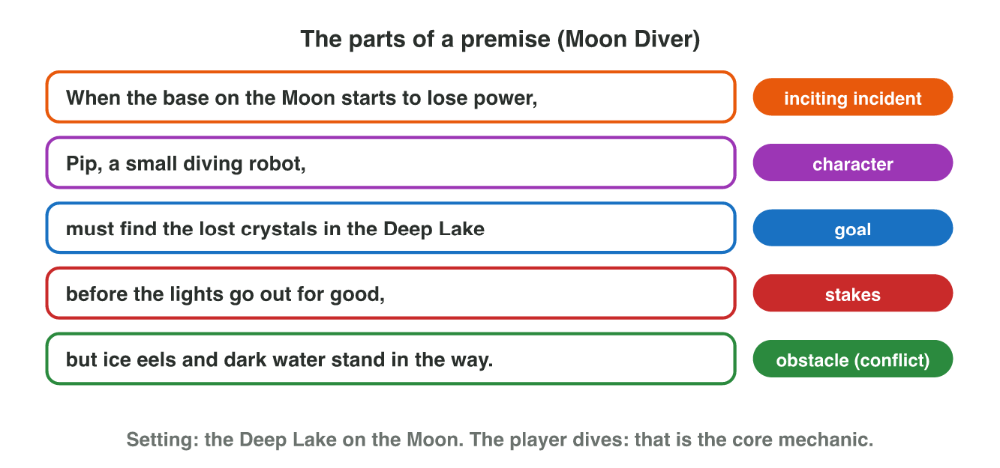
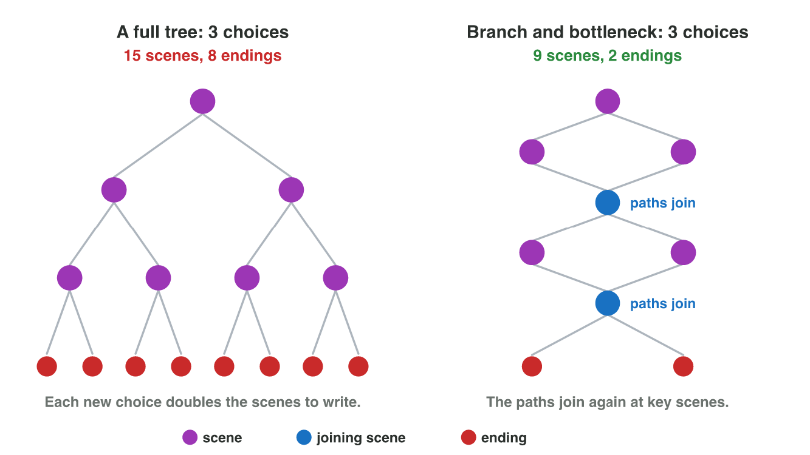

## Recall · Lectures 2 and 3

a) What do we call what is lost if the hero fails?
b) Which event starts the conflict of a story?
c) What do we call a structure in which the paths join again at key scenes?

::: {.answer}
a) the stakes
b) the inciting incident
c) branch and bottleneck
:::

## Activity 1 · Build a premise · 15 min

:::: {.columns}
::: {.column width="50%"}
- A premise says the story of a game in one or two sentences.
- The template is: when [incident], [character] must [goal] before [stakes], but [obstacle].
- **Do it:** Build the first premise in Pitch Room. Then put the five cards of Night Bus in order, and find the missing part of a shorter premise.
:::
::: {.column width="50%"}

:::
::::

## Live demo · Pitch Room



## Check 1 · Build a premise

What is the order of the Night Bus cards, and what is missing?

::: {.reveal}
1. The order is c, a, b, e, d: incident, character, goal, stakes, obstacle.
2. "When the city lights go out in a storm, Sami, a young bus driver, must bring the last passengers home…"
3. "…before the bridge closes at midnight, but fallen trees block the streets."
4. The shorter premise has no stakes: nothing says what is lost if Sami is late.
:::

## Activity 2 · Map and clues · 15 min

:::: {.columns}
::: {.column width="50%"}
- A story can be linear, branching or told by the environment.
- Nour's five scenes are A flood, B market, C bridge, D old school and E hill.
- **Do it:** Put the five letters in the boxes of the map, and name its structure. Then choose the two things in the old school that tell the story.
- Your product is five letters, one structure and two letters.
:::
::: {.column width="50%"}

:::
::::

## Check 2 · Map and clues

What is the map of Nour's story, and which things are clues?

::: {.reveal}
1. Box 1 is A (the flood); boxes 2 and 3 are B and C (the market or the bridge).
2. Box 4 is D (the old school), and box 5 is E (the hill).
3. The paths join at the old school, so the structure is branch and bottleneck.
4. The stopped calendar (a) and the mud line (c) are clues; a wall or a desk tells nothing.
:::

## Wrap-up

- You can build a premise from its five parts and find a missing part.
- You can put the scenes of a story on a map and choose clues in the world.
