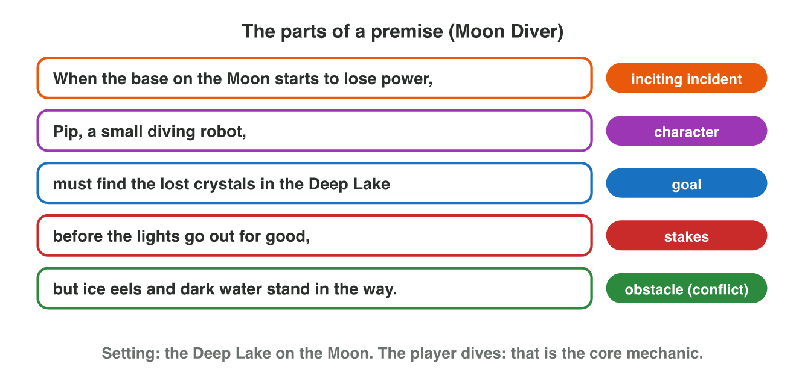
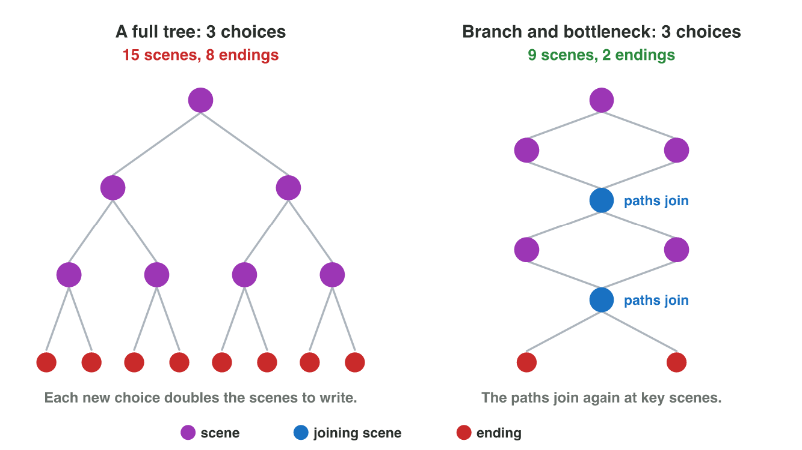

## Recall · Lectures 2 and 3

a) What do we call what is lost if the hero fails?
b) Which event starts the conflict of a story?
c) What do we call a structure in which the paths join again at key scenes?

::: {.answer}
a) the stakes
b) the inciting incident
c) branch and bottleneck
:::

## Activity 1 · Write a premise · 15 min

:::: {.columns}
::: {.column width="50%"}
- A premise says the story of a game in one or two sentences.
- The template is: when [incident], [character] must [goal] before [stakes], but [obstacle].
- **Do it:** Build the first premise in Pitch Room. Then write the premise of your own game idea.
:::
::: {.column width="50%"}

:::
::::

## Live demo · Pitch Room



## Check 1 · Write a premise

What does a good premise contain?

::: {.reveal}
1. It names the incident and the character: "When the ice queen freezes his village, Ali, a young blacksmith".
2. It gives the goal: "must melt the heart of the frozen mountain".
3. It adds the stakes and the obstacle: "before the last fire goes out, but snow wolves guard every path".
4. It stops at the conflict, so the ending stays open.
:::

## Activity 2 · Map and clues · 15 min

:::: {.columns}
::: {.column width="50%"}
- A story can be linear, branching or told by the environment.
- **Do it:** Draw the map of your premise with four to six scenes, linear or branching. Then write two clues in the world.
- Your product is the map and two clues.
:::
::: {.column width="50%"}

:::
::::

## Check 2 · Map and clues

What does a good map with clues look like?

::: {.reveal}
1. The flood leads to a choice: the market or the bridge.
2. Both paths join at the old school, where a family remembers the choice.
3. The story then goes on to the hill.
4. A child's boot in the water and a stopped calendar tell the story without words.
:::

## Wrap-up

- You can write the premise of a game with the template.
- You can choose how its story is told, draw its map and add clues.
