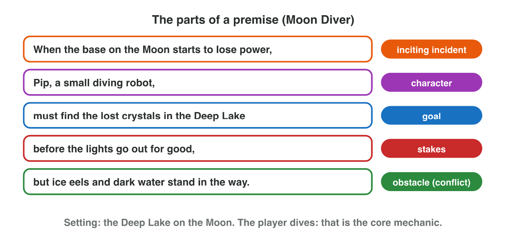
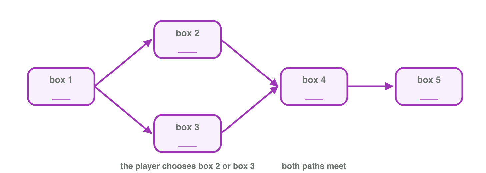

No new ideas today. You practise Lectures 2 and 3. There are two short
activities. Do each one alone. Tap, sort or type your answer at every step:
the page checks it at once and tells you why.

## Recall

| Word | What it means |
|------------------|----------------------------------------------------|
| inciting incident | the event that starts the problem |
| goal | what the hero wants |
| obstacle | what stops the hero |
| stakes | what is lost if the hero fails |

- A **linear** story has one road: every player sees the same scenes.
- A **branching** story changes with the player's choices. In **branch
  and bottleneck**, the paths join again at key scenes.
- In **environmental** storytelling, the things in the world tell the
  story without words. A **fake choice** changes nothing.

::: {.callout-tip title="Try it 1 · Recall"}
Choose the right answer.

::: {.match extra="the setting|a linear story"}
What is lost if the hero fails?
:   the stakes

    Why: The stakes make the player care and hurry.

Which event starts the problem of the story?
:   the inciting incident

    Why: It ends the normal world of act 1.

The paths join again at key scenes. What is this structure?
:   branch and bottleneck

    Why: The team writes fewer scenes, and the choices stay real.
:::
:::

## Activity 1 · The story in one sentence

At *Night Owl Games*, a writer has two minutes to present a game idea. So
the idea must fit in one long sentence: the **premise**. The premise puts
five parts in a fixed order, the **template**:

| Order | Part | It starts with | Moon Diver |
|:---:|-----------|------|------------------------------------------|
| 1 | inciting incident | When … | When the base on the Moon starts to lose power, |
| 2 | character | | Pip, a small robot, |
| 3 | goal | must … | must find the lost crystals in a deep lake |
| 4 | stakes | before … | before the lights of the base go out forever, |
| 5 | obstacle | but … | but ice eels and dark water try to stop Pip. |

: The template of a premise, with the premise of Moon Diver.

{width=90%}



The five cards of the premise of *Night Bus*, a mobile driving game, are
mixed up:

| Card | Words |
|:---:|-----------------------------------------------|
| a | Sami, a young bus driver, |
| b | must bring the last passengers home |
| c | When the city lights go out in a storm, |
| d | but fallen trees block the streets. |
| e | before the bridge closes at midnight, |

::: {.callout-note title="Activity 1 · Build a premise · 15 min"}
1. In **Pitch Room**, build the premise of the first brief (a puzzle game
   in a flooded city) from the cards.
2. Put the five Night Bus cards in the order of the template. Write the
   five letters. Help: the first card starts with "When".
3. A writer gives a shorter premise: "When the city lights go out in a
   storm, Sami, a young bus driver, must bring the last passengers home,
   but fallen trees block the streets." Which part is missing? Choose:
   the inciting incident, the goal, the stakes or the obstacle.

*Your product:* five letters and the name of one part.

::: {.order}
Step 2: put the five Night Bus cards in the order of the template.

1. c) When the city lights go out in a storm,
2. a) Sami, a young bus driver,
3. b) must bring the last passengers home
4. e) before the bridge closes at midnight,
5. d) but fallen trees block the streets.

Why: The inciting incident, the protagonist, the goal, the stakes, then the obstacle.
:::

::: {.choice}
Step 3: which part is missing in the shorter premise?

- [x] the stakes

  Why: It has no "before …": nothing says what is lost if Sami is late.

- [ ] the goal

  Why: "Must bring the last passengers home" is the goal.

- [ ] the obstacle

  Why: "But fallen trees block the streets" is the obstacle.

- [ ] the inciting incident

  Why: "When the city lights go out" is the inciting incident.
:::
:::

::: {.callout-tip title="Try it 2 · Parts of a premise"}
The premise: "When the dragon steals the village bell, Tala, a young
shepherd, must bring it back before the winter festival, but the mountain
path is full of traps." Choose the part.

::: {.match extra="the setting|the goal"}
"the dragon steals the village bell"
:   the inciting incident

    Why: It starts the problem.

"before the winter festival"
:   the stakes

    Why: The time limit shows what is lost if she is late.

"the mountain path is full of traps"
:   the obstacle

    Why: It stands between Tala and her goal.
:::
:::

## Activity 2 · How will the story be told?

The same premise can be told in different ways:

- **Linear:** one road. Every player sees the same scenes.
- **Branching:** the player chooses. The paths often join again at a
  **bottleneck**.
- **Environmental:** things in the world tell part of the story without
  words.

The story of Nour in *Rooftop Rescue* has five scenes:

| Letter | Scene |
|:---:|---------------------------------------------------|
| A | the flood: the story starts here |
| B | the market |
| C | the bridge |
| D | the old school |
| E | the hill: the story ends here |

The facts: Nour starts at the flood and ends at the hill. On the way, the
player chooses: the market or the bridge. Both ways lead to the old school.

{width=90%}

Six things in the old school:

| Thing | What the player sees |
|:---:|------------------------------------------------------|
| a | a calendar on the wall that stops on the day of the flood |
| b | a white wall |
| c | a line of mud high on the wall, where the water was |
| d | a desk |
| e | a window |
| f | a lamp |

::: {.callout-note title="Activity 2 · Map and clues · 15 min"}
1. Write the letter of the scene in each box of the map (A to E).
2. Which structure is the map: linear, a full tree, or branch and
   bottleneck?
3. Which two things in the old school tell part of the story without
   words? Write the two letters.

*Your product:* five letters, one structure and two letters.

::: {.sort}
Step 1: which box of the map does each scene go into? Sort them.

Box 1, the start
:   A, the flood

    Why: The story starts here.

Boxes 2 and 3, the two ways
:   B, the market

    Why: One way the player can choose.

:   C, the bridge

    Why: The other way.

Box 4, where the ways meet
:   D, the old school

    Why: Both ways lead to the old school.

Box 5, the end
:   E, the hill

    Why: The story ends here.
:::

::: {.choice}
Step 2: which structure is the map?

- [x] branch and bottleneck

  Why: The two paths join again at the old school.

- [ ] linear

  Why: The player chooses between the market and the bridge.

- [ ] a full tree

  Why: In a full tree the paths never join.
:::

::: {.sort}
Step 3: which things in the old school tell part of the story? Sort them.

A clue
:   a) a calendar that stops on the day of the flood

    Why: It tells when the flood came.

:   c) a line of mud high on the wall

    Why: It tells how high the water was.

Only decoration
:   b) a white wall

    Why: Every school has one.

:   d) a desk

    Why: Every school has desks.

:   f) a lamp

    Why: A lamp tells nothing about the flood.
:::
:::

::: {.callout-tip title="Try it 3 · Linear, branching or environment?"}
Choose the right answer.

::: {.match extra="branching"}
Every player sees the same scenes in the same order. Which structure is it?
:   linear

    Why: A linear story has only one road.

An empty house, a broken window and an old diary tell what happened. Which kind of storytelling is it?
:   environmental

    Why: The world tells the story without words.

Two options lead to the same scene, and nothing there is different. What is it?
:   a fake choice

    Why: The choice changes nothing for the player.
:::
:::

## At home · Task with AI

::: {.callout-note .ai-task title="Task with AI · Draw the map of a branching story"}
An extra for the curious: let an AI assistant write the story and draw its
map. Copy the prompt into an AI assistant that the university allows (for
example Microsoft Copilot with your university account), and look at the
result.

::: {.prompt}
Here is the premise of a mobile game: a young lighthouse keeper must keep
the light on during a storm, while a fishing boat is lost at sea. Write a
branching story. Scene 1 is the start. The first decision has two options,
each with its own scene, and both paths join again in one scene (a
bottleneck) that remembers which option the player chose. Then a second
decision has three options, each with its own ending. Give each scene a
title and one sentence, and draw the map of the scenes as boxes and
arrows.
:::

::: {.choice}
What should the map show? The AI can be wrong: compare.

- [x] Seven boxes: the start, two scenes, a bottleneck that remembers the first choice, and three endings.

  Why: 1 + 2 + 1 + 3 = 7 scenes; the bottleneck still shows what the player chose.

- [ ] Two separate stories that never meet.

  Why: The prompt asks the two paths to join in a bottleneck.
:::

::: {.try-change}
**Change:** say that the three options of the second decision join again in one
final scene, and ask again.

::: {.choice}
What changes?

- [x] Every path ends in the same scene: the story has one ending.

  Why: The second decision is a fake choice, unless the final scene shows what the player chose.

- [ ] The three endings stay.

  Why: The three paths now join in one final scene.
:::
:::

::: {.try-change}
**Change:** give the first decision three options, and ask again.

::: {.choice}
What changes?

- [x] One more box: three scenes after the start, all joining in the bottleneck (eight boxes).

  Why: The bottleneck keeps the story short.

- [ ] The map doubles in size.

  Why: Only one scene is added, because the paths join again.
:::
:::

**Your own idea:** change one more number or word, and look again. The AI
can be wrong: compare its result with the answers.
:::

## Wrap-up {.summary}

- You can build a premise from its five parts and find a missing part.
- You can put the scenes of a story on a branching map and choose the
  clues in the world.
